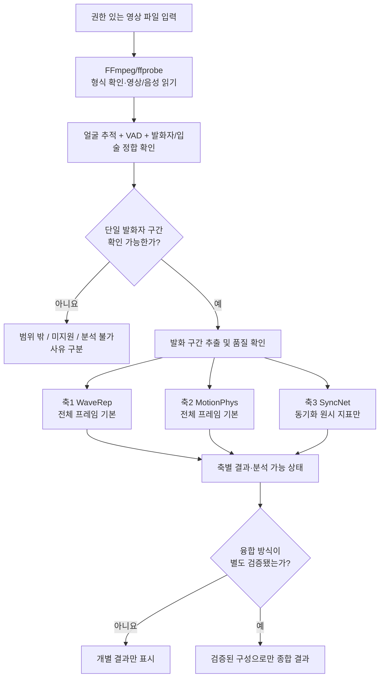
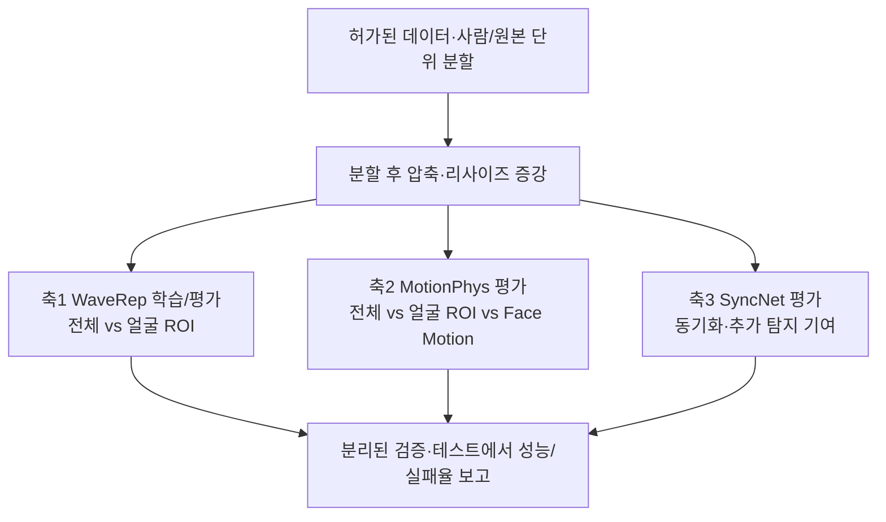
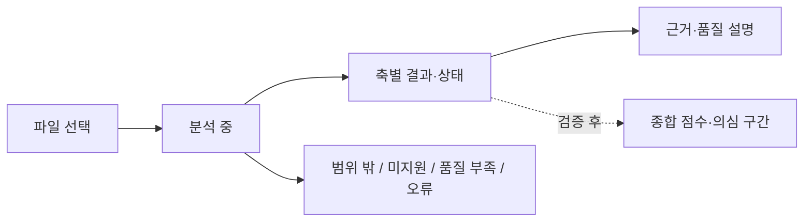

# TRINITY

> 사람이 나와서 말하는 영상이 AI로 생성·조작됐는지 판독하는 앱 (졸업작품)
>
> README v5.3 · 설계 결정 1–4 반영 · Apple Silicon 우선 · 모델 성능 검증 전
>
> **v5.1 변경:** 학습·평가 데이터셋 확정(§6.1) · 평가에서 가짜 영상의 YouTube 업로드 제거(§6.3) · (a) 유형에 영상+음성 동시 생성 포함, 소량 자체 생성(§6.1) · 축3의 립싱크 취약성 반영(§4 ④)
>
> **v5.2 변경:** AVH-Align 대신 SyncNet CPU를 축3의 검증 후보로 전환 · CUDA/AV-HuBERT/Fairseq를 기본 실행 의존성에서 제외 · Apple Silicon 전략 추가.
>
> **v5.3 변경(설계 결정 1–4):** 권한 있는 영상 **파일 입력 우선**, 단일 발화자 구간부터 분석 · 상태/부분 실패 명시 · SyncNet은 **동기화 측정 및 보조 후보**이며 진위 확률 아님 · MotionPhys 원본/얼굴 ROI/MediaPipe Face Motion 비교 · WaveRep 전체 프레임/얼굴 ROI, 압축 증강/점수 보정 분리 검증 · 미검증 모델의 점수 결합 금지. **아직 코드는 구현·실행 검증 전이며, 탐지 성능 향상은 입증되지 않았음.**

---

## 목차

1. [문제 정의](#1-문제-정의)
2. [시스템 개요](#2-시스템-개요)
3. [판독 파이프라인](#3-판독-파이프라인)
4. [왜 3축인가](#4-왜-3축인가)
5. [각 축 상세](#5-각-축-상세)
6. [학습 데이터와 데이터 위생](#6-학습-데이터와-데이터-위생)
7. [앱 (Flutter)](#7-앱-flutter)
8. [API (초안)](#8-api-초안)
9. [레포 구조 (초안)](#9-레포-구조-초안)
10. [실행 방법](#10-실행-방법)
11. [진행 현황과 검증 계획](#11-진행-현황과-검증-계획)
12. [한계](#12-한계)
13. [로드맵](#13-로드맵)
14. [참고문헌](#14-참고문헌)

---

## 1. 문제 정의

TRINITY는 **"사람이 속는 문제"**에서 출발했습니다. 실제 사람의 발언처럼 보이는 AI 생성·조작 영상이 오인될 위험을 줄이기 위해, 영상의 **검증 가능한 단서**와 분석 한계를 함께 제시하는 졸업작품입니다.

**초기 연구·구현 대상(결정 1):** 사용 권한을 확보한 영상 파일 중 **한 명의 실제 발화자가 화면에서 명확하게 식별되는 발화 구간**. 한 영상에 여러 인물이 있어도 *분리한 구간*에서 발화자를 유일하게 확인할 수 있다면 향후 지원 가능합니다. 얼굴이 하나이고 소리가 있다는 사실만으로 발화자가 일치한다고 간주하지 않습니다.

**위조 유형:**

| 유형 | 설명 | 예 |
|---|---|---|
| (a) 인물 전체 생성 | 인물과 음성을 AI가 처음부터 생성 | 영상+음성 동시 생성 모델(Veo·Sora류), AI 아바타, 사진 한 장 기반 토킹헤드 |
| (b) 음성 교체 + 립싱크 | 실제 인물 영상에 합성 음성을 넣고 입 모양을 맞춤 | TTS + 립싱크 모델 |
| (c) 얼굴 교체 | 실제 음성은 두고 얼굴만 교체 | Face swap |

**초기 범위 밖:** 이미지, 사람의 발화가 없는 영상, 풍경 중심 영상, 발화자를 신뢰성 있게 특정하기 어려운 다중 발화/나레이션 구간. 분석 중 실패나 낮은 품질은 범위 밖과 **별도로 기록**합니다(§3.3).

**입력 정책:** Phase 1에서는 **허가된 로컬/업로드 영상 파일**을 사용합니다. YouTube URL·공유 시트 입력은 콘텐츠 접근 권한과 플랫폼 약관을 충족하는 처리 방법을 확인한 이후의 조건부 Phase 2 과제입니다. YouTube에서 이미 유통 중인 영상의 평가 목적은 유지하되, 자동 다운로드를 기본 경로로 가정하지 않습니다.

## 2. 시스템 개요

**Thin Client, Fat Server** 구조입니다. 연구 엔진은 입력 경로와 분리합니다.

| 구성 | 내용 |
|---|---|
| 클라이언트 | Flutter 단일 코드베이스; 초기에는 Web UI 우선 검증, iOS·Android는 후속 확대 |
| Phase 1 입력 | **사용 권한이 있는 영상 파일** 선택/업로드 |
| Phase 2 입력(조건부) | YouTube 공유 시트/URL — 콘텐츠에 합법적으로 접근할 수 있는 경우만 |
| 서버 | Apple Silicon 맥북에서 FastAPI 셀프호스팅; 외부 데모 접속 정책·인증 별도 설계 |
| 추론 | WaveRep(MPS/CPU 후보), MotionPhys(CPU), SyncNet(CPU; **동기화 지표만**) |
| 결과 | 분석 상태, 축별 지표, 품질/적용 범위, 근거; **종합 진위 점수는 검증 후 제공** |

세 분석 축은 **실험 후보**입니다. 세 축을 모두 사용하거나 결합해야 한다는 전제는 두지 않습니다.

## 3. 판독 파이프라인

### 3.1 추론 단계 (영상 1개)



| 단계 | 하는 일 | 후보 기술 |
|---|---|---|
| 파일 수신 | 사용 권한·형식·파일 크기·길이 점검 | FastAPI, ffprobe |
| 전처리 | 영상/음성 디코딩 및 구간 추출 | FFmpeg |
| 발화자 확인 | VAD + 얼굴 추적 + 발화자와 입 움직임 일치 확인; **단순 얼굴+음성 존재만으로 통과 금지** | VAD/얼굴 검출 모델 미정, SyncNet 활용 가능성 별도 검증 |
| 축별 분석 | 신호·움직임·정합성 지표 측정 | §5 |
| 종합 평가 | 검증된 모델·지표만 사용 | §5.4(설계 문제 5에서 확정 예정) |

### 3.2 학습·검증 단계



압축 에뮬레이터는 실제 YouTube 재인코딩과 유사한 조건을 **로컬에서 시험하기 위한 연구용 모듈**입니다. 모델 학습/보정과 최종 테스트는 분리합니다(§6).

### 3.3 분석 상태 계약(결정 1)

| 상태 | 의미 | 점수 처리 |
|---|---|---|
| `completed` | 계획한 분석이 완료됨 | 검증된 결과만 표시 |
| `partial` | 분석 가능한 축만 완료됨 | 실패한 축은 `null`; 종합 결과는 별도 검증 규칙이 있을 때만 |
| `out_of_scope` | 정의한 대상 자체가 아님 | 진위 점수 없음 |
| `unsupported` | 다중 발화/나레이션 등 현재 미지원 유형 | 진위 점수 없음 |
| `insufficient_quality` | 화질·음질·유효 구간 부족 | 진위 점수 없음 |
| `analysis_unavailable` | 발화자 식별·추적 등 분석 불가 | 진위 점수 없음 |
| `failed` | 프로그램 오류 | 진위 점수 없음 |

각 축에도 `completed` / `insufficient_motion` / `tracking_failed` / `unavailable` 등 세부 상태를 기록합니다. **누락되거나 실패한 축의 점수를 0으로 대체하지 않습니다.**

## 4. 왜 3축인가

### ① 출발점: 저수준 / 고수준 이분법

패시브(콘텐츠 기반) 탐지는 크게 두 계층으로 나뉩니다. 딥페이크 이미지 탐지 종합 리뷰(ScienceDirect, 2026.3)는 공간·주파수 단서(저수준)와 의미·생리학 단서(고수준)로 분류하고, [TriDF](https://arxiv.org/abs/2512.10652)도 Quality Artifacts와 Semantic Artifacts로 같은 경계를 긋습니다. 경계의 조작적 정의는 [Alpha Blending Hypothesis](https://arxiv.org/abs/2605.10334)를 따릅니다. 저수준 아티팩트는 영상 내용과 무관하게 생기고, 고수준 오류는 장면 내용을 봐야 드러납니다.

| | 저수준 | 고수준 |
|---|---|---|
| 무엇의 흔적인가 | 생성·처리 과정 | 묘사된 세계의 규칙 위반 |
| 내용과의 관계 | 무엇을 찍었든 발생 | 장면 속 내용이 있어야 드러남 |

### ② 고수준을 둘로 나누는 기준: 증거가 어디에 있는가

- **영상 안의 시간 흐름:** 움직임이 물리 법칙(관성, 연속적인 힘)을 따르는가. 영상만으로 판단합니다.
- **영상과 소리 사이:** 입 모양과 발화가 맞물리는가. 영상과 음성을 함께 봐야 판단할 수 있습니다.

두 단서는 입력이 다르고 잡아내는 위조 유형도 다릅니다. 하나의 축으로 합치면 한쪽이 다른 쪽을 대신할 수 없는 영역이 생깁니다.

### ③ 결과: 3축

| 축 | 계층 | 증거 위치 | 방법 | 보는 것 |
|---|---|---|---|---|
| 축1 신호 | 저수준 | 프레임 내부 | WaveRep | 압축 후에도 남는 생성기 주파수 흔적 |
| 축2 물리 | 고수준 | 시간 흐름 | MotionPhys 기본 + 얼굴 특화 후보 | 궤적의 곡률 · 각속도 · jerk / 얼굴 특징점 움직임 |
| 축3 정합 | 관계 단서 | 영상 ↔ 음성 | SyncNet (보조 후보) | 입 모양과 음성의 동기화(진위 판별과 다름) |

축2는 원본에서는 물체의 의미를 인식하지 않지만 궤적의 시간적 일관성을 분석합니다. 얼굴 특화 접근은 별도 비교 후보입니다. 축3은 진위 탐지 모델이 아니라 동기화 측정 모델이므로 **서로 다른 증거가 반드시 상호 보완적이라는 주장은 검증되지 않았습니다.**

### ④ 왜 2축이 아닌가

서로 다른 위치에서 증거를 수집한다는 **3축 연구 가설**을 시험합니다. 아래 역할 분담은 기대 효과일 뿐, 특정 위조 유형을 반드시 탐지한다는 보장은 없습니다. 2축 모델이 더 좋다면 세 번째 축은 보조 정보로 남깁니다(§11).

| 위조 유형 | 축1 | 축2 | 축3 |
|---|---|---|---|
| (a) 인물 전체 생성 | 주력 | 주력 | 약함 가능성 높음·검증 필요 |
| (b) 음성 교체 + 립싱크 | 보조 | 검증 필요 | 립싱크 불일치 시 보조¹ |
| (c) 얼굴 교체, 음성은 진짜 | 주력 | 보조 | 약함 |

축3만 있으면 진짜 음성을 쓴 얼굴 교체(c)를 놓치고, 축2만 있으면 음성 조작(b)을 볼 수 없습니다.

¹ **SyncNet은 진위 판별 모델이 아니라 동기화 측정 모델**입니다. 잘 맞는 합성 립싱크와 영상·음성 동시 생성(a)은 놓칠 수 있고, 편집으로 어긋난 진짜 영상에서 오경보가 날 수 있습니다. 축3이 위조 유형 (b)에 유용한지는 별도 실험으로 검증합니다(§11). 고도화된 립싱크에 대한 문제는 [TFDBench](https://neurips.cc/virtual/2026/163771)와도 비교합니다.

### ⑤ 왜 4축이 아닌가

언어 모델이 장면을 서술하며 추론하는 계열은 계산 비용이 커서 셀프호스팅 서버에 맞지 않고, 판단 근거가 모델의 서술에 의존해 검증하기 어렵습니다. 향후 과제로 둡니다(§13). 출처증명(액티브)은 패시브 3축과 성격이 달라 별도 계층으로 다룹니다.

---

## 5. 각 축 상세

### 5.1 축1 · 신호 — WaveRep (결정 4)

| 항목 | 설계 |
|---|---|
| 근거 논문 | Corvi et al., [*Seeing What Matters*](https://arxiv.org/abs/2506.16802), NeurIPS 2025 |
| 기본 입력 | 발화 구간에서 추출한 **전체 프레임** |
| 기본 방법 | DINOv2 계열 프레임 탐지 + 포렌식용 웨이블릿 증강(원 논문 재현 우선) |
| 비교 후보 | 같은 구간의 **얼굴 영역(ROI) crop**, 전체+얼굴 점수 결합 — **원본과 다른 실험 조건** |
| 압축 대응 | (1) 학습 중 압축·리사이즈 **증강**, (2) 별도 검증 분할에서 **점수/임계값 보정**; 두 방법을 분리 평가 |
| 출력 | 원시 모델 점수, 프레임/클립 집계값, 분석 상태, 영상 품질 정보, 미검증 조건 경고 |
| 핵심 실험 | A·B·C 위조 유형별 성능, 전체 vs 얼굴 ROI, 압축 강도별 AUC 및 고정 FPR 탐지율, 미지 생성 모델, 증강/보정 효과 |
| 실행 | PyTorch MPS 우선 검증, 필요 시 CPU; 원본 코드의 CUDA 전용 연산 여부 확인 |
| 주의 | 원시 점수 ≠ AI 생성 확률. 강한 압축에서 성능 저하 가능; [TRACE](https://arxiv.org/abs/2609.25775) 등의 외부 재현 차이 원인 확인 필요 |

**판단 규칙:** 압축 증강은 학습 설계이고 보정은 검증 데이터에 의한 판정 설계입니다. 보정으로 해결되는 점수 이동과 압축 때문에 구분 정보 자체가 손실되는 상황을 구별합니다. 테스트 영상으로 보정값을 정하지 않습니다. 전체+얼굴 결합은 성능 이득이 확인될 때만 채택합니다.

### 5.2 축2 · 물리 — MotionPhys + 얼굴 특화 비교 (결정 3)

| 항목 | 설계 |
|---|---|
| 근거 논문 | He et al., [*MotionPhys*](https://arxiv.org/abs/2608.20770) |
| 기준선 A | **원본 MotionPhys:** Shi–Tomasi + 격자점 → 피라미드 Lucas–Kanade → 8·12·24프레임 궤적 → 곡률·각속도·jerk 통계 504차원 → LightGBM |
| 비교 B | **얼굴 ROI MotionPhys:** 동일한 알고리즘을 얼굴 영역으로 제한; 원본 연구와는 다른 조건 |
| 비교 C | **Face Motion(프로젝트 임시명):** MediaPipe Face Landmarker 특징점으로 머리·눈썹·입술의 움직임 통계 계산 + LightGBM |
| 비교 D/E | A+C, B+C 결합 — 독립 실험이며 성능 향상 전제 없음 |
| 출력 | 후보별 분류 점수 및 추적 성공률·유효 궤적 수·움직임 크기·축 상태 |
| 실패 처리 | `insufficient_motion` / `tracking_failed`, `score: null` (0점으로 대체하지 않음) |
| 실행 | OpenCV · NumPy · LightGBM · MediaPipe의 **CPU 기반** 구성을 우선 시험 |
| 핵심 실험 | 토킹헤드 움직임 많음/적음, 카메라 흔들림, 압축·프레임 누락, 얼굴 ROI 효과, Face Motion의 추가 기여 |

**주의:** MediaPipe는 얼굴 위치와 표정 관련 특징을 추출하는 도구이지 그 자체로 딥페이크 탐지기가 아닙니다. Face Motion 분류기는 학습·평가가 필요하고, SyncNet의 입술-음성 정렬과 다른 증거를 제공하는지도 검증해야 합니다. 유효 궤적 수나 최소 움직임 등 **분석 가능 기준은 개발/검증 데이터에서 정한 뒤 테스트 전에 고정**합니다.

### 5.3 축3 · 정합 — SyncNet (동기화 보조 후보; 결정 2)

| 항목 | 내용 |
|---|---|
| 원전 | Chung & Zisserman, *Out of time: automated lip sync in the wild* (2016), [원본 코드](https://github.com/joonson/syncnet_python) |
| macOS 후보 구현 | [nawta/SyncNet_py309_313](https://github.com/nawta/SyncNet_py309_313) (`syncnet-python` >= 0.2.3) — Apple Silicon CPU 실행 사례가 공개됨. TRINITY 내 통합은 **미검증** |
| 입력 | 얼굴 추적이 가능한 말하는 구간의 비디오 및 대응 오디오 |
| 방법 | 사전학습 SyncNet으로 입 움직임과 음성 간 시간적 동기화 비교 (사전학습 가중치 이용, 우선 CPU 추론) |
| 원시 출력 | 얼굴 트랙별 오프셋(프레임), LSE-C(클수록 동기화 우수), LSE-D(작을수록 동기화 우수) |
| TRINITY 출력 | 동기화 원시 지표·상태·품질. **검증 전에는 위조 확률이나 종합 탐지 점수를 출력하지 않음** |
| 유의 | 정상 동기화 ≠ 진짜 영상. 정밀한 립싱크 합성·영상+음성 동시 생성은 놓칠 수 있고, 지연된 진짜 영상은 오경보 가능 |
| 남은 결정 | 정상/인위적 오프셋/(a)/(b)/(c) 평가, 압축 내성, **축3 포함/제외의 추가 성능 이득** 확인 후 결합 여부 결정 |

**사용 원칙:** 발화자 트랙이 확인된 경우에만 측정합니다. 동기화가 정상이어도 영상이 진짜라는 뜻이 아니며, 동기화가 어긋나도 가짜라는 뜻이 아닙니다. 사전학습 SyncNet 지표 자체를 진위 점수로 변환하지 않고, 검증 데이터에서 추가 탐지 기여가 있을 때만 융합 후보로 고려합니다.

**대체 이유와 제한:** 기존 [AVH-Align](https://github.com/bit-ml/AVH-Align)은 CUDA 12.4 중심 연구 환경과 AV-HuBERT/Fairseq 의존성으로 macOS 유지보수 부담이 높습니다. SyncNet CPU 구현은 CUDA 없는 실행을 위한 **엔지니어링 대안**이며, AVH-Align과 같은 학습 목표나 딥페이크 탐지 성능을 제공한다는 뜻이 아닙니다. AVH-Align은 비교 연구 후보로 남기되 기본 의존성에서 제외합니다.

**실행 예시(별도 실험 환경, 가중치 확보 후):**

```bash
python3 -m pip install 'syncnet-python>=0.2.3'
syncnet-python clip.mp4 --device cpu -o results.json
```

- FFmpeg 설치 및 원본 SyncNet/S3FD 가중치가 필요합니다. 다운로드 경로와 가중치 이용 조건은 구현체 README에서 확인합니다.
- 공개 구현의 기본 실행 장치는 CUDA일 수 있으므로 **`--device cpu`를 명시**합니다.
- `best_conf`와 `min_dist`는 여러 얼굴 트랙에서 서로 다른 인물에게서 나올 수 있습니다. **발화자 식별·얼굴 트랙 일치 확인** 없이는 영상 전체 판정에 쓰지 않습니다.
- 짧은 구간·무음·가려진 입·멀티스피커는 `unavailable/low_quality`로 처리할 수 있도록 품질 기준을 실험으로 정합니다.
- 의심 구간 타임라인은 구간별 재평가를 구현·검증한 뒤 제공하며, SyncNet 원시 출력만으로 자동 확보된다고 가정하지 않습니다.

### 5.4 점수 결합 (문제 5 — **아직 미확정**)

- 방식 미정. 후보: 축별 **검증된** 특징을 결합하는 선형 모델(축3 LSE-C/LSE-D 등을 그대로 확률로 취급하지 않음)
- 화질(해상도·비트레이트)이 낮을수록 축1 가중치를 낮추는 방식 검토(제안 단계)
- 종합 점수와 별개로 **축별 지표·분석 가능 상태를 함께 표시**해 근거를 추적할 수 있게 함
- 축3의 예측 기여도가 검증되지 않으면 종합 점수에서 제외하고 **동기화 참고 정보**로만 제공. 결측 축은 0점으로 대체하지 않음

---

## 6. 학습 데이터와 데이터 위생

### 6.1 데이터셋

| 용도 | 데이터 | 다루는 유형 | 접근 | 상태 |
|---|---|---|---|---|
| 주 학습 | [DeepSpeak v2](https://huggingface.co/datasets/faridlab/deepspeak_v2) — 동의한 참여자의 웹캠 토킹헤드 영상, 진짜 + 가짜(얼굴 교체·립싱크·아바타) | (a) 아바타 · (b) · (c) · 진짜 | 외부 양식 작성 후 Hugging Face 조건 동의 | 신청 예정 |
| (a) 보강 | [TalkingHeadBench](https://arxiv.org/abs/2505.24866) — 사진 한 장을 음성·영상으로 구동한 토킹헤드 | (a) 사진 기반 | 공개 범위·조건 확인 필요 | 확인 필요 |
| (a) 보강 | 자체 생성 — 영상+음성 동시 생성 모델(Veo·Sora류)로 만든 가상 인물 발화 영상 소량(20~50개) | (a) 동시 생성 | 생성 서비스 약관·비용 확인 | 미정 |
| 축3 검증·보정 | SyncNet 원본 사전학습 가중치(별도 확보), DeepSpeak 진짜/가짜 검증 분할 | 전부 | 가중치 사용 조건 확인 및 데이터 접근 | 미정 |
| 점수 결합 학습 | DeepSpeak 검증 분할(학습에 쓰지 않은 사람) | 전부 | 위와 동일 | — |
| 실전 평가 | [Deepfake-Eval-2024](https://arxiv.org/abs/2503.02857) — 2024년 SNS에서 실제 유통된 영상 중 말하는 사람 구간만 선별 | 혼합(유형 라벨 여부 확인 필요) | 기관 이메일 + 관련 작업 링크 제출(2027년 5월까지 심사) | 신청 예정 |
| 압축 설정 추정 | 직접 촬영한 진짜 영상만 비공개 업로드(해상도당 50개 미만) | 진짜 | — | 미정 |
| 참조 | [AV-Deepfake1M++](https://arxiv.org/abs/2507.20579) — 진짜 영상의 일부 구간을 조작한 데이터 중심 | (b) 중심 | 연구 전용 EULA | 참조만 |

**데이터 분할 주의:** 동일 인물뿐 아니라 **같은 원본 영상에서 파생된 원본/위조/압축/해상도 변형본은 동일 분할**에 묶습니다. 얼굴 ROI·전체 프레임 비교도 같은 분할을 사용합니다. Deepfake-Eval-2024는 허용 범위를 확인하고 원칙적으로 **외부 최종 평가 전용**으로 둡니다.

**도메인 차이 주의:** DeepSpeak은 웹캠 화상회의 환경이라 YouTube의 촬영·편집 환경과 다릅니다. 이 차이는 Deepfake-Eval-2024 평가로 따로 확인합니다(§11).

### 6.2 YouTube 열화 에뮬레이터

Montibeller et al.([arXiv:2508.08765](https://arxiv.org/abs/2508.08765))의 방식을 따릅니다. 영상을 실제로 업로드했다가 다시 받아 플랫폼의 압축·리사이즈 파라미터를 추정하고, 그 값으로 대량의 학습 데이터에 같은 열화를 로컬에서 재현합니다. 원 논문은 해상도당 50개 미만의 업로드로 정확한 재현이 가능하다고 보고합니다.

**업로드에는 직접 촬영한 진짜 영상만 비공개로 사용하고, 데이터셋 영상이나 가짜 영상은 올리지 않습니다.**

### 6.3 평가 설계

학습에 쓴 열화와 **다른 조건**으로 평가합니다([AV-Deepfake1M++](https://arxiv.org/abs/2507.20579)의 학습/테스트 열화 분리 방식 참고). 평가 세트는 세 가지입니다.

1. **실전 유통본:** Deepfake-Eval-2024의 말하는 사람 구간 — 실제 플랫폼 압축을 이미 거친 영상
2. **조건 분리:** DeepSpeak 테스트 분할에, 학습 때 쓰지 않은 에뮬레이터 설정(해상도·비트레이트)을 적용
3. **(a) 동시 생성:** 자체 생성 영상 중 학습에 쓰지 않은 부분

지표: ROC-AUC, **TPR@5% FPR**(오탐률을 5%로 제한할 때의 탐지율; 기존 ACC@5% FPR 표기는 지표 정의 확인 필요), 고정 기준에서의 balanced accuracy, 위조 유형(a·b·c)별 성능, 압축 조건별 성능, 축별 실패율, 처리시간. **축3은 원시 동기화 지표 자체의 분포와 오탐률도 보고하고, 점수 보정·융합을 한다면 검증/테스트 분리**를 적용합니다.

### 6.4 데이터 위생 (`training/hygiene.py`)

| 점검 항목 | 이유 |
|---|---|
| 사람(ID) + 원본 영상 계보 단위 분할 | 같은 사람 또는 동일 원본의 위조·압축·crop 파생본이 서로 다른 분할에 섞이지 않도록 함 |
| 앞부분 무음 제거·무작위화 | 기존 오디오-비주얼 데이터셋에서 가짜 영상 앞부분 무음만으로 진짜/가짜가 거의 구분되는 편향이 보고됨([AVH-Align 논문](https://arxiv.org/abs/2412.00175)) |
| 진짜/가짜의 인코딩·해상도·길이 맞추기 | 형식 차이를 탐지 단서로 학습하는 지름길 방지 |
| 같은 내용끼리 짝짓기 | 내용 차이로 구분하는 지름길 방지(WaveRep의 프롬프트 짝짓기 방식) |
| 도메인 편향 점검 | 특정 인물·촬영 환경·언어에 과적합 방지 |

### 6.5 라이선스·약관·윤리

- 이 레포에는 어떤 데이터셋의 영상이나 파생물도 포함하지 않습니다. 데이터 로더와 사람(ID) 분할 목록만 둡니다.
- DeepSpeak: 접근 양식과 이용 조건을 따르고, 사용 시 출처를 표기합니다(정확한 라이선스 조건 확인 필요).
- Deepfake-Eval-2024: 연구 목적 접근 심사를 거치며(2027년 5월까지), 라이선스는 CC-BY-SA-4.0입니다.
- AV-Deepfake1M++: 연구 전용 EULA를 따릅니다.
- SyncNet 코드/패키지의 MIT·Apache-2.0 고지와 **모델 가중치의 별도 이용 조건**을 각각 확인합니다. 코드 라이선스가 가중치까지 자동으로 허용하지는 않습니다.
- 자체 생성 (a): 실존 인물의 얼굴·목소리는 쓰지 않고 가상 인물만 만들며, 생성 서비스 약관을 따르고 공개 게시하지 않습니다.
- Phase 1에서는 사용 권한이 확보된 영상 파일만 입력받습니다. YouTube 자동 다운로드·채널 집계는 이용약관·API 정책과 콘텐츠 접근 권한을 만족하는 방법이 확정되기 전까지 활성화하지 않습니다.

---

## 7. 앱 (Flutter)

| 항목 | 내용 |
|---|---|
| 플랫폼 | Flutter(iOS · Android · Web); **초기 Web UI 먼저**, 모바일 확장 예정 |
| Phase 1 입력 | 사용 권한이 있는 **영상 파일 선택/업로드** |
| Phase 2 입력 | YouTube 공유 시트/URL — 적법한 접근 방법이 마련된 경우에만 |
| 네비게이션 | 탭바 없는 스택 네비게이션 |
| 디자인 | Bold Typography 다크 스타일 · 배경 `#0A0A0A` · 액센트 `#FF3D00` · Inter Tight + JetBrains Mono |



| 화면 | 내용 |
|---|---|
| 홈 | 영상 파일 입력, 최근 분석(개인/저장 정책 미정) |
| 분석 중 | 단계별 진행 상태(형식 확인 → 발화자 확인 → 개별 축 측정) |
| 결과 요약 | 분석 가능 여부, 축별 원시 지표/상태, 화질 경고. **미검증 종합 확률 금지** |
| 결과 해설 | 축별 근거와 한계; 시간별 의심 구간은 별도 실험 후 제공 |
| 채널 상세 | **조건부 Phase 2**: 적법한 YouTube 연동이 가능할 때만 검토 |

> 웹 클라이언트에서는 CORS, 업로드 크기 제한, 인증, 파일 보관·삭제 정책이 필요하며 아직 미설계입니다.

## 8. API (초안)

| 메서드 | 경로 | 설명 |
|---|---|---|
| `POST` | `/analyze/file` | 권한이 있는 영상 파일 업로드 → 작업 ID 반환(크기·형식 제한은 추후 결정) |
| `GET` | `/jobs/{job_id}` | 진행 상태/축별 결과 조회 |
| `POST` | `/analyze/url` | **Phase 2 조건부**, 현재 구현 대상 아님 |
| `GET` | `/channels/{channel_id}` | **Phase 2 조건부**, 현재 구현 대상 아님 |

**아래는 설계 형태를 나타내는 예시 값입니다. 실제 모델 결과가 아닙니다.**

```json
{
  "job_id": "example-job",
  "status": "completed",
  "in_scope": true,
  "overall_score": null,
  "overall_status": "not_validated",
  "axes": {
    "signal": {"status": "completed", "raw_score": 0.71, "authenticity_probability": null},
    "physics": {"status": "insufficient_motion", "raw_score": null, "candidate": "MotionPhys"},
    "alignment": {"status": "completed", "model": "SyncNet", "offset_frames": 1, "lse_c": 4.53, "lse_d": 9.24, "authenticity_probability": null}
  },
  "quality": {"height": 720, "bitrate_kbps": 1800, "warning": "compression_robustness_not_verified"}
}
```

- `status`는 작업 전체의 실행 상태이며 `axes.*.status`는 축별 분석 상태입니다. 일부 축이 실패하면 작업 상태는 `partial`이 될 수 있습니다.
- `overall_score: null`은 **종합 진위 모델이 검증되지 않았음**을 의미합니다. 원시 모델 점수를 확률로 오인해서는 안 됩니다.
- `out_of_scope`, `unsupported`, `insufficient_quality`, `analysis_unavailable`, `failed`에서 진위 점수를 생성하지 않습니다(§3.3).

## 9. 레포 구조 (초안)

```text
TRINITY/
├── app/                           # Flutter (초기 Web UI)
├── server/
│   ├── main.py                    # FastAPI 진입점
│   ├── ingest/                    # 파일 업로드 · 형식 확인 · FFmpeg
│   ├── gate/                      # 얼굴·VAD·발화자 확인 · 구간 추출
│   ├── axes/
│   │   ├── signal/                # WaveRep: full-frame / face-ROI 후보
│   │   ├── physics/               # MotionPhys + Face Motion 비교 후보
│   │   └── alignment/             # SyncNet: CPU 동기화 지표
│   └── fusion/                    # 문제 5에서 결정; 검증 전 미활성
├── training/
│   ├── datasets/                  # ID·원본 계보 기반 분할 목록
│   ├── emulator/                  # 압축·리사이즈 조건 에뮬레이터
│   ├── experiments/               # 축별 ablation/보정/실패율 실험
│   └── hygiene.py                 # 데이터 위생 점검
└── docs/                          # 설계 결정과 실험 프로토콜
```

> 위 구조는 **계획**이며 실제 디렉터리나 코드가 생성됐다는 뜻은 아닙니다.

## 10. 실행 방법

> 구현 진행에 따라 갱신합니다. 아래 서버·앱 명령은 **구현 후 실행을 위한 초안**이며, 현재 기능의 실행을 보장하지 않습니다.

### 10.1 Apple Silicon (macOS ARM64) 실행 전략

| 컴포넌트 | 실행 장치 | 전략 및 검증 상태 |
|---|---|---|
| WaveRep / DINOv2 | MPS 우선, 미지원 연산은 CPU | 모델 가중치 로딩·웨이블릿 처리·추론 테스트 필요 |
| MotionPhys / OpenCV·NumPy·LightGBM + MediaPipe | CPU | 원본/얼굴 ROI/Face Motion의 ARM64 패키지 및 속도 시험 |
| SyncNet / 얼굴 추적·오디오-비디오 정합 | **CPU** | 외부 구현에 Apple Silicon CPU 사례 있음; TRINITY 통합 테스트 필요 |
| FFmpeg·ffprobe | CPU | macOS 파일 입력·디코딩 검증 |
| Flutter / FastAPI | macOS 네이티브 | 기존 계획 유지 |

- NVIDIA CUDA, Windows API, Linux 전용 GPU 패키지를 **기본 실행의 필수 의존성으로 두지 않습니다**. 현재 프로젝트 구현 전이므로 전체 코드에 그런 의존성이 없다는 보증은 아닙니다.
- PyTorch MPS를 사용할 수 있더라도 WaveRep의 모든 연산이 지원된다는 뜻은 아닙니다. `mps`와 `cpu` 각각 짧은 클립으로 확인합니다.
- SyncNet 후보는 CUDA 디폴트가 있을 수 있으므로 명시적으로 `--device cpu`를 사용합니다.
- Python 3.10 ARM64를 초기 기준으로 **검토**하되, 각 축 간 의존성 충돌이 있으면 별도 가상환경·프로세스를 사용합니다. 버전 고정은 설치 시험 후 결정합니다.
- 속도, 메모리 피크, 실패율을 측정하고 모델을 순차 실행하는 구성을 우선 검토합니다.
- SyncNet 가중치 배포·재배포 제한을 확인합니다. YouTube URL 수집·다운로드는 Phase 2까지 보류합니다.
- Face Motion용 MediaPipe ARM64 패키지와 WaveRep 전체 프레임/얼굴 ROI 입력의 호환성을 별도로 시험합니다.

**축3 단독 스모크 테스트(미실행 예시):**

```bash
# 준비: macOS용 Python, FFmpeg, SyncNet/S3FD 가중치
python3 -m pip install 'syncnet-python>=0.2.3'
syncnet-python clip.mp4 --device cpu -o results.json
```


**서버**

```bash
cd server
pip install -r requirements.txt
uvicorn main:app --reload --port 8000
ngrok http 8000        # 데모 시 외부 접속용
```

**앱**

```bash
cd app
flutter pub get
flutter run -d chrome  # Web
flutter run -d ios     # iOS
flutter run -d android # Android
```

---

## 11. 진행 현황과 검증 계획

### 11.1 설계 결정 추적

| 번호 | 문제 | 결정 | 상태 |
|---|---|---|---|
| 1 | 영상 입력·대상 | **허가된 파일 입력 우선**; 단일 발화자 구간; 범위 밖/실패/부분 완료 상태 분리 | 설계 확정, 구현 전 |
| 2 | SyncNet 역할 | **동기화 보조 지표**로 유지, 진위 확률 변환 금지; 추가 기여 입증 시에만 융합 | 설계 확정, 성능 검증 전 |
| 3 | MotionPhys 적합성 | 원본 A / 얼굴 ROI B / MediaPipe Face Motion C / A+C / B+C 비교; 움직임 부족 시 `null` | 실험 설계 확정, 최종 후보 미선정 |
| 4 | WaveRep 압축 내성 | 전체 프레임 기본 / 얼굴 ROI 비교; 압축 증강·점수 보정 분리; 유형별 성능 검증 | 실험 설계 확정, 최종 보정 미선정 |
| 5 | 세 축 점수 결합 | **미정**. 원시 지표 혼합·미검증 진위 점수 제공 금지 | 다음 설계 과제 |
| 6–12 | 데이터·에뮬레이터·상태 운영·macOS·해석·API·평가 | 일부 기존 초안, 세부 결정 남음 | 순차 검토 예정 |

### 11.2 남은 구현·검증 게이트

1. **입력·발화자:** 단일 발화자 판단 규칙, 다중 인물/나레이션 거부 기준, 파일 업로드 제한을 검증.
2. **WaveRep:** 원본 CPU/MPS 재현 → 압축별 ROC-AUC·고정 FPR 탐지율 → full-frame/face ROI → (a)/(b)/(c) 유형별 평가 → 웨이블릿 증강 vs 플랫폼 열화 증강 vs 점수 보정을 각각 비교.
3. **MotionPhys:** 원본(A), 얼굴 ROI(B), MediaPipe Face Motion(C), A+C, B+C를 **같은 데이터 분할**에서 비교. 움직임 부족/추적 실패율·카메라 흔들림·압축/프레임 누락 영향 측정.
4. **SyncNet:** 정상 진짜 영상, 인위적 음성 지연, 립싱크 조작(b), 전체 생성(a), 얼굴 교체(c), 재인코딩 조건을 구분해서 평가. 단독 지표와 **축3 추가 전/후** 탐지 성능을 비교.
5. **실행 환경:** 각 모델 Apple Silicon CPU/MPS 단독 실행, 추론 시간·메모리 피크·실패율 측정; 모델·가중치 라이선스 확인.
6. **데이터:** DeepSpeak 접근/활용 권한과 분할 계보 확보; 외부 평가 Deepfake-Eval-2024의 허가 범위 확인; 최종 외부 평가 데이터는 튜닝에 사용하지 않음.
7. **압축:** 같은 원본의 모든 파생본은 같은 분할로 묶고, 학습용 압축과 최종 평가 압축 설정을 구분.
8. **융합:** 문제 5 해결 후 별도 검증 프로토콜을 정의하며, 결과를 확인하기 전까지 종합 점수를 비활성화.

**현재 상태:** 실험 방법과 대체 후보를 정리한 단계이며 **성능 측정값·통합 실행 결과 없음**. 실제 데이터 접근, 모델 의존성 및 재현 성공 여부를 아직 확인해야 합니다.

## 12. 한계

- 판독 결과는 확률적 추정이며, 단독으로 진위를 확정하는 근거로 쓰면 안 됩니다.
- 초기 구현은 **사용 권한이 확보된 영상 파일의 단일 발화자 구간**만 분석합니다. 다중 발화·나레이션·저화질·추적 실패는 사유별 별도 상태로 처리합니다.
- 진짜 음성을 쓴 얼굴 교체(c)는 축3이 약하므로 축1·2에 의존합니다.
- SyncNet은 **동기화 검사**일 뿐, 딥페이크 진위 확률을 직접 제공하지 않습니다. 잘 동기화된 가짜와 편집으로 어긋난 진짜를 구별하지 못할 수 있습니다.
- SyncNet이 실제 탐지 성능에 기여하지 못하면 축3은 종합 점수에서 제외하고 보조 정보로만 표시합니다.
- 강한 압축에서는 WaveRep의 성능이 저하될 수 있습니다. 점수 보정만으로 소실된 정보를 되찾을 수는 없습니다. 얼굴 ROI가 더 낫다는 근거도 아직 없습니다.
- MotionPhys는 토킹헤드 움직임이 부족하면 유효한 궤적을 얻기 어렵고, Face Motion은 자체적으로 진위 탐지 모델이 아닙니다.
- 축별 성능 수치는 원 논문의 보고치이며, 이 프로젝트의 조건(YouTube 열화, 말하는 사람 영상)에서는 아직 측정 전입니다.
- 주 학습 데이터(DeepSpeak)는 웹캠 화상회의 환경이라 YouTube 촬영·편집 환경과 차이가 있습니다.
- 영상+음성 동시 생성(a) 데이터는 소량 자체 생성에 의존하므로, 이 유형의 성능 추정은 불확실성이 큽니다.
- Apple Silicon 호환은 일부 구성 라이브러리 및 외부 공개 실행 사례에 근거한 **계획**이며, TRINITY 전체 파이프라인의 동작을 검증한 것은 아닙니다.
- YouTube URL 직접 수집 및 채널 분석은 정책·권한 이슈를 해결하기 전까지 기본 기능에서 제외합니다.

---

## 13. 로드맵

| 단계 | 내용 |
|---|---|
| Phase 0 | 허가된 파일 입력·단일 발화자 게이트 설계 검증, Apple Silicon 각 축 스모크 테스트, WaveRep/ MotionPhys 대조 실험, SyncNet 추가 기여 및 데이터 접근·라이선스 확인 |
| Phase 1 | **사용 권한 있는 파일** 분석 — 발화자 확인 + 축별 결과/실패 상태 + 검증 완료 시에만 점수 결합 + Web 결과 화면 |
| Phase 2(조건부) | YouTube URL/공유 시트 및 채널 분석 이력 — 정책과 적법한 콘텐츠 확보 방식 확인 후에만 |
| 향후 | 출처 확인 계층(C2PA, 플랫폼 AI 라벨)과 패시브 판독과의 무결성 충돌 처리 |
| 향후 | 시각적 증거(스펙트럼 잔차 히트맵, 구간별 물리 불일치 히트맵) |
| 향후 | 언어 모델 기반 세계 추론 계층 |
| 향후 | YouTube 외 플랫폼 |

---

## 14. 참고문헌

**탐지 축**

- Corvi et al. [*Seeing What Matters: Generalizable AI-generated Video Detection with Forensic-Oriented Augmentation.*](https://arxiv.org/abs/2506.16802) arXiv:2506.16802 (NeurIPS 2025) — 축1 · [코드](https://github.com/grip-unina/WaveRep-SyntheticVideoDetection)
- He et al. [*MotionPhys: Detecting AI-Generated Videos via Physical Consistency of Optical-Flow Trajectories.*](https://arxiv.org/abs/2608.20770) arXiv:2608.20770 — 축2 기준선
- Google [MediaPipe Face Landmarker](https://ai.google.dev/edge/mediapipe/solutions/vision/face_landmarker/python) — 축2 Face Motion의 특징점 추출 도구(딥페이크 탐지 모델 아님)
- [THEval](https://github.com/Newbyl/THEval) — 토킹헤드 움직임 평가 접근 참고(직접 탐지 성능을 뜻하지 않음)
- Chung & Zisserman. [*Out of time: automated lip sync in the wild.*](https://www.robots.ox.ac.uk/~vgg/software/lipsync/) (2016) — 축3 SyncNet 원전 · [원본 코드](https://github.com/joonson/syncnet_python)
- [SyncNet_py309_313](https://github.com/nawta/SyncNet_py309_313) — 축3 macOS CPU 후보 구현. 검증된 것은 해당 저장소의 공개 사례이며 본 프로젝트의 실험 결과는 아님.
- Smeu et al. [*Circumventing Shortcuts in Audio-visual Deepfake Detection Datasets with Unsupervised Learning.*](https://arxiv.org/abs/2412.00175) CVPR 2025, arXiv:2412.00175 — **이전 축3 AVH-Align, 비교 연구 후보** · [코드](https://github.com/bit-ml/AVH-Align)

**학습·평가**

- Montibeller et al. [*Bridging the Gap: A Framework for Real-World Video Deepfake Detection via Social Network Compression Emulation.*](https://arxiv.org/abs/2508.08765) arXiv:2508.08765 · [DOI:10.1145/3746265.3759670](https://doi.org/10.1145/3746265.3759670) — 열화 에뮬레이터
- Cai et al. [*AV-Deepfake1M++: A Large-Scale Audio-Visual Deepfake Benchmark with Real-World Perturbations.*](https://arxiv.org/abs/2507.20579) ACM MM 2025, arXiv:2507.20579 — 평가 설계 참고

**데이터셋**

- Barrington, Bohacek, Farid. [*The DeepSpeak Dataset.*](https://arxiv.org/abs/2408.05366) arXiv:2408.05366 — 주 학습 데이터 · [Hugging Face](https://huggingface.co/datasets/faridlab/deepspeak_v2)
- Chandra et al. [*Deepfake-Eval-2024: A Multi-Modal In-the-Wild Benchmark of Deepfakes Circulated in 2024.*](https://arxiv.org/abs/2503.02857) arXiv:2503.02857 — 실전 평가
- [*TalkingHeadBench: A Multi-Modal Benchmark & Analysis of Talking-Head DeepFake Detection.*](https://arxiv.org/abs/2505.24866) arXiv:2505.24866 — (a) 보강
- [*TFDBench: A Comprehensive Benchmark and Codebase for Talking-Face Deepfake Detection.*](https://neurips.cc/virtual/2026/163771) NeurIPS 2026 (arXiv 번호 확인 필요) — 축3 립싱크 취약성 근거

**분류 체계 (§4)**

- [*Alpha Blending Hypothesis.*](https://arxiv.org/abs/2605.10334) arXiv:2605.10334 — 저수준/고수준 경계의 조작적 정의
- [*TriDF.*](https://arxiv.org/abs/2512.10652) arXiv:2512.10652 — Quality Artifacts vs Semantic Artifacts
- [*Countering synthetic realities: Advances, challenges, and future directions in deepfake image detection.*](https://www.sciencedirect.com/science/article/pii/S2772941926000396) ScienceDirect, 2026.3 — 공간·주파수 vs 의미·생리학 분류

**비교·참고**

- Chang et al. [*What Matters in Detecting AI-Generated Videos like Sora?*](https://arxiv.org/abs/2406.19568) arXiv:2406.19568
- Cao et al. [*TRACE: Trajectory Representation and Consistency Estimation for AI-Generated Video Detection.*](https://arxiv.org/abs/2609.25775) arXiv:2609.25775

---

**문서 상태:** v5.3은 설계 결정 1–4를 반영한 작업 기준안입니다. 문제 5(융합) 이후의 세부 설정과 모델 최종 채택은 **미확정**입니다. README에 기술한 실험은 아직 수행되지 않았습니다.
