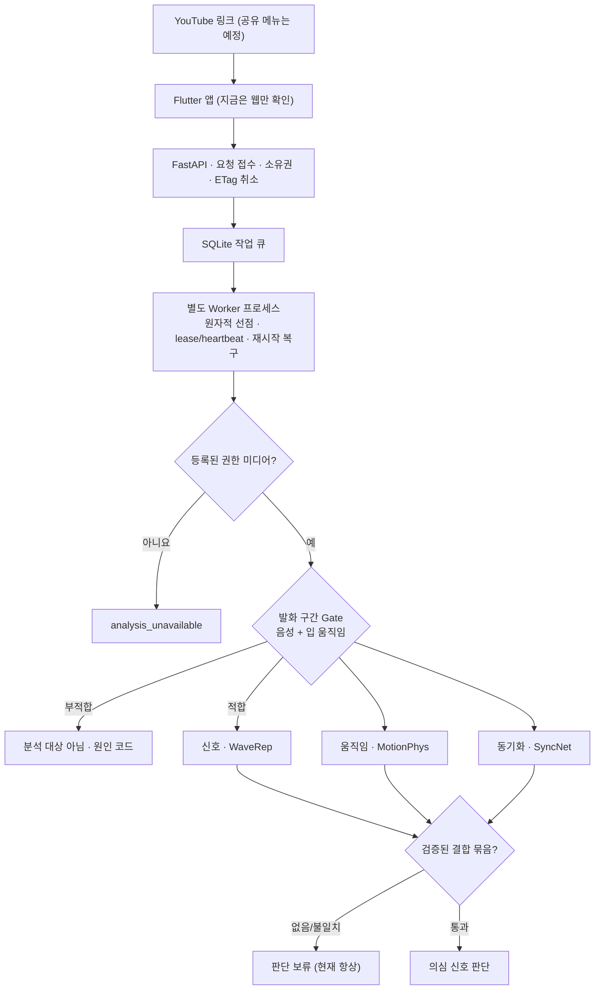

# TRINITY

> **Signals speak. Provenance testifies. Semantics verify.**
>
> YouTube에서 누군가의 말을 믿기 전에, 링크 하나로 **AI 생성·조작 의심 신호**를 확인하는 연구용 시제품

말하는 사람이 나오는 영상(토킹헤드)을 세 가지 서로 다른 증거, 곧 **화면 신호·얼굴 움직임·음성과 입술의 동기화**로 따로 분석합니다. 근거가 충분할 때만 종합 판단을 냅니다.

> **⚠️ 이 프로젝트는 진위를 판정하는 도구가 아닙니다.**
> 결과는 참고 정보입니다. 검증된 결합 모델이 아직 없어서 서버는 **항상 "판단 보류"** 를 냅니다(의도된 동작).
> 법적·사실 확인의 증거로 쓸 수 없습니다.

창원대학교 컴퓨터공학과 산학 캡스톤 · 이연제 (Yeonje Lee)

---

## 목차

1. [무엇을 하나](#1-무엇을-하나)
2. [설계 원칙: 모르면 모른다고 말한다](#2-설계-원칙-모르면-모른다고-말한다)
3. [아키텍처](#3-아키텍처)
4. [세 개의 분석 축](#4-세-개의-분석-축)
5. [진행 상황](#5-진행-상황)
6. [학습·평가 파이프라인과 독립 감사](#6-학습평가-파이프라인과-독립-감사)
7. [데이터셋 현황](#7-데이터셋-현황)
8. [앞으로 할 일](#8-앞으로-할-일)
9. [중요 사항과 한계](#9-중요-사항과-한계)
10. [실행 방법](#10-실행-방법)
11. [저장소 구조와 문서](#11-저장소-구조와-문서)

---

## 1. 무엇을 하나

| 입력 | 처리 | 출력 |
|---|---|---|
| YouTube 링크 붙여넣기 (YouTube 공유 메뉴는 예정) | 발화 구간 선별 → 세 축 분석 → 조건부 결합 | 축별 상태·지표, 분석량(coverage), 보류 사유, 설명 |

- **파일 업로드는 없습니다.** 입력은 YouTube 주소뿐입니다.
- **임의의 YouTube 영상을 내려받지 않습니다.** URL만으로는 영상 원본에 접근할 권한이 생기지 않습니다. 현재는 권한이 확인된 미디어를 등록해 둔 목록(`AuthorizedMediaRegistry`)에 있는 영상만 분석하고, 나머지는 `analysis_unavailable`로 답합니다.
- 대상은 **한 사람이 화면에서 말하는 구간**입니다. 말하는 얼굴이 없거나, 음성과 입 움직임이 맞지 않거나, 품질이 낮으면 분석하지 않고 그 이유를 알려 줍니다.

## 2. 설계 원칙: 모르면 모른다고 말한다

딥페이크 탐지기는 "가짜 확률 95%" 같은 숫자를 보여 주기 쉽습니다. 그 숫자가 검증되지 않았다면 오히려 해롭습니다. TRINITY는 다음 규칙을 코드로 강제합니다.

- **상태를 나눕니다.** 작업 상태(`job_status`), 분석 상태(`analysis_status`), 판정 상태(`verdict_status`), 축별 상태(`axes.*.status`)가 따로 있습니다.
- **실패는 0점이 아니라 `null`입니다.** 실행하지 않았거나 실패한 축의 점수는 비워 둡니다. 평균이나 0으로 채우지 않습니다.
- **종합 점수는 검증을 통과한 결합 모델이 있을 때만 냅니다.** 그 모델 묶음은 내용 해시(digest)로 저장소에 고정되고, 서버가 매번 다시 확인합니다. 하나라도 어긋나면 판단을 보류합니다(fail-closed).
- **coverage는 분석한 양**이지 정확도가 아닙니다.
- 앱 문구는 "의심 신호 발견 / 의심 신호 낮음 / 판단 보류"입니다. "진짜 / 가짜"라고 말하지 않습니다.

## 3. 아키텍처



- 모델마다 **독립된 Python 가상환경과 하위 프로세스**에서 실행합니다. 하나가 실패하거나 멈춰도 다른 축 결과는 남습니다.
- 취소·제한시간 초과 때 Worker의 감시자가 자식 프로세스 그룹 전체를 종료합니다.
- 작업 제한시간은 Gate가 찾은 적합 구간 길이에 비례합니다. Gate 통과 뒤 `min(1800, 180 + 20 × 적합 구간 초)`이고(Gate 전에는 600초), SyncNet 단계에는 `min(60 + 16 × 적합 구간 초, 남은 작업 시간 − 10초)` 제한을 따로 둡니다.
- 실행 환경은 Apple M3(메모리 16GB) Mac 한 대입니다. MPS를 우선 쓰고 안 되면 CPU로 대체하는데, 장치가 바뀐 결과는 결합 입력으로 쓰지 않습니다.

## 4. 세 개의 분석 축

| 축 | 모델 | 보는 것 | 현재 상태 |
|---|---|---|---|
| ① 신호 | **WaveRep** (Corvi et al., NeurIPS 2025) | 프레임에 남은 생성 모델의 저수준 흔적 | 실제 추론 연결. 프레임 logit 중앙값 |
| ② 움직임 | **MotionPhys** 재구현 (전체 / 얼굴 ROI / Face Motion 3가지 비교) | 광학 흐름 궤적의 물리적 일관성 | 특징 추출을 축에 연결. 분류기는 학습 전이라 점수 `null` |
| ③ 동기화 | **SyncNet** | 음성과 입술 움직임의 동기화 | 실제 추론 연결. 보조 지표이며 결합 여부는 검증 뒤 결정 |

세 축을 쓰는 이유: 저수준 흔적(①)은 재압축에 약하고, 고수준 증거(②③)는 압축에 비교적 강하지만 놓치는 생성 방식이 다릅니다. **"세 축 결합이 단일 축보다 낫다"는 검증할 가설이지 결과가 아닙니다.** 결합이 이기지 못하면 WaveRep 단독을 쓰거나 판단을 보류합니다.

## 5. 진행 상황

*기준: 2026-11-18 · 테스트 `pytest -q` 815 passed, 1 skipped*

| 영역 | 상태 |
|---|---|
| 서비스 골격 (FastAPI·SQLite·Worker·취소·복구·소유권) | ✅ 구현·통합 테스트 |
| 권한 미디어 등록부 · 임의 URL 거절 | ✅ |
| 발화 구간 Gate (webrtcvad + MediaPipe 입 움직임) | ✅ 본인 촬영 영상으로 검증. 다중 화자는 미검증 |
| WaveRep 실제 추론 + Worker 연결 | ✅ |
| MotionPhys 특징 추출 + Worker 연결 | ✅ 분류기 학습은 데이터 대기 |
| SyncNet 실제 추론 + Worker 연결 (MPS 가속, 2초 미만 구간 제외 규칙) | ✅ |
| 4단계 종단 실행 (Gate → WaveRep → MotionPhys → SyncNet) | ✅ 실제 영상 1건 |
| 작업·단계 제한시간 정책 | ✅ 구현. 실제 영상에서 제한에 걸리는 경우는 미검증 |
| 압축 견고성 측정 (본인 영상 3개 × 원본·변환본 10개 × Gate와 세 축 = 120건) | ✅ 진짜 영상만, 가짜 없음 |
| 압축 에뮬레이터 (x264 CRF 20/28/34 × 해상도 4종 = 12 프로파일) | ✅ |
| 학습·평가 파이프라인 + 검증된 묶음만 쓰는 서버 관문 | ✅ 합성 데이터로 검증 |
| 독립 감사 (17건 발견, 높음 3건 포함. A7 일부를 빼고 모두 고치거나 결정) | ✅ |
| Flutter 앱 (웹, 화면 8종, mock·실제 서버 모드) | 🟡 공유 시트·iOS/Android 빌드 없음 |
| **실제 데이터 학습·결합 모델 채택** | ⏳ **DeepSpeak 승인 대기** |
| 최종 외부 평가 | ⏳ 학습 뒤 1회 |

**실측 예시 (실제 영상 A, 적합 구간 37.0초, Worker 실행, 1회):** 2026-11-18 재측정에서 Gate 13.1초 · WaveRep 19.8초 · MotionPhys 36.7초 · SyncNet 139.0초 · 전체 208.5초였습니다. SyncNet을 MPS로 옮기고 짧은 구간을 제외하기 전(2026-11-16)에는 전체 506초(SyncNet 약 400초, CPU)였습니다. 같은 세션의 SyncNet 단독 실행(137.7초)과는 차이가 1% 안팎이었습니다. 다만 같은 단독 실행이 2026-11-17 저녁에는 230~234초여서 세션마다 시간이 크게 달라지고, 그 원인은 아직 모릅니다. Worker 안 SyncNet의 실제 장치는 기록되지 않아 MPS로 추정만 합니다.

## 6. 학습·평가 파이프라인과 독립 감사

실제 데이터가 오기 전에 "숫자를 속일 수 없는 파이프라인"을 먼저 만들었습니다.

- **그룹 분할:** 같은 인물·같은 원본에서 나온 영상은 한 분할에만 들어갑니다. 연결된 영상 전체를 하나의 그룹으로 묶고, 누수가 있으면 학습을 거부합니다.
- **결합:** 그룹 5-fold OOF 로지스틱 회귀 → OOF Platt 보정 → dev에서 FPR 5% 임계값 고정.
- **사전 고정 채택 기준** (`configs/training.json`): 결합 후보의 AUC CI 하한 > 0.5, **WaveRep과 단일 최강 후보 각각**에 대한 TPR 이득의 CI 하한 > 0, FPR 악화 ≤ 2%p, 판정 제공 비율 감소 ≤ 5%p, test FPR 상한 ≤ 10%. 신뢰구간은 그룹 단위 bootstrap 1,000회로 계산하고, FPR 상한은 bootstrap 상한과 Clopper–Pearson 정확 상한 중 큰 값을 씁니다.
- **압축 조건 분리:** dev는 `original`과 `x264-crf28-720p`만 씁니다. `x264-crf34-source`·`x264-crf34-720p`·`x264-crf20-source`는 최종 평가 전용이고, 480p는 WaveRep 운영 범위 밖이라 따로 보고합니다.
- **외부 평가 잠금:** MAVOS-DD 표본은 고정 시드로 미리 정했습니다. 모델과 임계값을 고정한 뒤 잠금(`configs/external_eval_lock.json`)을 커밋으로 풀어야만 평가 명령이 돌고, 평가는 한 번만 합니다.
- **묶음 관문:** 서버는 저장소에 digest로 고정된 묶음만 읽고, 다음을 모두 다시 확인합니다. 학습 설정이 커밋된 설정과 같은지, 리포트의 판단을 지표로 다시 계산했을 때 같은지, 서버가 읽는 모든 파일이 digest에 포함되는지, 장치가 대체되지 않았는지. 묶음을 만들기 전에는 학습을 다시 돌려 결과 해시가 같은지도 봅니다.

**독립 감사 (2026-11-18, `docs/audit-training-pipeline.md`).** 이 코드를 처음 보는 감사자가 6가지 공격 시나리오로 파이프라인을 검사했습니다. 리포트 위조, 커밋되지 않은 설정으로 학습, 서빙 집단과 검증 집단의 불일치, 장치 대체, 1080p 쌍둥이 누수 등 17건을 찾았습니다. A7의 남은 부분(MAVOS-DD 파일 해시 비교)만 보류하고 나머지는 모두 고치거나 결정을 내렸습니다. 발견마다 재현 테스트가 있습니다.

신호가 전혀 없는 합성 데이터로 학습부터 채택 판단까지 돌려 보았습니다. 감사 결정을 반영하기 전에는 234회 중 결합 모델이 채택된 경우가 **0회**, "WaveRep 단독"이 5회였습니다. WaveRep 단독 관문은 사실상 AUC에 대한 한쪽 2.5% 검정이라, 신호가 없어도 그 정도는 우연히 나옵니다. 이 점은 실제 결과를 보고할 때 함께 적습니다. 결정을 반영한 뒤 같은 조건(인물 120명)으로 200회 다시 돌렸을 때는 둘 다 0회였습니다. 하지만 이 데이터는 test의 진짜 그룹이 12개뿐이라 FPR 관문을 구조적으로 넘을 수 없어서 나온 0입니다. 관문을 넘을 수 있는 크기(진짜 그룹 약 100개 이상)에서의 우연 채택률은 아직 재지 않았습니다.

## 7. 데이터셋 현황

| 데이터셋 | 역할 | 상태 |
|---|---|---|
| DeepSpeak v2 | 주 학습·내부 검증 | ⏳ 접근 요청함, 심사 대기 (2026-11-13 확인) |
| MAVOS-DD (open-set model 분할) | 최종 외부 평가 전용 | ✅ 승인. 표본 2,160개 잠금 (시드 20261113) |
| TalkingHeadBench | 최종 외부 평가 전용 (토킹헤드 생성 방식 일반화) | Hugging Face 메타데이터상 접근 제한 표시 없음. 다운로드 절차·원본 영상 권리는 확인 필요. 신청·다운로드 안 함 |
| HiDF | 호환성 점검 / 임시 개발 데이터 후보 | 공개 정보(필드·분할·계보·이용 조건)를 아직 확인하지 않아 변환을 거부하도록 해 둠. 확인 전에는 학습에 쓰지 않음 |
| Deepfake-Eval-2024 | 실전 유통본 평가 | ❌ 접근 거절. 재신청 검토 |
| 본인 촬영 영상 5개 | 기능·견고성 확인 | ✅ 사용 중 (공개하지 않음) |

**DeepSpeak 대기 대책:** 2026-11-22까지 승인이 없으면 확인 절차를 거친 HiDF를 임시 개발 데이터로 쓰는 방안을 검토합니다.

## 8. 앞으로 할 일

**데이터가 필요한 일 (DeepSpeak 승인 후)**
1. test의 진짜 **그룹** 수 먼저 세기. 영상 FPR이 5%라면 진짜 그룹이 약 150개 있어야 FPR 정확 상한이 10% 밑으로 내려갑니다. 부족하면 **학습 전에** 멈추고 결정합니다(재분할하지 않음).
2. 특징 추출 → 학습 → dev 임계값 고정 → 후보 비교·채택 판단 (`docs/training-pipeline.md` 체크리스트)
3. 재현 검증을 거쳐 묶음 생성 → digest 고정 → 앱에 판단 문구 표시
4. MAVOS-DD 최종 외부 평가 **1회**

**데이터 없이 할 수 있는 일**
- 세션마다 처리 시간이 크게 달라지는 원인 조사, Worker 안 SyncNet의 실제 장치 기록
- 실제 영상으로 단계 제한시간·실제 모델 실행 중 강제 종료(SIGKILL)·MPS 취소 검증
- MotionPhys LightGBM margin을 실제 가상환경 경로로 확인
- 원본 영상의 여러 오디오 트랙 중 Gate·SyncNet이 어느 트랙을 쓰는지 확인
- 정식 인증·사용자별 요청 한도(rate limit) (대기 3건 초과 시 429는 구현됨)
- Flutter 공유 시트 + iOS/Android 빌드
- 라이선스 표 (SyncNet·S3FD 가중치, MediaPipe, webrtcvad, 폰트)
- HiDF 호환성 점검 (진짜 10 + 가짜 10: 해상도·오디오·Gate·WaveRep)

**결정 대기**
- 시연 방식: 테스트 URL(권장) vs 비공개 YouTube 업로드
- Deepfake-Eval-2024 재신청
- 앱에 판정 라벨 노출 시점

## 9. 중요 사항과 한계

- **성능 수치는 아직 없습니다.** 지금까지의 학습 결과는 모두 파이프라인을 검증하려고 만든 합성 데이터의 결과이며, 어떤 모델의 성능도 아닙니다.
- **"WaveRep이 재압축에 민감하다"는 관찰에는 교란 요인이 있습니다.** 본인 촬영 영상은 HEVC 원본이고 압축본은 H.264라서, 압축률의 영향과 코덱이 바뀐 영향이 섞여 있습니다.
- **YouTube 범용 분석은 하지 않습니다.** 권한 있는 미디어 확보는 별도의 과제입니다. 사용자 영상이나 데이터셋 영상을 YouTube에 올리지 않습니다.
- **데이터·모델·가상환경·영상은 저장소에 커밋하지 않습니다** (`data/`는 Git 제외).
- **연구 데이터 라이선스를 따릅니다.** 비상업 라이선스 데이터가 있어 상업적 이용은 할 수 없습니다.
- **AI 협업:** 구현은 Claude Code와 Codex가 맡고, 계획 승인과 merge 결정은 저장소 소유자가 합니다. AI는 소유자의 지시 없이 main에 merge하지 않습니다.

## 10. 실행 방법

**요구 사항:** macOS (Apple Silicon), Python 3.11, FFmpeg, Flutter(3.41.6에서 확인)

```bash
conda create -n trinity python=3.11 -y
conda activate trinity
pip install -r requirements.txt
pytest -q
```

서버와 Worker는 터미널 두 개에서 실행합니다.

```bash
uvicorn server.main:app --reload     # API (http://127.0.0.1:8000)
python -m server.jobs.worker         # 분석은 Worker에서만 실행
```

등록되지 않은 영상은 `analysis_unavailable`로 끝납니다. 허가 미디어 등록과 환경 변수는 `docs/DESIGN.md` 하단 "서버 실행 방법"에 있습니다. 실제 미디어를 분석하려면 Gate 의존성(`pip install -r requirements-gate.txt`, 모델 파일은 `docs/gate.md`)도 필요합니다.

각 모델의 가상환경과 가중치를 준비하는 방법은 `docs/*-adapter.md`에 있습니다. 모델 환경이 없으면 해당 축은 `error`로 끝나고 다른 축은 계속 진행합니다.

앱 (mock 모드는 서버가 필요 없음):

```bash
cd app
flutter pub get
flutter run -d chrome --web-port 8080 --no-web-resources-cdn
```

## 11. 저장소 구조와 문서

```
server/      FastAPI, Worker, Gate, 세 축 어댑터, 결합 관문
training/    데이터셋 어댑터, 위생 검사, 특징 추출, 결합·리포트·묶음, 압축 에뮬레이터
research/    모델별 독립 실행기 (각자 .venv)
configs/     사전 고정 설정 (training.json, fusion_bundle.json, external_eval_lock.json)
app/         Flutter 앱
scripts/     측정·시뮬레이션 스크립트
tests/       pytest
docs/        설계·측정·결정 기록
```

| 문서 | 내용 |
|---|---|
| `docs/DESIGN.md` | 전체 설계 명세 v6.0. API 계약, 상태 규칙, 결정 기록 §15.3 |
| `docs/HANDOFF.md` | 작업별 인수인계 기록 |
| `docs/training-pipeline.md` | 학습·채택 절차, DeepSpeak 승인 후 체크리스트 |
| `docs/audit-training-pipeline.md` | 독립 감사 결과와 결정 |
| `docs/robustness-selfvideo.md` | 압축 견고성 측정 |
| `docs/syncnet-adapter.md` | SyncNet 성능·짧은 구간 규칙·제한시간 정책 |
| `docs/gate.md`, `docs/waverep-adapter.md`, `docs/motionphys-adapter.md` | 각 단계 구현과 검증 |
| `docs/dataset-access.md`, `docs/media-access.md` | 데이터·미디어 접근 근거 |

### 참고문헌 (핵심)

- Corvi et al. *Seeing What Matters: Generalizable AI-generated Video Detection with Forensic-Oriented Augmentation.* NeurIPS 2025 — WaveRep
- He et al. *MotionPhys: Detecting AI-Generated Videos via Physical Consistency of Optical-Flow Trajectories.* arXiv:2608.20770
- Chung & Zisserman. *Out of time: automated lip sync in the wild.* 2016 — SyncNet
- Barrington, Bohacek, Farid. *The DeepSpeak Dataset.* arXiv:2408.05366
- Croitoru et al. *MAVOS-DD.* arXiv:2505.11109
- Montibeller et al. *Bridging the Gap: … Social Network Compression Emulation.* arXiv:2508.08765

전체 목록은 `docs/DESIGN.md` §16에 있습니다.

---

*연구용 시제품입니다. 결과는 참고 정보이며 진위를 보증하지 않습니다.*
