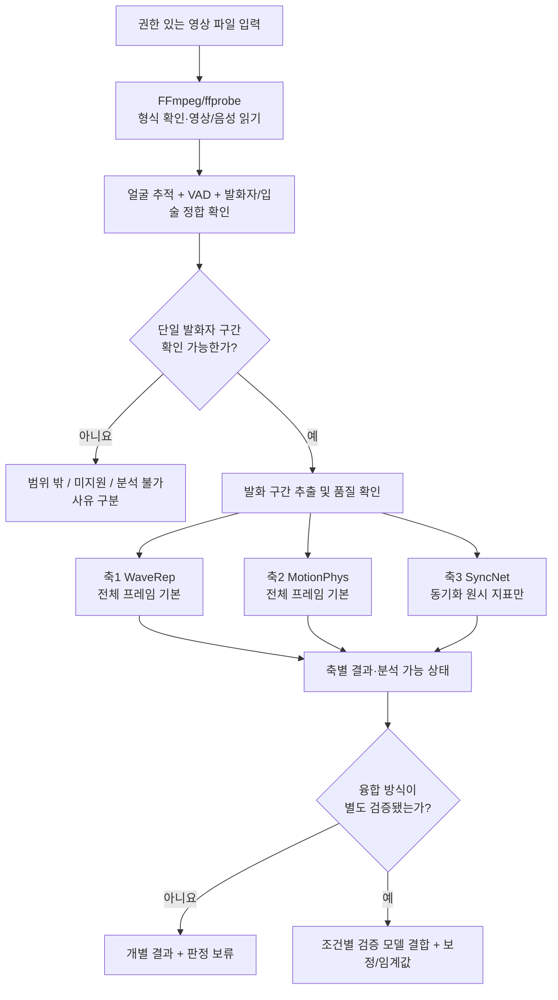
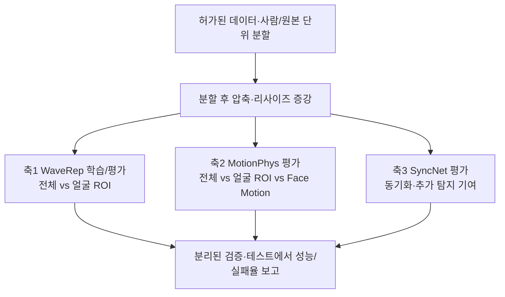
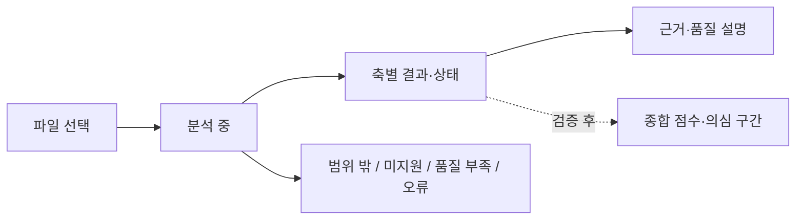

# TRINITY

> 사람이 나와서 말하는 영상이 AI로 생성·조작됐는지 판독하는 앱 (졸업작품)
>
> README v5.4 · **설계 결정 1–9 반영** · Apple Silicon/macOS ARM64 우선 · 구현 전 기술검증 단계
>
> **연구 목표:** 단일 발화자가 나타나는 영상에서 AI 생성·조작 여부를 평가하기 위해 프레임 신호(WaveRep), 움직임(MotionPhys/Face Motion), 음성-입술 동기화(SyncNet)를 비교하고, 실제 환경의 압축·도메인 변화에서 각 단서와 결합의 유효성을 검증한다.
>
> **v5.4 변경:** (5) Logistic Regression 기반 조건부 점수 결합 · (6) 그룹/원본 계보 분할 및 OOF 학습 · (7) Montibeller et al.의 공식 `social_emulator`를 우선 검증하는 2단계 압축 재현 · (8) 작업/분석/판정 상태 분리와 판정 보류 · (9) Python 3.11 ARM64 기준, 독립 가상환경·CPU/MPS 순차 추론. **문제 10–12는 추후 설계**, 정확한 버전·임계값·모델 채택은 실험 후 확정.
>
> **현재 상태:** 설계 문서. 이 README의 모델 성능, 실행 호환성 및 서비스 기능은 TRINITY에서 아직 구현·실측하지 않았다. 외부 논문 성능을 TRINITY 성능으로 주장하지 않는다.

---

## 목차

1. [문제 정의](#1-문제-정의)
2. [시스템 개요](#2-시스템-개요)
3. [판독 파이프라인](#3-판독-파이프라인)
4. [왜 3축인가](#4-왜-3축인가)
5. [각 축 상세](#5-각-축-상세)
6. [학습 데이터와 데이터 위생](#6-학습-데이터와-데이터-위생)
7. [앱 (Flutter)](#7-앱-flutter)
8. [API (초안)](#8-api-초안)
9. [레포 구조 (초안)](#9-레포-구조-초안)
10. [실행 환경 및 구현 전 확인](#10-실행-환경-및-구현-전-확인)
11. [진행 현황 및 설계 결정 추적](#11-진행-현황-및-설계-결정-추적)
12. [한계](#12-한계)
13. [로드맵](#13-로드맵)
14. [참고문헌](#14-참고문헌)

---

## 1. 문제 정의

TRINITY는 **"사람이 속는 문제"**에서 출발했습니다. 실제 사람의 발언처럼 보이는 AI 생성·조작 영상이 오인될 위험을 줄이기 위해, 영상의 **검증 가능한 단서**와 분석 한계를 함께 제시하는 졸업작품입니다.

**초기 연구·구현 대상(결정 1):** 사용 권한을 확보한 영상 파일 중 **한 명의 실제 발화자가 화면에서 명확하게 식별되는 발화 구간**. 한 영상에 여러 인물이 있어도 *분리한 구간*에서 발화자를 유일하게 확인할 수 있다면 향후 지원 가능합니다. 얼굴이 하나이고 소리가 있다는 사실만으로 발화자가 일치한다고 간주하지 않습니다.

**위조 유형:**

| 유형 | 설명 | 예 |
|---|---|---|
| (a) 인물 전체 생성 | 인물과 음성을 AI가 처음부터 생성 | 영상+음성 동시 생성 모델(Veo·Sora류), AI 아바타, 사진 한 장 기반 토킹헤드 |
| (b) 음성 교체 + 립싱크 | 실제 인물 영상에 합성 음성을 넣고 입 모양을 맞춤 | TTS + 립싱크 모델 |
| (c) 얼굴 교체 | 실제 음성은 두고 얼굴만 교체 | Face swap |

**초기 범위 밖:** 이미지, 사람의 발화가 없는 영상, 풍경 중심 영상, 발화자를 신뢰성 있게 특정하기 어려운 다중 발화/나레이션 구간. 분석 중 실패나 낮은 품질은 범위 밖과 **별도로 기록**합니다(§3.3).

**입력 정책:** Phase 1에서는 **허가된 로컬/업로드 영상 파일**을 사용합니다. YouTube URL·공유 시트 입력은 콘텐츠 접근 권한과 플랫폼 약관을 충족하는 처리 방법을 확인한 이후의 조건부 Phase 2 과제입니다. YouTube에서 이미 유통 중인 영상의 평가 목적은 유지하되, 자동 다운로드를 기본 경로로 가정하지 않습니다.

## 2. 시스템 개요

**Thin Client, Fat Server** 구조입니다. 연구 엔진은 입력 경로와 분리합니다.

| 구성 | 내용 |
|---|---|
| 클라이언트 | Flutter 단일 코드베이스; 초기에는 Web UI 우선 검증, iOS·Android는 후속 확대 |
| Phase 1 입력 | **사용 권한이 있는 영상 파일** 선택/업로드 |
| Phase 2 입력(조건부) | YouTube 공유 시트/URL — 콘텐츠에 합법적으로 접근할 수 있는 경우만 |
| 서버 | Apple Silicon 맥북에서 FastAPI 셀프호스팅; 외부 데모 접속 정책·인증 별도 설계 |
| 추론 | WaveRep(MPS/CPU 후보), MotionPhys(CPU), SyncNet(CPU; **동기화 지표만**) |
| 결과 | 분석 상태, 축별 지표, 품질/적용 범위, 근거; **종합 진위 점수는 검증 후 제공** |

세 분석 축은 **실험 후보**입니다. 세 축을 모두 사용하거나 결합해야 한다는 전제는 두지 않습니다.

## 3. 판독 파이프라인

### 3.1 추론 단계 (영상 1개)



| 단계 | 하는 일 | 후보 기술 |
|---|---|---|
| 파일 수신 | 사용 권한·형식·파일 크기·길이 점검 | FastAPI, ffprobe |
| 전처리 | 영상/음성 디코딩 및 구간 추출 | FFmpeg |
| 발화자 확인 | VAD + 얼굴 추적 + 발화자와 입 움직임 일치 확인; **단순 얼굴+음성 존재만으로 통과 금지** | VAD/얼굴 검출 모델 미정, SyncNet 활용 가능성 별도 검증 |
| 축별 분석 | 신호·움직임·정합성 지표 측정 | §5 |
| 종합 평가 | 검증된 조합에 한해 Logistic Regression, 보정/임계값 | §5.4 |

### 3.2 학습·검증 단계



압축 에뮬레이터는 실제 YouTube 재인코딩과 유사한 조건을 **로컬에서 시험하기 위한 연구용 모듈**입니다. 모델 학습/보정과 최종 테스트는 분리합니다(§6).

### 3.3 상태 및 판정 보류 계약 (결정 8)

**작업 상태**, **분석 상태**, **진위 판정 상태**를 독립적으로 기록한다. 프로그램이 정상 종료되어도 진위 판정을 반드시 내리지는 않는다.

| 범주 | 값 | 의미 |
|---|---|---|
| `job_status` | `queued`, `processing`, `finished`, `failed` | 백그라운드 작업의 생명주기 |
| `analysis_status` | `completed`, `partial`, `out_of_scope`, `unsupported`, `insufficient_quality`, `analysis_unavailable` | 증거 수집 및 지원 범위 |
| `verdict_status` | `assessed`, `abstained`, `not_applicable` | 검증된 종합 진위 판단 여부 |
| `abstention_reason` | `insufficient_evidence`, `unvalidated_condition`, `no_valid_fusion_model` | 판정 보류의 핵심 이유 (`abstained`일 때) |

**축별 상태**는 `completed`, `insufficient_input`, `unsupported_input`, `out_of_distribution`, `error`로 통일하고 세부 원인(`insufficient_motion`, `tracking_failed`, `speaker_unconfirmed`, `occluded_mouth` 등)을 별도 필드로 둔다. **실패한 점수를 0으로 대체하지 않으며 반드시 `null`로 나타낸다.**

- **의견 불일치 ≠ 오류:** 세 모델의 출력이 서로 달라도 해당 조합에 대한 검증된 결합 모델이 있으면 판정 가능하다.
- **부분 분석:** 한 축이 실패해도 나머지 축은 실행하며, 실패 조건에 대해 별도 검증한 모델 조합이 없으면 종합 판정은 보류한다.
- **검증 범위:** 해상도, 프레임레이트, 얼굴 크기, 구간 길이, 압축·오디오 조건을 기록한다. 단순 규칙만으로 미지의 생성 모델을 완벽히 OOD 검출한다고 주장하지 않는다.
- **분석 범위(coverage):** 전체 영상 길이, 분석 대상 발화 구간의 길이, 실제 성공적으로 분석한 길이, 사용한 구간 목록을 구분한다. 검사하지 않은 구간의 진위를 추론하지 않는다.
- **판정 보류:** 분석 결과가 나왔더라도 성능이 검증되지 않았거나 적합한 결합 모델이 없으면 `overall_score: null`, `verdict_status: abstained`로 반환한다.

## 4. 왜 3축인가

### ① 출발점: 저수준 / 고수준 이분법

패시브(콘텐츠 기반) 탐지는 크게 두 계층으로 나뉩니다. 딥페이크 이미지 탐지 종합 리뷰(ScienceDirect, 2026.3)는 공간·주파수 단서(저수준)와 의미·생리학 단서(고수준)로 분류하고, [TriDF](https://arxiv.org/abs/2512.10652)도 Quality Artifacts와 Semantic Artifacts로 같은 경계를 긋습니다. 경계의 조작적 정의는 [Alpha Blending Hypothesis](https://arxiv.org/abs/2605.10334)를 따릅니다. 저수준 아티팩트는 영상 내용과 무관하게 생기고, 고수준 오류는 장면 내용을 봐야 드러납니다.

| | 저수준 | 고수준 |
|---|---|---|
| 무엇의 흔적인가 | 생성·처리 과정 | 묘사된 세계의 규칙 위반 |
| 내용과의 관계 | 무엇을 찍었든 발생 | 장면 속 내용이 있어야 드러남 |

### ② 고수준을 둘로 나누는 기준: 증거가 어디에 있는가

- **영상 안의 시간 흐름:** 움직임이 물리 법칙(관성, 연속적인 힘)을 따르는가. 영상만으로 판단합니다.
- **영상과 소리 사이:** 입 모양과 발화가 맞물리는가. 영상과 음성을 함께 봐야 판단할 수 있습니다.

두 단서는 입력이 다르고 잡아내는 위조 유형도 다릅니다. 하나의 축으로 합치면 한쪽이 다른 쪽을 대신할 수 없는 영역이 생깁니다.

### ③ 결과: 3축

| 축 | 계층 | 증거 위치 | 방법 | 보는 것 |
|---|---|---|---|---|
| 축1 신호 | 저수준 | 프레임 내부 | WaveRep | 압축 후에도 남는 생성기 주파수 흔적 |
| 축2 물리 | 고수준 | 시간 흐름 | MotionPhys 기본 + 얼굴 특화 후보 | 궤적의 곡률 · 각속도 · jerk / 얼굴 특징점 움직임 |
| 축3 정합 | 관계 단서 | 영상 ↔ 음성 | SyncNet (보조 후보) | 입 모양과 음성의 동기화(진위 판별과 다름) |

축2는 원본에서는 물체의 의미를 인식하지 않지만 궤적의 시간적 일관성을 분석합니다. 얼굴 특화 접근은 별도 비교 후보입니다. 축3은 진위 탐지 모델이 아니라 동기화 측정 모델이므로 **서로 다른 증거가 반드시 상호 보완적이라는 주장은 검증되지 않았습니다.**

### ④ 왜 2축이 아닌가

서로 다른 위치에서 증거를 수집한다는 **3축 연구 가설**을 시험합니다. 아래 역할 분담은 기대 효과일 뿐, 특정 위조 유형을 반드시 탐지한다는 보장은 없습니다. 2축 모델이 더 좋다면 세 번째 축은 보조 정보로 남깁니다(§11).

| 위조 유형 | 축1 | 축2 | 축3 |
|---|---|---|---|
| (a) 인물 전체 생성 | 주력 | 주력 | 약함 가능성 높음·검증 필요 |
| (b) 음성 교체 + 립싱크 | 보조 | 검증 필요 | 립싱크 불일치 시 보조¹ |
| (c) 얼굴 교체, 음성은 진짜 | 주력 | 보조 | 약함 |

축3만 있으면 진짜 음성을 쓴 얼굴 교체(c)를 놓치고, 축2만 있으면 음성 조작(b)을 볼 수 없습니다.

¹ **SyncNet은 진위 판별 모델이 아니라 동기화 측정 모델**입니다. 잘 맞는 합성 립싱크와 영상·음성 동시 생성(a)은 놓칠 수 있고, 편집으로 어긋난 진짜 영상에서 오경보가 날 수 있습니다. 축3이 위조 유형 (b)에 유용한지는 별도 실험으로 검증합니다(§11). 고도화된 립싱크에 대한 문제는 [TFDBench](https://neurips.cc/virtual/2026/163771)와도 비교합니다.

### ⑤ 왜 4축이 아닌가

언어 모델이 장면을 서술하며 추론하는 계열은 계산 비용이 커서 셀프호스팅 서버에 맞지 않고, 판단 근거가 모델의 서술에 의존해 검증하기 어렵습니다. 향후 과제로 둡니다(§13). 출처증명(액티브)은 패시브 3축과 성격이 달라 별도 계층으로 다룹니다.

---

## 5. 각 축 상세

### 5.1 축1 · 신호 — WaveRep (결정 4)

| 항목 | 설계 |
|---|---|
| 근거 논문 | Corvi et al., [*Seeing What Matters*](https://arxiv.org/abs/2506.16802), NeurIPS 2025 |
| 기본 입력 | 발화 구간에서 추출한 **전체 프레임** |
| 기본 방법 | DINOv2 계열 프레임 탐지 + 포렌식용 웨이블릿 증강(원 논문 재현 우선) |
| 비교 후보 | 같은 구간의 **얼굴 영역(ROI) crop**, 전체+얼굴 점수 결합 — **원본과 다른 실험 조건** |
| 압축 대응 | (1) 학습 중 압축·리사이즈 **증강**, (2) 별도 검증 분할에서 **점수/임계값 보정**; 두 방법을 분리 평가 |
| 출력 | 원시 모델 점수, 프레임/클립 집계값, 분석 상태, 영상 품질 정보, 미검증 조건 경고 |
| 핵심 실험 | A·B·C 위조 유형별 성능, 전체 vs 얼굴 ROI, 압축 강도별 AUC 및 고정 FPR 탐지율, 미지 생성 모델, 증강/보정 효과 |
| 실행 | PyTorch MPS 우선 검증, 필요 시 CPU; 원본 코드의 CUDA 전용 연산 여부 확인 |
| 주의 | 원시 점수 ≠ AI 생성 확률. 강한 압축에서 성능 저하 가능; [TRACE](https://arxiv.org/abs/2609.25775) 등의 외부 재현 차이 원인 확인 필요 |

**판단 규칙:** 압축 증강은 학습 설계이고 보정은 검증 데이터에 의한 판정 설계입니다. 보정으로 해결되는 점수 이동과 압축 때문에 구분 정보 자체가 손실되는 상황을 구별합니다. 테스트 영상으로 보정값을 정하지 않습니다. 전체+얼굴 결합은 성능 이득이 확인될 때만 채택합니다.

### 5.2 축2 · 물리 — MotionPhys + 얼굴 특화 비교 (결정 3)

| 항목 | 설계 |
|---|---|
| 근거 논문 | He et al., [*MotionPhys*](https://arxiv.org/abs/2608.20770) |
| 기준선 A | **원본 MotionPhys:** Shi–Tomasi + 격자점 → 피라미드 Lucas–Kanade → 8·12·24프레임 궤적 → 곡률·각속도·jerk 통계 504차원 → LightGBM |
| 비교 B | **얼굴 ROI MotionPhys:** 동일한 알고리즘을 얼굴 영역으로 제한; 원본 연구와는 다른 조건 |
| 비교 C | **Face Motion(프로젝트 임시명):** MediaPipe Face Landmarker 특징점으로 머리·눈썹·입술의 움직임 통계 계산 + LightGBM |
| 비교 D/E | A+C, B+C 결합 — 독립 실험이며 성능 향상 전제 없음 |
| 출력 | 후보별 분류 점수 및 추적 성공률·유효 궤적 수·움직임 크기·축 상태 |
| 실패 처리 | `insufficient_motion` / `tracking_failed`, `score: null` (0점으로 대체하지 않음) |
| 실행 | OpenCV · NumPy · LightGBM · MediaPipe의 **CPU 기반** 구성을 우선 시험 |
| 핵심 실험 | 토킹헤드 움직임 많음/적음, 카메라 흔들림, 압축·프레임 누락, 얼굴 ROI 효과, Face Motion의 추가 기여 |

**주의:** MediaPipe는 얼굴 위치와 표정 관련 특징을 추출하는 도구이지 그 자체로 딥페이크 탐지기가 아닙니다. Face Motion 분류기는 학습·평가가 필요하고, SyncNet의 입술-음성 정렬과 다른 증거를 제공하는지도 검증해야 합니다. 유효 궤적 수나 최소 움직임 등 **분석 가능 기준은 개발/검증 데이터에서 정한 뒤 테스트 전에 고정**합니다.

### 5.3 축3 · 정합 — SyncNet (동기화 보조 후보; 결정 2)

| 항목 | 내용 |
|---|---|
| 원전 | Chung & Zisserman, *Out of time: automated lip sync in the wild* (2016), [원본 코드](https://github.com/joonson/syncnet_python) |
| macOS 후보 구현 | [nawta/SyncNet_py309_313](https://github.com/nawta/SyncNet_py309_313) (`syncnet-python` >= 0.2.3) — Apple Silicon CPU 실행 사례가 공개됨. TRINITY 내 통합은 **미검증** |
| 입력 | 얼굴 추적이 가능한 말하는 구간의 비디오 및 대응 오디오 |
| 방법 | 사전학습 SyncNet으로 입 움직임과 음성 간 시간적 동기화 비교 (사전학습 가중치 이용, 우선 CPU 추론) |
| 원시 출력 | 얼굴 트랙별 오프셋(프레임), LSE-C(클수록 동기화 우수), LSE-D(작을수록 동기화 우수) |
| TRINITY 출력 | 동기화 원시 지표·상태·품질. **검증 전에는 위조 확률이나 종합 탐지 점수를 출력하지 않음** |
| 유의 | 정상 동기화 ≠ 진짜 영상. 정밀한 립싱크 합성·영상+음성 동시 생성은 놓칠 수 있고, 지연된 진짜 영상은 오경보 가능 |
| 남은 결정 | 정상/인위적 오프셋/(a)/(b)/(c) 평가, 압축 내성, **축3 포함/제외의 추가 성능 이득** 확인 후 결합 여부 결정 |

**사용 원칙:** 발화자 트랙이 확인된 경우에만 측정합니다. 동기화가 정상이어도 영상이 진짜라는 뜻이 아니며, 동기화가 어긋나도 가짜라는 뜻이 아닙니다. 사전학습 SyncNet 지표 자체를 진위 점수로 변환하지 않고, 검증 데이터에서 추가 탐지 기여가 있을 때만 융합 후보로 고려합니다.

**대체 이유와 제한:** 기존 [AVH-Align](https://github.com/bit-ml/AVH-Align)은 CUDA 12.4 중심 연구 환경과 AV-HuBERT/Fairseq 의존성으로 macOS 유지보수 부담이 높습니다. SyncNet CPU 구현은 CUDA 없는 실행을 위한 **엔지니어링 대안**이며, AVH-Align과 같은 학습 목표나 딥페이크 탐지 성능을 제공한다는 뜻이 아닙니다. AVH-Align은 비교 연구 후보로 남기되 기본 의존성에서 제외합니다.

**실행 예시(별도 실험 환경, 가중치 확보 후):**

```bash
python3 -m pip install 'syncnet-python>=0.2.3'
syncnet-python clip.mp4 --device cpu -o results.json
```

- FFmpeg 설치 및 원본 SyncNet/S3FD 가중치가 필요합니다. 다운로드 경로와 가중치 이용 조건은 구현체 README에서 확인합니다.
- 공개 구현의 기본 실행 장치는 CUDA일 수 있으므로 **`--device cpu`를 명시**합니다.
- `best_conf`와 `min_dist`는 여러 얼굴 트랙에서 서로 다른 인물에게서 나올 수 있습니다. **발화자 식별·얼굴 트랙 일치 확인** 없이는 영상 전체 판정에 쓰지 않습니다.
- 짧은 구간·무음·가려진 입·멀티스피커는 `unavailable/low_quality`로 처리할 수 있도록 품질 기준을 실험으로 정합니다.
- 의심 구간 타임라인은 구간별 재평가를 구현·검증한 뒤 제공하며, SyncNet 원시 출력만으로 자동 확보된다고 가정하지 않습니다.

### 5.4 축별 점수 결합 — Fusion (결정 5)

**기본 결합 후보는 `WaveRep + MotionPhys`의 Logistic Regression**이다. SyncNet은 A/B/C 유형별 실험에서 추가적인 탐지 기여도가 확인되는 경우에만 결합 후보에 포함한다. 최종 채택은 실험 결과를 따르며, 3축의 우월성을 전제하지 않는다.

| 항목 | 설계 |
|---|---|
| 비교 기준선 | 최고 성능 단일 축 / 검증된 동일 척도 점수의 단순 평균 / Logistic Regression |
| 기본 특징 | WaveRep 점수 + 선택된 MotionPhys 계열 점수 |
| 조건부 특징 | SyncNet LSE-C, LSE-D, 오프셋; 진위 확률로 직접 취급하지 않음 |
| 전처리 | 훈련 데이터에서만 학습한 표준화/변환 파이프라인을 검증·테스트에 동일 적용 |
| 결합 모델 학습 | 인물·원본 계보 기반 그룹 분할, 기본 모델의 **OOF(out-of-fold)** 예측값 사용 |
| 확률 보정 | 검증된 필요성이 있을 때 별도 분할 또는 누수 없는 교차 검증으로 Sigmoid 우선 시험 |
| 판정 기준 | 개발용 검증 분할에서 **목표 FPR 5%**에 맞춰 선택, 최종 테스트에서 실제 FPR과 TPR 보고 |
| 부분 실패 | 검증된 축 조합별 대체 모델만 사용; 점수 결측 시 0 대체·임의 평균 금지 |
| 출력 | `raw_score` 및 `overall_score`의 의미를 구분; 보정·검증 전 종합 점수 제공 금지 |
| 실행 | scikit-learn CPU |

**데이터 절차:** (1) 기본 모델 학습 → (2) 독립 그룹에 대한 OOF 예측으로 결합 모델 학습 → (3) 별도의 보정/임계값 검증 → (4) 내부 최종 테스트 → (5) 최종 외부 테스트. 교차 검증을 사용해 데이터 규모를 효율적으로 활용하되, 각 역할 사이에 원본·인물 정보가 유출되지 않도록 한다. 특정 축이 유독 실패하는 조건에서는 그 조건만 따로 평가해야 한다.

Logistic Regression이 내놓는 0–1 값은 **보정 여부와 무관하게 곧바로 '진짜 가짜 확률'이라고 단정할 수 없다.** 확률 보정 결과와 모집단 차이의 영향을 확인하고, 사용자 표현은 문제 10에서 확정한다.

## 6. 학습 데이터와 데이터 위생

### 6.1 데이터셋 및 역할 (결정 6)

| 데이터 | 주 역할 | 접근·제약 | 상태 |
|---|---|---|---|
| [DeepSpeak v2](https://huggingface.co/datasets/faridlab/deepspeak_v2) | 진짜 + (a) 아바타·(b) 립싱크·(c) 얼굴 교체를 이용한 **주 학습/내부 검증** | 사용 승인·동의 및 ID/원본 계보 확인 필요 | 접근 신청/확인 필요 |
| [TalkingHeadBench](https://huggingface.co/datasets/luchaoqi/TalkingHeadBench) | **우선 외부 생성 방식 일반화 평가**. 별도 허용된 학습 분할은 추후 선택 | 제공 분할, 상위 영상 권리, 라이선스 확인 | 평가 자료 확보 필요 |
| 자체 생성 가상 인물 영상(약 20–50편 계획) | 최신 **영상+음성 동시 생성(a)**의 탐색적 평가 | 생성 도구 약관·비용·모델 버전·프롬프트 기록; 진짜 비교군 필요 | 계획 |
| [Deepfake-Eval-2024](https://huggingface.co/datasets/nuriachandra/Deepfake-Eval-2024) | **최종 외부 실전 평가 전용** | 접근 승인·사용 조건 확인; 학습/튜닝/임계값 조정에 사용하지 않음 | 접근 신청/확인 필요 |
| 직접 촬영한 권한 확보 진짜 영상 | 압축 기준 특성 추정 및 파이프라인 시험 | 플랫폼 출력본 사용 권한 별도 확인 | 계획 |
| [AV-Deepfake1M++](https://arxiv.org/abs/2507.20579) | 분할·압축 평가 방식 참고 | 연구 EULA 확인 | 참조만 |

**위조 유형 관리:** A1 사진 기반, A2 아바타, A3 영상·음성 동시 생성; B1 음성 교체, B2 음성+립싱크; C1 얼굴 교체, C2 교체+보정으로 *평가용 메타데이터*를 관리한다. 이는 일곱 가지 다중분류 클래스를 새로 정의한 것이 아니다. 유형별 표본이 부족하면 성능 주장을 보류한다.

**우선 접근 원칙:** 접근·이용 허가가 확인되지 않은 데이터를 이미 확보한 것처럼 표시하지 않는다. Deepfake-Eval-2024는 최종 홀드아웃으로 두며, 반복적인 모델 수정 피드백에 사용하지 않는다. TalkingHeadBench를 학습에 활용하는 경우 그 부분은 더 이상 독립적인 외부 평가 자료가 아님을 명시한다.

### 6.2 사회관계망 압축 에뮬레이터 — Montibeller 기반 (결정 7)

**채택 근거:** Montibeller et al., [*Bridging the Gap: A Framework for Real-World Video Deepfake Detection via Social Network Compression Emulation*](https://arxiv.org/abs/2508.08765). **공개 구현:** [`truebees-ai/social_emulator`](https://github.com/truebees-ai/social_emulator). README 및 스크립트의 실제 입출력, 라이선스, ffmpeg 의존성은 Phase 0에서 검증한다. macOS ARM64에서의 공식 실행 보증은 아직 없다.

**2단계 설계:**

1. **범용 강건성 시험:** macOS의 FFmpeg CPU 소프트웨어 인코더로 H.264 CRF `20/28/34`(초기 *실험 프로파일*, YouTube 내부 CRF 아님), 원본/1080p/720p/480p(업스케일 제외)를 대상으로 압축·리사이즈 변형을 생성한다. 오디오 재인코딩, FPS 변경, 반복 인코딩은 별도 실험 축으로 관리한다.
2. **플랫폼 특성 추정:** 실제 플랫폼 처리본을 **약관에 맞게 확보할 수 있을 때에만**, 원본과 대응 처리본으로 파라미터를 추정하고 공식 `social_emulator` 방식과 출력을 비교한다. 확보 불가 시 **'YouTube 재현'이라고 주장하지 않고** 범용 압축 강건성 실험으로 제한한다.

**핵심 구분:** 논문은 주로 영상 압축·리사이즈를 다룬다. SyncNet의 오디오 재인코딩과 오디오/비디오 시간 동기화 영향 시험은 **TRINITY의 추가 실험**이며 논문 저자 구현과 동일한 기능이라고 주장하지 않는다.

**실험 매트릭스:** 원본 학습→원본 테스트 / 원본 학습→압축 테스트 / 압축 증강 학습→기존 압축 조건 / 압축 증강 학습→미사용 압축 조건 / (권한 허용 시) 플랫폼 유통본 최종 평가. 학습용 압축 설정과 최종 평가 설정은 분리한다. WaveRep의 웨이블릿 증강과 플랫폼 압축 증강도 별개의 요인으로 측정한다.

**품질 및 재현성:** 해상도·코덱·비트레이트·주파수 특성·모델 출력 변화 등을 비교한다. 결과물의 메타데이터에는 `source_recording_id`, `derivation_group_id`, `split`, `profile_id`, `ffmpeg_version`, 인코더 설정, 입력/출력 SHA-256, 처리 상태를 기록한다. 원본 파일을 덮어쓰지 않으며 제한 데이터와 파생물은 GitHub에 올리지 않는다.

**예정 경로:** `training/emulator/profiles/`, `video.py`, `audio.py`, `metadata.py`, `quality.py`, `pipeline.py`. 저자 스크립트를 우선 실험하고 필요할 때 해당 기능을 래핑하거나 macOS 호환 수정한다.

### 6.3 평가 설계

모든 평가에서 ROC-AUC, **TPR@5% FPR**, 실제 FPR, 유형별 성능, 압축 조건별 성능, 축별 실패율·latency·메모리를 보고한다. 보정된 확률을 제공하는 경우 Brier score/ECE 등도 별도 보고한다. 진짜 비교군이 없는 자체 생성 가짜 영상 집합에서는 ROC-AUC를 계산하지 않는다.

**순서:** 내부 홀드아웃에서 성능을 확인한 뒤 모든 모델 선택·가중치·임계값을 고정하고, TalkingHeadBench 및 Deepfake-Eval-2024의 허용된 외부 평가로 일반화 성능을 측정한다. 최종 외부 평가 결과를 보고 다시 조정하면 그 결과를 더 이상 독립적인 최종 테스트라고 부르지 않는다. 최종 평가 프로토콜의 상세 기준은 **설계 문제 12에서 확정 예정**.

### 6.4 데이터 위생 (`training/hygiene.py`) (결정 6)

데이터 분할은 가능한 한 **인물(얼굴 교체의 출처·대상 포함) + 원본 녹화 + 파생본 계보**의 연결 관계를 기준으로 한다. 같은 원본의 가짜·압축·ROI crop·재인코딩 파생본이 서로 다른 분할에 들어가면 안 된다. 공식 벤치마크 분할은 존중하되 누수 위험이 있다면 제외·별도 실험·제약 보고를 검토한다.

| 점검 항목 | 방법 / 목적 |
|---|---|
| 인물·원본 계보 분할 | 연결 그룹 간 `train/validation/test` 중복 방지. 얼굴 출처·대상 모두 확인 |
| 동일/유사 영상 | 해시 + 원본 계보 + 필요한 경우 영상 유사도 점검. 해시가 다르다고 다른 영상은 아님 |
| 오디오 무음 편향 | 진짜/가짜 간 앞부분 무음·길이·오디오 처리 차이 확인 |
| 코덱·해상도·FPS·길이 | 파일 메타데이터만으로 라벨이 예측되는 **shortcut** 여부 진단 |
| 원본 변환과 압축 | 먼저 분할을 확정한 뒤 압축·증강 적용. 계보 ID 보존 |
| 외부 평가 접근 제한 | 학습·OOF·확률 보정·임계값 설정에 외부 최종 평가 샘플 유입 금지 |
| 재현성 | 데이터셋 버전, 공개 가능한 ID/변환 메타데이터, 분할 해시, 전처리 설정 기록 |

**공통 데이터 레코드(계획):** `dataset_id`, `video_id`, `source_recording_id`, `identity_ids`, `generator_id`, `manipulation_type`, `parent_video_id`, `derivation_group_id`, `split`, `file_hash`. 이 필드들은 **TRINITY 내부 공통 스키마**이며 외부 데이터셋의 실제 필드와 반드시 같지는 않다.

### 6.5 라이선스·약관·윤리

- 이 레포에는 어떤 데이터셋의 영상이나 파생물도 포함하지 않습니다. 데이터 로더와 사람(ID) 분할 목록만 둡니다.
- DeepSpeak: 접근 양식과 이용 조건을 따르고, 사용 시 출처를 표기합니다(정확한 라이선스 조건 확인 필요).
- Deepfake-Eval-2024: 접근 심사와 배포 조건을 준수하며, **평가 전용**으로 사용합니다. 구체적 신청 기한·사용 허가는 신청 시점에 재확인합니다.
- AV-Deepfake1M++: 연구 전용 EULA를 따릅니다.
- SyncNet 코드/패키지의 MIT·Apache-2.0 고지와 **모델 가중치의 별도 이용 조건**을 각각 확인합니다. 코드 라이선스가 가중치까지 자동으로 허용하지는 않습니다.
- 자체 생성 (a): 실존 인물의 얼굴·목소리는 쓰지 않고 가상 인물만 만들며, 생성 서비스 약관을 따르고 공개 게시하지 않습니다.
- Phase 1에서는 사용 권한이 확보된 영상 파일만 입력받습니다. YouTube 자동 다운로드·채널 집계는 이용약관·API 정책과 콘텐츠 접근 권한을 만족하는 방법이 확정되기 전까지 활성화하지 않습니다.

---

## 7. 앱 (Flutter)

| 항목 | 내용 |
|---|---|
| 플랫폼 | Flutter(iOS · Android · Web); **초기 Web UI 먼저**, 모바일 확장 예정 |
| Phase 1 입력 | 사용 권한이 있는 **영상 파일 선택/업로드** |
| Phase 2 입력 | YouTube 공유 시트/URL — 적법한 접근 방법이 마련된 경우에만 |
| 네비게이션 | 탭바 없는 스택 네비게이션 |
| 디자인 | Bold Typography 다크 스타일 · 배경 `#0A0A0A` · 액센트 `#FF3D00` · Inter Tight + JetBrains Mono |



| 화면 | 내용 |
|---|---|
| 홈 | 영상 파일 입력, 최근 분석(개인/저장 정책 미정) |
| 분석 중 | 단계별 `job_status` 및 형식 확인 → 발화자 확인 → 축별 측정 |
| 결과 요약 | 세 층 상태(`job/analysis/verdict`), 축별 원시 지표/실패 이유, 화질·coverage 경고. **미검증 종합 확률 금지** |
| 결과 해설 | 축별 근거·검증 범위·분석 구간 목록; 의심 구간의 자동 위치 추정은 별도 검증 후 제공 |
| 채널 상세 | **조건부 Phase 2**: 적법한 YouTube 연동이 가능할 때만 검토 |

> 웹 클라이언트에서는 CORS, 업로드 크기 제한, 인증, 파일 보관·삭제 정책이 필요하며 아직 미설계입니다.

## 8. API (초안; 결정 8 반영)

| 메서드 | 경로 | 역할 |
|---|---|---|
| `POST` | `/analyze/file` | 이용 권한이 있는 파일 업로드, 입력 검사, 작업 ID 반환 |
| `GET` | `/jobs/{job_id}` | 작업·분석·판정 상태, 적용 구간, 축별 결과 조회 |
| `POST` | `/analyze/url` | **조건부 Phase 2** — 현재 기본 기능 아님 |
| `GET` | `/channels/{channel_id}` | **조건부 Phase 2** |

**예시 값(실제 모델 추론 결과가 아님):**

```json
{
  "job_id": "example-job",
  "job_status": "finished",
  "analysis_status": "partial",
  "verdict_status": "abstained",
  "abstention_reason": "no_valid_fusion_model",
  "overall_score": null,
  "scope": {
    "video_duration_sec": 600,
    "eligible_duration_sec": 120,
    "analyzed_duration_sec": 60,
    "eligible_coverage": 0.5,
    "full_video_coverage": 0.1,
    "analyzed_segments": [[0, 20], [40, 80]]
  },
  "axes": {
    "signal": {
      "status": "completed",
      "model": "WaveRep",
      "raw_score": 0.81
    },
    "physics": {
      "status": "insufficient_input",
      "reason": "insufficient_motion",
      "raw_score": null
    },
    "alignment": {
      "status": "completed",
      "model": "SyncNet",
      "lse_c": 4.2,
      "lse_d": 7.8,
      "included_in_fusion": false,
      "authenticity_probability": null
    }
  },
  "quality": {"height": 720, "bitrate_kbps": 1800, "warning": "compression_robustness_not_verified"}
}
```

**설계 원칙:** `job_status: finished`와 `verdict_status: assessed`는 별개의 의미다. `partial`도 완료된 개별 지표를 반환할 수 있으나 검증되지 않은 합산 점수를 내지 않는다. `analyzed_segments`에는 실제로 분석에 성공한 구간만 기록한다. 상세 인증·파일 크기 제한·삭제 정책은 **문제 11에서 확정 예정**이다.

## 9. 레포 구조 (초안)

```text
TRINITY/
├── app/                              # Flutter: Web 우선, 모바일 확대
├── server/
│   ├── main.py                       # FastAPI
│   ├── ingest/                       # 권한 확인·파일 형식·FFmpeg
│   ├── gate/                         # 얼굴 추적·VAD·발화자 확인
│   ├── axes/
│   │   ├── signal/                   # WaveRep: 전체/얼굴 ROI
│   │   ├── physics/                  # MotionPhys·Face Motion 대조
│   │   └── alignment/                # SyncNet CPU, 동기화 지표
│   ├── fusion/                       # Logistic Regression (검증 후 활성화)
│   └── jobs/                         # 작업·축별 실행 상태 관리
├── research/
│   ├── waverep/                      # 모델 단독 재현·CPU/MPS 실험
│   ├── motionphys/                   # CPU 대조 실험
│   └── syncnet/                      # 가중치·CPU 추론·독립 환경 시험
├── training/
│   ├── datasets/
│   │   ├── schema.py                 # 공통 데이터/원본 계보 메타데이터
│   │   ├── splits/                   # 그룹 분할 ID 목록
│   │   └── metadata/                 # 공개 가능한 manifest
│   ├── emulator/
│   │   ├── profiles/                 # 범용 압축·플랫폼 추정 설정
│   │   ├── video.py
│   │   ├── audio.py
│   │   ├── metadata.py
│   │   ├── quality.py
│   │   └── pipeline.py               # Montibeller 공식 코드 연계 검증
│   ├── fusion/                       # OOF 점수·표준화·결합 모델 학습
│   ├── evaluation/                   # 외부 평가/압축·유형별 평가
│   └── hygiene.py                    # 그룹 누수·편향 점검
├── configs/
│   ├── models/                       # 가중치 위치·해시·전처리 설정
│   └── runtime.yaml                  # CPU/MPS·순차 실행 등
├── scripts/
│   └── check_environment.py          # macOS ARM64 스모크 테스트(예정)
└── docs/                             # 설계 결정/실험 프로토콜
```

> 모두 **예정 구조**다. `.venv`, 외부 데이터셋 영상, 접근 제한 가중치, 사용자 업로드 파일은 GitHub에 커밋하지 않는다.

## 10. 실행 환경 및 구현 전 확인 (결정 9)

### 10.1 macOS ARM64 / Apple Silicon

**기본 Python은 3.11 ARM64를 우선 시험**하며, 실제 패키지 호환성 테스트 이후 각 환경의 정확한 버전을 고정한다. 공식 저장소의 실행 예시가 다른 Python 버전을 요구하면 해당 모델만 별도 환경으로 분리한다.

| 구성 | 기본 장치 | 포팅·검증 방향 |
|---|---|---|
| WaveRep / DINOv2 | **MPS 우선**, CPU 대체 | 우선 CPU 공식 체크포인트 추론 성공 → MPS 동일 입력 비교 → 연산 지원/출력 차이/메모리 점검 |
| MotionPhys·Face Motion | **CPU** | OpenCV·NumPy·LightGBM·MediaPipe 네이티브 ARM64 호환·속도 측정 |
| SyncNet | **CPU** | `SyncNet_py309_313` 및 사전학습 가중치의 독립 환경 추론, OpenCV 패키지 충돌 점검 |
| 압축 에뮬레이터 | **CPU** | FFmpeg 소프트웨어 인코딩 + 공식 `social_emulator` 스크립트 ARM64 검증 |
| Fusion | **CPU** | scikit-learn 표준화/Logistic Regression/조건부 보정 |
| FastAPI·Flutter | macOS | 분석 모델과 연동하기 전 API·파일 처리 테스트 |

### 10.2 프로세스·메모리 설계

- **Phase 0:** 모델별 독립 Python 가상환경으로 설치·추론을 시험한다. 패키지 충돌 여부를 확인한 후 통합 가능 환경만 합친다.
- **Phase 1:** **동시에 하나의 영상**을 분석하고, 기본적으로 **WaveRep → MotionPhys → SyncNet 순차 실행**한다. 축별 결과는 즉시 기록하며 실패한 축을 이유로 다른 축을 생략하지 않는다.
- Apple Silicon은 CPU/GPU가 통합 메모리를 공유한다. 실제 메모리 용량, 전처리 및 모델별 최대 사용량을 측정한 뒤 배치·병렬 실행을 결정한다.
- NVIDIA CUDA 12.4·AV-HuBERT·Fairseq는 기본 추론 의존성에서 제외하되, 원본 연구 재현 후보 자체는 문서화한다.
- 공개 가중치로 **추론 성공**을 먼저 검증하고, 파인튜닝/전체 학습은 별도 연구 환경에서 진행한다. 학습 장치와 서비스 추론 장치는 동일할 필요가 없다.
- 모델 아티팩트에는 체크포인트 SHA-256, 코드 버전, 라이브러리 버전, 데이터/분할 버전, 전처리, 검증 지표, 임계값, 실행 장치를 기록한다.

### 10.3 Phase 0 실행 검증 관문 (아직 미실행)

1. `python`의 ARM64 아키텍처 및 FFmpeg 인코더 설치 확인
2. PyTorch CPU 텐서 계산 및 MPS 가용성/연산 확인
3. WaveRep 공식 체크포인트로 CPU 추론 후 MPS 비교
4. OpenCV·LightGBM·MediaPipe CPU 추론 확인
5. SyncNet/S3FD 가중치 사용 조건 확인 후 SyncNet CPU 추론
6. Montibeller 공개 코드의 FFmpeg/쉘/Python 의존성 및 macOS 포팅 검증
7. 단계별 시간, 최대 메모리, 오류율, 결과 재현성 측정
8. 통합 FastAPI 작업에서 단계별 상태·부분 실패·작업 완료 검증

**주의:** 현재 소스 구현이 아직 없으므로 아래 명령을 실제 실행 방법으로 단정하지 않는다. 구성별 환경 파일과 실행 스크립트는 Phase 0 검증 후 작성한다. 공식 SyncNet 예시를 실행하려면 FFmpeg, 모델 가중치, 해당 구현체가 요구하는 버전/인자를 먼저 확인해야 한다.

## 11. 진행 현황 및 설계 결정 추적

### 11.1 확정한 설계 원칙 (1–9)

| # | 문제 | 합의된 설계 방향 | 구현/성능 |
|---|---|---|---|
| 1 | 입력·분석 대상 | 권한 있는 파일 우선, 단일 발화자 구간, YouTube URL은 조건부 확대 | 미검증 |
| 2 | SyncNet | 진위 탐지기 아닌 동기화 **보조 지표**, 융합 기여 검증 후 채택 | 미검증 |
| 3 | MotionPhys | 원본 / 얼굴 ROI / MediaPipe Face Motion 및 조합 대조 | 미검증 |
| 4 | WaveRep | 전체 프레임 기본, 얼굴 ROI 대조; 압축 증강·점수 보정 분리 | 미검증 |
| 5 | Fusion | Logistic Regression 기본; 그룹 OOF; 필요시 보정; 목표 FPR 5%; 검증된 조합만 판정 | 미검증 |
| 6 | 데이터 위생 | DeepSpeak 주 학습, TalkingHeadBench 일반화, 자체 생성 탐색, Deepfake-Eval 최종 평가; 연결 그룹 분할 | 접근/실험 전 |
| 7 | 압축 에뮬레이터 | Montibeller 논문·공식 `social_emulator` 기반; FFmpeg 범용 프로파일과 적법한 플랫폼 처리본 추정 분리 | 포팅/실측 전 |
| 8 | 보류 시스템 | 작업·분석·판정 상태 분리; 부분 실패·coverage·사유 기록; 불확실하면 보류 | 미구현 |
| 9 | macOS 실행 | Python 3.11 ARM64 우선 시험; WaveRep MPS/CPU; MotionPhys·SyncNet CPU; 독립 환경 → 순차 실행 | 미검증 |

**설계 미완료:** 10. 설명 가능성 및 사용자 표현, 11. FastAPI/Flutter 서비스 계약·인증·저장, 12. 최종 실험 프로토콜·판정 채택 기준. 세 모델의 실제 성능/호환성이 검증되었다는 의미로 **'확정'을 해석하지 않는다.**

### 11.2 구현 및 실험 우선순위 (Phase 0)

1. 데이터 접근·이용 조건·모델 가중치 라이선스 확인 및 Apple Silicon 기본 환경 검증.
2. 각 축의 **원본 또는 공개 구현 추론을 단독 재현**, 실제 메모리/추론 시간과 실패 조건 기록.
3. DeepSpeak 그룹 분할·데이터 위생 검사 구축, TalkingHeadBench/Deepfake-Eval 외부 평가 자료 접근 확인.
4. Montibeller 공식 `social_emulator` 포팅과 범용 압축 프로파일 재현; 실제 플랫폼과의 동일성은 별도 검증.
5. WaveRep 압축·전체/얼굴 ROI, MotionPhys 원본/얼굴/Face Motion, SyncNet A/B/C 유형별 유효성 대조.
6. 검증된 출력에 한해 OOF 기반 Logistic Regression과 축 조합·보정·임계값 대조 실험.
7. 테스트 전에 모델 선택과 임계값을 고정한 후 독립 내부·외부 데이터로 성능, FPR, 실패율, 지연, coverage 보고.
8. 그 결과를 근거로 종합 판정 기능을 활성화할지 결정하며, 이후 FastAPI/Flutter 통합을 구현.

### 11.3 미확정 수치·조건

- 얼굴 추적 성공률·유효 궤적 수·품질/발화 구간 길이의 구체적 기준
- SyncNet의 탐지 기여 인정 기준 및 결합 채택 여부
- 각 분석 축 후보 중 최종 모델과 단일 축 실패 시 판정 모델 조합
- 확률 보정 필요성, 최종 판정 임계값, coverage에 따른 보류 기준
- Python 패키지 정확한 핀 버전, 맥북별 메모리·시간 예산
- 업로드 크기·파일 보존/삭제·사용자 인증·UI 표현 및 최종 평가 프로토콜

## 12. 한계

- 판독 결과는 확률적 추정이며, 단독으로 진위를 확정하는 근거로 쓰면 안 됩니다.
- 초기 구현은 **사용 권한이 확보된 영상 파일의 단일 발화자 구간**만 분석합니다. 다중 발화·나레이션·저화질·추적 실패는 사유별 별도 상태로 처리합니다.
- 진짜 음성을 쓴 얼굴 교체(c)는 축3이 약하므로 축1·2에 의존합니다.
- SyncNet은 **동기화 검사**일 뿐, 딥페이크 진위 확률을 직접 제공하지 않습니다. 잘 동기화된 가짜와 편집으로 어긋난 진짜를 구별하지 못할 수 있습니다.
- SyncNet이 실제 탐지 성능에 기여하지 못하면 축3은 종합 점수에서 제외하고 보조 정보로만 표시합니다.
- 강한 압축에서는 WaveRep의 성능이 저하될 수 있습니다. 점수 보정만으로 소실된 정보를 되찾을 수는 없습니다. 얼굴 ROI가 더 낫다는 근거도 아직 없습니다.
- MotionPhys는 토킹헤드 움직임이 부족하면 유효한 궤적을 얻기 어렵고, Face Motion은 자체적으로 진위 탐지 모델이 아닙니다.
- 축별 성능 수치는 원 논문의 보고치이며, 이 프로젝트의 조건(YouTube 열화, 말하는 사람 영상)에서는 아직 측정 전입니다.
- 주 학습 데이터(DeepSpeak)는 웹캠 화상회의 환경이라 YouTube 촬영·편집 환경과 차이가 있습니다.
- 영상+음성 동시 생성(a) 데이터는 소량 자체 생성에 의존하므로, 이 유형의 성능 추정은 불확실성이 큽니다.
- Apple Silicon 호환은 일부 구성 라이브러리 및 외부 공개 실행 사례에 근거한 **계획**이며, TRINITY 전체 파이프라인의 동작을 검증한 것은 아닙니다.
- YouTube URL 직접 수집 및 채널 분석은 정책·권한 이슈를 해결하기 전까지 기본 기능에서 제외합니다.

---

## 13. 로드맵

| 단계 | 범위 | 완료 판단 |
|---|---|---|
| Phase 0 — 설계·기술검증 | 문제 10–12 결정; 데이터 권한·환경, 모델 단독 실행·압축 에뮬레이터·기초 실험 | 재현 가능한 입력/출력·테스트 기록 확보 |
| Phase 1 — 연구 엔진 | 발화자 구간 검사, 세 분석 축(필요시 일부만), 데이터 위생, 검증된 Fusion 및 판정 보류 | 독립 내부·외부 평가와 오류 처리 통과 |
| Phase 1 UI | Web 우선 Flutter + FastAPI 파일 업로드 및 상태/근거 표시 | 권한 있는 파일에 대한 종단 간 분석 데모 |
| Phase 2 — 조건부 | 적법한 접근 방식이 확보될 경우 YouTube URL·공유 시트·채널 이력 | 약관·접근 권한 확인 후 별도 결정 |
| 향후 | C2PA·출처 확인, 시각적 히트맵, 언어 모델 추론, 다른 플랫폼 | 연구 및 리소스 검토 후 |

## 14. 참고문헌

**탐지 축**

- Corvi et al. [*Seeing What Matters: Generalizable AI-generated Video Detection with Forensic-Oriented Augmentation.*](https://arxiv.org/abs/2506.16802) arXiv:2506.16802 (NeurIPS 2025) — 축1 · [코드](https://github.com/grip-unina/WaveRep-SyntheticVideoDetection)
- He et al. [*MotionPhys: Detecting AI-Generated Videos via Physical Consistency of Optical-Flow Trajectories.*](https://arxiv.org/abs/2608.20770) arXiv:2608.20770 — 축2 기준선
- Google [MediaPipe Face Landmarker](https://ai.google.dev/edge/mediapipe/solutions/vision/face_landmarker/python) — 축2 Face Motion의 특징점 추출 도구(딥페이크 탐지 모델 아님)
- [THEval](https://github.com/Newbyl/THEval) — 토킹헤드 움직임 평가 접근 참고(직접 탐지 성능을 뜻하지 않음)
- Chung & Zisserman. [*Out of time: automated lip sync in the wild.*](https://www.robots.ox.ac.uk/~vgg/software/lipsync/) (2016) — 축3 SyncNet 원전 · [원본 코드](https://github.com/joonson/syncnet_python)
- [SyncNet_py309_313](https://github.com/nawta/SyncNet_py309_313) — 축3 macOS CPU 후보 구현. 검증된 것은 해당 저장소의 공개 사례이며 본 프로젝트의 실험 결과는 아님.
- Smeu et al. [*Circumventing Shortcuts in Audio-visual Deepfake Detection Datasets with Unsupervised Learning.*](https://arxiv.org/abs/2412.00175) CVPR 2025, arXiv:2412.00175 — **이전 축3 AVH-Align, 비교 연구 후보** · [코드](https://github.com/bit-ml/AVH-Align)

**학습·평가**

- Montibeller et al. [*Bridging the Gap: A Framework for Real-World Video Deepfake Detection via Social Network Compression Emulation.*](https://arxiv.org/abs/2508.08765) arXiv:2508.08765 · [DOI:10.1145/3746265.3759670](https://doi.org/10.1145/3746265.3759670) — 열화 에뮬레이터 · [공식 구현](https://github.com/truebees-ai/social_emulator)
- Cai et al. [*AV-Deepfake1M++: A Large-Scale Audio-Visual Deepfake Benchmark with Real-World Perturbations.*](https://arxiv.org/abs/2507.20579) ACM MM 2025, arXiv:2507.20579 — 평가 설계 참고

**데이터셋**

- Barrington, Bohacek, Farid. [*The DeepSpeak Dataset.*](https://arxiv.org/abs/2408.05366) arXiv:2408.05366 — 주 학습 데이터 · [Hugging Face](https://huggingface.co/datasets/faridlab/deepspeak_v2)
- Chandra et al. [*Deepfake-Eval-2024: A Multi-Modal In-the-Wild Benchmark of Deepfakes Circulated in 2024.*](https://arxiv.org/abs/2503.02857) arXiv:2503.02857 — 실전 평가
- [*TalkingHeadBench: A Multi-Modal Benchmark & Analysis of Talking-Head DeepFake Detection.*](https://arxiv.org/abs/2505.24866) arXiv:2505.24866 — (a) 보강
- [*TFDBench: A Comprehensive Benchmark and Codebase for Talking-Face Deepfake Detection.*](https://neurips.cc/virtual/2026/163771) NeurIPS 2026 (arXiv 번호 확인 필요) — 축3 립싱크 취약성 근거

**분류 체계 (§4)**

- [*Alpha Blending Hypothesis.*](https://arxiv.org/abs/2605.10334) arXiv:2605.10334 — 저수준/고수준 경계의 조작적 정의
- [*TriDF.*](https://arxiv.org/abs/2512.10652) arXiv:2512.10652 — Quality Artifacts vs Semantic Artifacts
- [*Countering synthetic realities: Advances, challenges, and future directions in deepfake image detection.*](https://www.sciencedirect.com/science/article/pii/S2772941926000396) ScienceDirect, 2026.3 — 공간·주파수 vs 의미·생리학 분류

**비교·참고**

- Chang et al. [*What Matters in Detecting AI-Generated Videos like Sora?*](https://arxiv.org/abs/2406.19568) arXiv:2406.19568
- Cao et al. [*TRACE: Trajectory Representation and Consistency Estimation for AI-Generated Video Detection.*](https://arxiv.org/abs/2609.25775) arXiv:2609.25775

---

**문서 상태:** v5.4는 설계 결정 1–9를 반영한 통합 기준안입니다. 문제 10–12와 모델 최종 채택·구체적 실험 수치는 미확정이며, README에 기재한 실험은 아직 수행되지 않았습니다.
