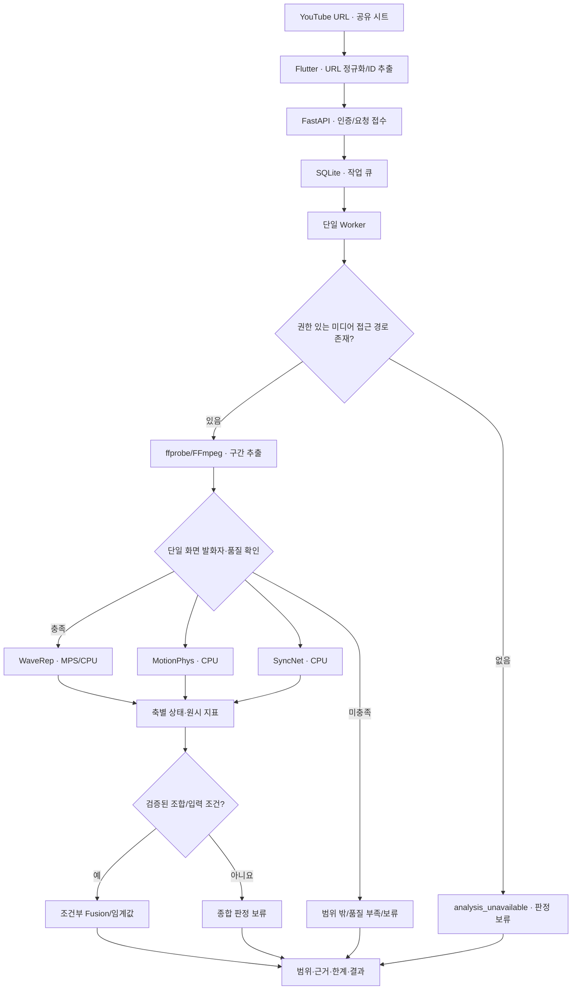

# TRINITY

> **Signals speak. Provenance testifies. Semantics verify.**
>
> **YouTube에서 누군가의 말을 믿기 전, 공유 한 번으로 AI 생성·조작 의심 신호를 확인하는 서비스**
>
> **README v6.0 · 최종 설계 기준안 (결정 1~12 반영) · 구현/실증 이전**

**상태:** 본 문서는 **구현 명세와 실험 계획**입니다. 사용자 대상 YouTube 링크 분석, Apple Silicon 모델 구동, 데이터셋 접근, 검출 성능은 현재 TRINITY에서 완료되었다고 주장하지 않습니다. *설계 결정*과 *검증 완료*는 다릅니다.

**최상위 제품 원칙:** 사용자는 영상 파일을 다운로드하거나 업로드하지 않습니다. **YouTube 링크를 붙여넣거나 YouTube 공유 메뉴에서 TRINITY를 선택**하는 것이 유일한 기본 입력입니다. 다만 YouTube URL만으로 원본 영상/음성에 접근할 권한이 자동으로 생기지는 않습니다. 분석 가능한 미디어 확보는 **출시를 가로막을 수 있는 독립적인 P0 과제**입니다.

**연구 목표:** 단일 화면 발화자가 확인되는 토킹헤드 영상에서 WaveRep(신호), MotionPhys/Face Motion(움직임), SyncNet(음성·입술 동기화)의 유효성을 **각각 검증**하고, 압축·새 생성기·실제 유통 환경에서의 성능과 선택적 점수 결합 효과를 비교합니다. **3축 결합의 우월성은 연구 가설이며 결과가 아닙니다.**

## 목차

1. [문제 정의와 설계 철학](#1-문제-정의와-설계-철학)
2. [제품 범위 및 성공 조건](#2-제품-범위-및-성공-조건)
3. [전체 아키텍처와 데이터 접근 관문](#3-전체-아키텍처와-데이터-접근-관문)
4. [왜 3축인가](#4-왜-3축인가)
5. [각 축 상세](#5-각-축-상세)
6. [학습 데이터와 데이터 위생](#6-학습-데이터와-데이터-위생)
7. [YouTube URL·공유 시트 제품 경험](#7-youtube-url공유-시트-제품-경험)
8. [FastAPI·Worker·SQLite 서비스 설계](#8-fastapiworkersqlite-서비스-설계)
9. [API 계약](#9-api-계약)
10. [상태, 실패, 부분 분석 및 보류](#10-상태-실패-부분-분석-및-보류)
11. [결과 설명과 사용자 신뢰](#11-결과-설명과-사용자-신뢰)
12. [Apple Silicon 환경 및 보안](#12-apple-silicon-환경-및-보안)
13. [최종 평가 프로토콜](#13-최종-평가-프로토콜)
14. [개발 우선순위와 수용 기준](#14-개발-우선순위와-수용-기준)
15. [저장소 구조·위험·결정 기록](#15-저장소-구조위험결정-기록)
16. [참고문헌](#16-참고문헌)

---

## 1. 문제 정의와 설계 철학

### 1.1 문제의 출발점

사람들은 YouTube에서 실제 인물이 발언하는 듯한 영상을 보고 사실이라고 믿기도 합니다. 영상이 AI로 생성되었거나 얼굴·음성이 조작된 경우, 시청자가 확인에 필요한 전문 도구를 직접 다루기는 어렵습니다. TRINITY는 **시청 중인 영상의 링크를 공유하고, 분석 가능한 범위에서 관찰된 단서와 불확실성을 이해할 수 있게 하는 것**을 목표로 합니다.

```text
YouTube에서 영상 시청 → 공유 → TRINITY 선택 → URL 접수
  → 적법하게 분석 가능한 미디어 확인 → 발화 구간·품질 검사
  → 탐지 모델 평가 → (검증된 경우) 종합 의심 신호
  → 분석 범위·보류 사유·근거 표시
```

- **사용자 행동 최소화:** 파일 다운로드/파일 업로드 요구 없음. URL 붙여넣기와 공유 시트만 제공.
- **정확성보다 확신을 과장하지 않음:** 분석 실패는 진짜 판정이 아님. 모델 점수는 법적 진위 증명이 아님.
- **투명성:** 관찰된 수치, 모델 추론, 해석의 한계를 구분하고, 분석한 구간만 설명.
- **연구의 정직성:** 외부 논문에 나온 성능은 TRINITY의 실측 성능이 아니며, 모델이 모두 유효할 것으로 전제하지 않음.

### 1.2 분석 범위

**초기 목표:** 한 구간에 **화면에 보이는 한 명의 발화자**를 신뢰성 있게 식별할 수 있는 말하는 사람 영상. 한 편에 여러 인물이 나와도 구간별 단일 발화자 확인이 가능한 부분만 분석 후보로 취급합니다. 얼굴과 음성이 동시에 존재한다는 사실만으로 동일 발화자라고 단정하지 않습니다.

| 위조 유형 | 설명 | 평가용 하위 유형 예시 |
|---|---|---|
| A. 인물·발화 전체 생성 | 사진 기반 말하는 얼굴, 아바타 또는 영상·음성 동시 생성 | A1 사진, A2 아바타, A3 동시 생성 |
| B. 음성 교체·립싱크 | 실제 인물 영상에 합성 음성 또는 립싱크 변환 | B1 음성 교체, B2 교체+립싱크 |
| C. 얼굴 교체 | 실제 음성은 유지하면서 얼굴만 교체·보정 | C1 교체, C2 교체+보정 |

**초기 범위 밖:** 풍경·동물만 나오는 영상, 발화자 확인 불가, 이미지·텍스트 진위 판별, 일반적인 정치·의학 발언의 사실검증, 영상의 역사적 진위에 대한 확정적인 법의학 판정. 미검증 조건은 성공 처리하지 않습니다.

## 2. 제품 범위 및 성공 조건

| 영역 | v6.0 기본 범위 | 제외/미해결 |
|---|---|---|
| 사용자 입력 | **YouTube `watch`, `youtu.be`, 지원된 Shorts URL**, 공유 시트 | MP4/MOV 업로드 UI, 임의 URL 다운로더 |
| 미디어 확보 | 허가·승인 및 사용 조건이 확인된 데이터 접근 어댑터 | 모든 공개 YouTube 영상 자동 수집 가능하다는 가정 |
| 연구/시연 | **등록된 YouTube ID ↔ 별도 권한 보유 미디어**로 링크 중심 흐름 검증 | 등록된 원본을 YouTube 재인코딩본이라고 주장 |
| 분석 | 적합한 단일 발화 구간, 세 후보 축, 조건부 Fusion | 무조건 3축 합산, 전체 영상 진위 확정 |
| 결과 | 분석 상태·coverage·축별 원시 지표·보류 사유·설명 | 검증 전 '가짜 확률 95%' 표시 |
| 운영 | Mac 단일 서버, 인증된 제한 시연 | 다중 사용자 공개 서비스 즉시 출시 |

**서로 다른 완료 기준**을 분리합니다.

1. **연구 엔진 완성:** 권한 있는 테스트 미디어에서 파이프라인과 독립 평가 실행.
2. **링크 UX 완성:** 사용자가 URL/공유 시트로 요청하고, 등록된 허가 미디어에 대한 분석 결과 수신.
3. **범용 YouTube 서비스 가능:** 임의 영상에 필요한 미디어를 **적법하게 확보하는 접근 경로**와 운영 권한, 실제 처리본 평가가 확보된 뒤에만 주장.

## 3. 전체 아키텍처와 데이터 접근 관문



### 3.1 YouTube 미디어 접근은 구현 전 P0 관문

YouTube Data API 및 IFrame Player는 **영상 ID·메타데이터/재생**에 사용할 수 있지만, AI 추론을 위한 원본 프레임·오디오 파일을 일반적으로 제공하는 API가 아닙니다. YouTube [서비스 이용약관](https://www.youtube.com/t/terms)과 [API 개발자 정책](https://developers.google.com/youtube/terms/developer-policies)은 콘텐츠 접근·다운로드·캐싱을 제한합니다. **권리자의 동의만으로 YouTube 플랫폼의 별도 승인 요건이 자동 충족된다고 가정하지 않습니다.** API 정책이 적용되는 작업에는 필요한 YouTube의 사전 서면 승인과 콘텐츠 권한을 함께 검토합니다.

**접근 추상화 (구현 필수):**

```text
MediaResolver.resolve(youtube_video_id) ->
  Available(local_authorized_media_path, provenance, access_basis)
  | Unavailable(reason_code)
```

- `YouTubeMetadataAdapter`: 공식 지원 범위에서 영상 ID/메타데이터 확인. 디코딩용 미디어는 제공하지 않음.
- `AuthorizedMediaRegistry`: **실험·시연용으로 허가된 미디어와 YouTube ID를 연결**, 허가 출처·원본/플랫폼 처리본 여부를 기록. 사용자는 파일을 올리지 않음.
- `ApprovedPlatformAccessAdapter`: 플랫폼/콘텐츠 양측의 필요한 접근 권한과 구현 경로가 확보된 **후에만** 활성화하는 인터페이스. 미구현 상태 유지.
- `Unavailable`: 미디어가 없거나 접근 권한이 없으면 `video_access_unavailable`/`access_not_authorized`로 종료하고 **점수 생성 금지**.

**개발 우선순위상 결론:** URL 파싱/UI만 먼저 만들고 '영상 분석 기능 완성'이라고 할 수 없습니다. 반대로 허가된 미디어 기반 엔진을 개발하되 제품 입력 철학을 파일 업로드로 바꾸지도 않습니다.

### 3.2 분석 및 학습의 경계

사용자의 URL은 데이터 소스의 **식별자**이며 영상 데이터 자체가 아닙니다. 분석 Worker만 접근이 승인된 미디어 어댑터의 출력을 사용합니다. 학습 자료는 별도의 연구 저장소에서 관리하며 **실사용자 요청에서 자동 수집/학습하지 않습니다.**

## 4. 왜 3축인가

### ① 출발점: 저수준 / 고수준 이분법

패시브(콘텐츠 기반) 탐지는 크게 두 계층으로 나뉩니다. 딥페이크 이미지 탐지 종합 리뷰(ScienceDirect, 2026.3)는 공간·주파수 단서(저수준)와 의미·생리학 단서(고수준)로 분류하고, [TriDF](https://arxiv.org/abs/2512.10652)도 Quality Artifacts와 Semantic Artifacts로 같은 경계를 긋습니다. 경계의 조작적 정의는 [Alpha Blending Hypothesis](https://arxiv.org/abs/2605.10334)를 따릅니다. 저수준 아티팩트는 영상 내용과 무관하게 생기고, 고수준 오류는 장면 내용을 봐야 드러납니다.

| | 저수준 | 고수준 |
|---|---|---|
| 무엇의 흔적인가 | 생성·처리 과정 | 묘사된 세계의 규칙 위반 |
| 내용과의 관계 | 무엇을 찍었든 발생 | 장면 속 내용이 있어야 드러남 |

### ② 고수준을 둘로 나누는 기준: 증거가 어디에 있는가

- **영상 안의 시간 흐름:** 움직임이 물리 법칙(관성, 연속적인 힘)을 따르는가. 영상만으로 판단합니다.
- **영상과 소리 사이:** 입 모양과 발화가 맞물리는가. 영상과 음성을 함께 봐야 판단할 수 있습니다.

두 단서는 입력이 다르고 잡아내는 위조 유형도 다릅니다. 하나의 축으로 합치면 한쪽이 다른 쪽을 대신할 수 없는 영역이 생깁니다.

### ③ 결과: 3축

| 축 | 계층 | 증거 위치 | 방법 | 보는 것 |
|---|---|---|---|---|
| 축1 신호 | 저수준 | 프레임 내부 | WaveRep | 생성 영상과 연관된 신호·주파수 특징(압축 후 보존 여부는 실험) |
| 축2 물리 | 고수준 | 시간 흐름 | MotionPhys 기본 + 얼굴 특화 후보 | 궤적의 곡률 · 각속도 · jerk / 얼굴 특징점 움직임 |
| 축3 정합 | 관계 단서 | 영상 ↔ 음성 | SyncNet (보조 후보) | 입 모양과 음성의 동기화(진위 판별과 다름) |

축2는 원본에서는 물체의 의미를 인식하지 않지만 궤적의 시간적 일관성을 분석합니다. 얼굴 특화 접근은 별도 비교 후보입니다. 축3은 진위 탐지 모델이 아니라 동기화 측정 모델이므로 **서로 다른 증거가 반드시 상호 보완적이라는 주장은 검증되지 않았습니다.**

### ④ 왜 2축이 아닌가

서로 다른 위치에서 증거를 수집한다는 **3축 연구 가설**을 시험합니다. 아래 역할 분담은 기대 효과일 뿐, 특정 위조 유형을 반드시 탐지한다는 보장은 없습니다. 2축 모델이 더 좋다면 세 번째 축은 보조 정보로 남깁니다(§14).

| 위조 유형 | 축1 | 축2 | 축3 |
|---|---|---|---|
| (a) 인물 전체 생성 | 주력 | 주력 | 약함 가능성 높음·검증 필요 |
| (b) 음성 교체 + 립싱크 | 보조 | 검증 필요 | 립싱크 불일치 시 보조¹ |
| (c) 얼굴 교체, 음성은 진짜 | 주력 | 보조 | 약함 |

축3만 있으면 진짜 음성을 쓴 얼굴 교체(c)를 놓치고, 축2만 있으면 음성 조작(b)을 볼 수 없습니다.

¹ **SyncNet은 진위 판별 모델이 아니라 동기화 측정 모델**입니다. 잘 맞는 합성 립싱크와 영상·음성 동시 생성(a)은 놓칠 수 있고, 편집으로 어긋난 진짜 영상에서 오경보가 날 수 있습니다. 축3이 위조 유형 (b)에 유용한지는 별도 실험으로 검증합니다(§14). 고도화된 립싱크에 대한 문제는 [TFDBench](https://neurips.cc/virtual/2026/163771)와도 비교합니다.

### ⑤ 왜 4축이 아닌가

언어 모델이 장면을 서술하며 추론하는 계열은 계산 비용이 커서 셀프호스팅 서버에 맞지 않고, 판단 근거가 모델의 서술에 의존해 검증하기 어렵습니다. 향후 과제로 둡니다(§15). 출처증명(액티브)은 패시브 3축과 성격이 달라 별도 계층으로 다룹니다.

---

## 5. 각 축 상세

### 5.1 축1 · 신호 — WaveRep (결정 4)

| 항목 | 설계 |
|---|---|
| 근거 논문 | Corvi et al., [*Seeing What Matters*](https://arxiv.org/abs/2506.16802), NeurIPS 2025 |
| 기본 입력 | 발화 구간에서 추출한 **전체 프레임** |
| 기본 방법 | DINOv2 계열 프레임 탐지 + 포렌식용 웨이블릿 증강(원 논문 재현 우선) |
| 비교 후보 | 같은 구간의 **얼굴 영역(ROI) crop**, 전체+얼굴 점수 결합 — **원본과 다른 실험 조건** |
| 압축 대응 | (1) 학습 중 압축·리사이즈 **증강**, (2) 별도 검증 분할에서 **점수/임계값 보정**; 두 방법을 분리 평가 |
| 출력 | 원시 모델 점수, 프레임/클립 집계값, 분석 상태, 영상 품질 정보, 미검증 조건 경고 |
| 핵심 실험 | A·B·C 위조 유형별 성능, 전체 vs 얼굴 ROI, 압축 강도별 AUC 및 고정 FPR 탐지율, 미지 생성 모델, 증강/보정 효과 |
| 실행 | PyTorch MPS 우선 검증, 필요 시 CPU; 원본 코드의 CUDA 전용 연산 여부 확인 |
| 주의 | 원시 점수 ≠ AI 생성 확률. 강한 압축에서 성능 저하 가능; [TRACE](https://arxiv.org/abs/2609.25775) 등의 외부 재현 차이 원인 확인 필요 |

**판단 규칙:** 압축 증강은 학습 설계이고 보정은 검증 데이터에 의한 판정 설계입니다. 보정으로 해결되는 점수 이동과 압축 때문에 구분 정보 자체가 손실되는 상황을 구별합니다. 테스트 영상으로 보정값을 정하지 않습니다. 전체+얼굴 결합은 성능 이득이 확인될 때만 채택합니다.

### 5.2 축2 · 물리 — MotionPhys + 얼굴 특화 비교 (결정 3)

| 항목 | 설계 |
|---|---|
| 근거 논문 | He et al., [*MotionPhys*](https://arxiv.org/abs/2608.20770) |
| 기준선 A | **원본 MotionPhys:** Shi–Tomasi + 격자점 → 피라미드 Lucas–Kanade → 8·12·24프레임 궤적 → 곡률·각속도·jerk 통계 504차원 → LightGBM |
| 비교 B | **얼굴 ROI MotionPhys:** 동일한 알고리즘을 얼굴 영역으로 제한; 원본 연구와는 다른 조건 |
| 비교 C | **Face Motion(프로젝트 임시명):** MediaPipe Face Landmarker 특징점으로 머리·눈썹·입술의 움직임 통계 계산 + LightGBM |
| 비교 D/E | A+C, B+C 결합 — 독립 실험이며 성능 향상 전제 없음 |
| 출력 | 후보별 분류 점수 및 추적 성공률·유효 궤적 수·움직임 크기·축 상태 |
| 실패 처리 | `insufficient_motion` / `tracking_failed`, `score: null` (0점으로 대체하지 않음) |
| 실행 | OpenCV · NumPy · LightGBM · MediaPipe의 **CPU 기반** 구성을 우선 시험 |
| 핵심 실험 | 토킹헤드 움직임 많음/적음, 카메라 흔들림, 압축·프레임 누락, 얼굴 ROI 효과, Face Motion의 추가 기여 |

**주의:** MediaPipe는 얼굴 위치와 표정 관련 특징을 추출하는 도구이지 그 자체로 딥페이크 탐지기가 아닙니다. Face Motion 분류기는 학습·평가가 필요하고, SyncNet의 입술-음성 정렬과 다른 증거를 제공하는지도 검증해야 합니다. 유효 궤적 수나 최소 움직임 등 **분석 가능 기준은 개발/검증 데이터에서 정한 뒤 테스트 전에 고정**합니다.

### 5.3 축3 · 정합 — SyncNet (동기화 보조 후보; 결정 2)

| 항목 | 내용 |
|---|---|
| 원전 | Chung & Zisserman, *Out of time: automated lip sync in the wild* (2016), [원본 코드](https://github.com/joonson/syncnet_python) |
| macOS 후보 구현 | [nawta/SyncNet_py309_313](https://github.com/nawta/SyncNet_py309_313) (`syncnet-python` >= 0.2.3) — Apple Silicon CPU 실행 사례가 공개됨. TRINITY 내 통합은 **미검증** |
| 입력 | 얼굴 추적이 가능한 말하는 구간의 비디오 및 대응 오디오 |
| 방법 | 사전학습 SyncNet으로 입 움직임과 음성 간 시간적 동기화 비교 (사전학습 가중치 이용, 우선 CPU 추론) |
| 원시 출력 | 얼굴 트랙별 오프셋(프레임), LSE-C(클수록 동기화 우수), LSE-D(작을수록 동기화 우수) |
| TRINITY 출력 | 동기화 원시 지표·상태·품질. **검증 전에는 위조 확률이나 종합 탐지 점수를 출력하지 않음** |
| 유의 | 정상 동기화 ≠ 진짜 영상. 정밀한 립싱크 합성·영상+음성 동시 생성은 놓칠 수 있고, 지연된 진짜 영상은 오경보 가능 |
| 남은 결정 | 정상/인위적 오프셋/(a)/(b)/(c) 평가, 압축 내성, **축3 포함/제외의 추가 성능 이득** 확인 후 결합 여부 결정 |

**사용 원칙:** 발화자 트랙이 확인된 경우에만 측정합니다. 동기화가 정상이어도 영상이 진짜라는 뜻이 아니며, 동기화가 어긋나도 가짜라는 뜻이 아닙니다. 사전학습 SyncNet 지표 자체를 진위 점수로 변환하지 않고, 검증 데이터에서 추가 탐지 기여가 있을 때만 융합 후보로 고려합니다.

**대체 이유와 제한:** 기존 [AVH-Align](https://github.com/bit-ml/AVH-Align)은 CUDA 12.4 중심 연구 환경과 AV-HuBERT/Fairseq 의존성으로 macOS 유지보수 부담이 높습니다. SyncNet CPU 구현은 CUDA 없는 실행을 위한 **엔지니어링 대안**이며, AVH-Align과 같은 학습 목표나 딥페이크 탐지 성능을 제공한다는 뜻이 아닙니다. AVH-Align은 비교 연구 후보로 남기되 기본 의존성에서 제외합니다.

**실행 예시(별도 실험 환경, 가중치 확보 후):**

```bash
python3 -m pip install 'syncnet-python>=0.2.3'
syncnet-python clip.mp4 --device cpu -o results.json
```

- FFmpeg 설치 및 원본 SyncNet/S3FD 가중치가 필요합니다. 다운로드 경로와 가중치 이용 조건은 구현체 README에서 확인합니다.
- 공개 구현의 기본 실행 장치는 CUDA일 수 있으므로 **`--device cpu`를 명시**합니다.
- `best_conf`와 `min_dist`는 여러 얼굴 트랙에서 서로 다른 인물에게서 나올 수 있습니다. **발화자 식별·얼굴 트랙 일치 확인** 없이는 영상 전체 판정에 쓰지 않습니다.
- 짧은 구간·무음·가려진 입·멀티스피커는 `unavailable/low_quality`로 처리할 수 있도록 품질 기준을 실험으로 정합니다.
- 의심 구간 타임라인은 구간별 재평가를 구현·검증한 뒤 제공하며, SyncNet 원시 출력만으로 자동 확보된다고 가정하지 않습니다.

### 5.4 축별 점수 결합 — Fusion (결정 5)

**기본 결합 후보는 `WaveRep + MotionPhys`의 Logistic Regression**이다. SyncNet은 A/B/C 유형별 실험에서 추가적인 탐지 기여도가 확인되는 경우에만 결합 후보에 포함한다. 최종 채택은 실험 결과를 따르며, 3축의 우월성을 전제하지 않는다.

| 항목 | 설계 |
|---|---|
| 비교 기준선 | 최고 성능 단일 축 / 검증된 동일 척도 점수의 단순 평균 / Logistic Regression |
| 기본 특징 | WaveRep 점수 + 선택된 MotionPhys 계열 점수 |
| 조건부 특징 | SyncNet LSE-C, LSE-D, 오프셋; 진위 확률로 직접 취급하지 않음 |
| 전처리 | 훈련 데이터에서만 학습한 표준화/변환 파이프라인을 검증·테스트에 동일 적용 |
| 결합 모델 학습 | 인물·원본 계보 기반 그룹 분할, 기본 모델의 **OOF(out-of-fold)** 예측값 사용 |
| 확률 보정 | 검증된 필요성이 있을 때 별도 분할 또는 누수 없는 교차 검증으로 Sigmoid 우선 시험 |
| 판정 기준 | 개발용 검증 분할에서 **목표 FPR 5%**에 맞춰 선택, 최종 테스트에서 실제 FPR과 TPR 보고 |
| 부분 실패 | 검증된 축 조합별 대체 모델만 사용; 점수 결측 시 0 대체·임의 평균 금지 |
| 출력 | `raw_score` 및 `overall_score`의 의미를 구분; 보정·검증 전 종합 점수 제공 금지 |
| 실행 | scikit-learn CPU |

**데이터 절차:** (1) 기본 모델 학습 → (2) 독립 그룹에 대한 OOF 예측으로 결합 모델 학습 → (3) 별도의 보정/임계값 검증 → (4) 내부 최종 테스트 → (5) 최종 외부 테스트. 교차 검증을 사용해 데이터 규모를 효율적으로 활용하되, 각 역할 사이에 원본·인물 정보가 유출되지 않도록 한다. 특정 축이 유독 실패하는 조건에서는 그 조건만 따로 평가해야 한다.

Logistic Regression이 내놓는 0–1 값은 **보정 여부와 무관하게 곧바로 '진짜 가짜 확률'이라고 단정할 수 없다.** 확률 보정 결과와 모집단 차이의 영향을 확인하고, 사용자 표현은 §11에서 정한다.

## 6. 학습 데이터와 데이터 위생

### 6.1 데이터셋 및 역할 (결정 6)

| 데이터 | 주 역할 | 접근·제약 | 상태 |
|---|---|---|---|
| [DeepSpeak v2](https://huggingface.co/datasets/faridlab/deepspeak_v2) | 진짜 + (a) 아바타·(b) 립싱크·(c) 얼굴 교체를 이용한 **주 학습/내부 검증** | 사용 승인·동의 및 ID/원본 계보 확인 필요 | 접근 신청/확인 필요 |
| [TalkingHeadBench](https://huggingface.co/datasets/luchaoqi/TalkingHeadBench) | **우선 외부 생성 방식 일반화 평가**. 별도 허용된 학습 분할은 추후 선택 | 제공 분할, 상위 영상 권리, 라이선스 확인 | 평가 자료 확보 필요 |
| 자체 생성 가상 인물 영상(약 20–50편 계획) | 최신 **영상+음성 동시 생성(a)**의 탐색적 평가 | 생성 도구 약관·비용·모델 버전·프롬프트 기록; 진짜 비교군 필요 | 계획 |
| [Deepfake-Eval-2024](https://huggingface.co/datasets/nuriachandra/Deepfake-Eval-2024) | **최종 외부 실전 평가 전용** | 접근 승인·사용 조건 확인; 학습/튜닝/임계값 조정에 사용하지 않음 | 접근 신청/확인 필요 |
| 직접 촬영한 권한 확보 진짜 영상 | 압축 기준 특성 추정 및 파이프라인 시험 | 플랫폼 출력본 사용 권한 별도 확인 | 계획 |
| [AV-Deepfake1M++](https://arxiv.org/abs/2507.20579) | 분할·압축 평가 방식 참고 | 연구 EULA 확인 | 참조만 |

**위조 유형 관리:** A1 사진 기반, A2 아바타, A3 영상·음성 동시 생성; B1 음성 교체, B2 음성+립싱크; C1 얼굴 교체, C2 교체+보정으로 *평가용 메타데이터*를 관리한다. 이는 일곱 가지 다중분류 클래스를 새로 정의한 것이 아니다. 유형별 표본이 부족하면 성능 주장을 보류한다.

**우선 접근 원칙:** 접근·이용 허가가 확인되지 않은 데이터를 이미 확보한 것처럼 표시하지 않는다. Deepfake-Eval-2024는 최종 홀드아웃으로 두며, 반복적인 모델 수정 피드백에 사용하지 않는다. TalkingHeadBench를 학습에 활용하는 경우 그 부분은 더 이상 독립적인 외부 평가 자료가 아님을 명시한다.

### 6.2 사회관계망 압축 에뮬레이터 — Montibeller 기반 (결정 7)

**채택 근거:** Montibeller et al., [*Bridging the Gap: A Framework for Real-World Video Deepfake Detection via Social Network Compression Emulation*](https://arxiv.org/abs/2508.08765). **공개 구현:** [`truebees-ai/social_emulator`](https://github.com/truebees-ai/social_emulator). README 및 스크립트의 실제 입출력, 라이선스, ffmpeg 의존성은 Phase 0에서 검증한다. macOS ARM64에서의 공식 실행 보증은 아직 없다.

**2단계 설계:**

1. **범용 강건성 시험:** macOS의 FFmpeg CPU 소프트웨어 인코더로 H.264 CRF `20/28/34`(초기 *실험 프로파일*, YouTube 내부 CRF 아님), 원본/1080p/720p/480p(업스케일 제외)를 대상으로 압축·리사이즈 변형을 생성한다. 오디오 재인코딩, FPS 변경, 반복 인코딩은 별도 실험 축으로 관리한다.
2. **플랫폼 특성 추정:** 실제 플랫폼 처리본을 **약관에 맞게 확보할 수 있을 때에만**, 원본과 대응 처리본으로 파라미터를 추정하고 공식 `social_emulator` 방식과 출력을 비교한다. 확보 불가 시 **'YouTube 재현'이라고 주장하지 않고** 범용 압축 강건성 실험으로 제한한다.

**핵심 구분:** 논문은 주로 영상 압축·리사이즈를 다룬다. SyncNet의 오디오 재인코딩과 오디오/비디오 시간 동기화 영향 시험은 **TRINITY의 추가 실험**이며 논문 저자 구현과 동일한 기능이라고 주장하지 않는다.

**실험 매트릭스:** 원본 학습→원본 테스트 / 원본 학습→압축 테스트 / 압축 증강 학습→기존 압축 조건 / 압축 증강 학습→미사용 압축 조건 / (권한 허용 시) 플랫폼 유통본 최종 평가. 학습용 압축 설정과 최종 평가 설정은 분리한다. WaveRep의 웨이블릿 증강과 플랫폼 압축 증강도 별개의 요인으로 측정한다.

**품질 및 재현성:** 해상도·코덱·비트레이트·주파수 특성·모델 출력 변화 등을 비교한다. 결과물의 메타데이터에는 `source_recording_id`, `derivation_group_id`, `split`, `profile_id`, `ffmpeg_version`, 인코더 설정, 입력/출력 SHA-256, 처리 상태를 기록한다. 원본 파일을 덮어쓰지 않으며 제한 데이터와 파생물은 GitHub에 올리지 않는다.

**예정 경로:** `training/emulator/profiles/`, `video.py`, `audio.py`, `metadata.py`, `quality.py`, `pipeline.py`. 저자 스크립트를 우선 실험하고 필요할 때 해당 기능을 래핑하거나 macOS 호환 수정한다.

### 6.3 평가 설계

모든 평가에서 ROC-AUC, **TPR@5% FPR**, 실제 FPR, 유형별 성능, 압축 조건별 성능, 축별 실패율·latency·메모리를 보고한다. 보정된 확률을 제공하는 경우 Brier score/ECE 등도 별도 보고한다. 진짜 비교군이 없는 자체 생성 가짜 영상 집합에서는 ROC-AUC를 계산하지 않는다.

**순서:** 내부 홀드아웃에서 성능을 확인한 뒤 모든 모델 선택·가중치·임계값을 고정하고, TalkingHeadBench 및 Deepfake-Eval-2024의 허용된 외부 평가로 일반화 성능을 측정한다. 최종 외부 평가 결과를 보고 다시 조정하면 그 결과를 더 이상 독립적인 최종 테스트라고 부르지 않는다. 최종 평가 프로토콜은 §13에 명시한다.

### 6.4 데이터 위생 (`training/hygiene.py`) (결정 6)

데이터 분할은 가능한 한 **인물(얼굴 교체의 출처·대상 포함) + 원본 녹화 + 파생본 계보**의 연결 관계를 기준으로 한다. 같은 원본의 가짜·압축·ROI crop·재인코딩 파생본이 서로 다른 분할에 들어가면 안 된다. 공식 벤치마크 분할은 존중하되 누수 위험이 있다면 제외·별도 실험·제약 보고를 검토한다.

| 점검 항목 | 방법 / 목적 |
|---|---|
| 인물·원본 계보 분할 | 연결 그룹 간 `train/validation/test` 중복 방지. 얼굴 출처·대상 모두 확인 |
| 동일/유사 영상 | 해시 + 원본 계보 + 필요한 경우 영상 유사도 점검. 해시가 다르다고 다른 영상은 아님 |
| 오디오 무음 편향 | 진짜/가짜 간 앞부분 무음·길이·오디오 처리 차이 확인 |
| 코덱·해상도·FPS·길이 | 파일 메타데이터만으로 라벨이 예측되는 **shortcut** 여부 진단 |
| 원본 변환과 압축 | 먼저 분할을 확정한 뒤 압축·증강 적용. 계보 ID 보존 |
| 외부 평가 접근 제한 | 학습·OOF·확률 보정·임계값 설정에 외부 최종 평가 샘플 유입 금지 |
| 재현성 | 데이터셋 버전, 공개 가능한 ID/변환 메타데이터, 분할 해시, 전처리 설정 기록 |

**공통 데이터 레코드(계획):** `dataset_id`, `video_id`, `source_recording_id`, `identity_ids`, `generator_id`, `manipulation_type`, `parent_video_id`, `derivation_group_id`, `split`, `file_hash`. 이 필드들은 **TRINITY 내부 공통 스키마**이며 외부 데이터셋의 실제 필드와 반드시 같지는 않다.

### 6.5 라이선스·약관·윤리

- 이 레포에는 어떤 데이터셋의 영상이나 파생물도 포함하지 않습니다. 데이터 로더와 사람(ID) 분할 목록만 둡니다.
- DeepSpeak: 접근 양식과 이용 조건을 따르고, 사용 시 출처를 표기합니다(정확한 라이선스 조건 확인 필요).
- Deepfake-Eval-2024: 접근 심사와 배포 조건을 준수하며, **평가 전용**으로 사용합니다. 구체적 신청 기한·사용 허가는 신청 시점에 재확인합니다.
- AV-Deepfake1M++: 연구 전용 EULA를 따릅니다.
- SyncNet 코드/패키지의 MIT·Apache-2.0 고지와 **모델 가중치의 별도 이용 조건**을 각각 확인합니다. 코드 라이선스가 가중치까지 자동으로 허용하지는 않습니다.
- 자체 생성 (a): 실존 인물의 얼굴·목소리는 쓰지 않고 가상 인물만 만들며, 생성 서비스 약관을 따르고 공개 게시하지 않습니다.
- 사용자 제품 입력은 **YouTube URL만** 허용합니다. 연구용 미디어는 개발자가 별도로 확보·허가한 자료를 내부 테스트 어댑터에서만 사용하며, 업로드 UI를 만들지 않습니다. YouTube 오디오·영상 확보는 플랫폼 승인과 콘텐츠 권한에 적합한 경로가 있을 때만 수행합니다. 무단 스크래핑·다운로드를 정상 기능으로 간주하지 않습니다.

---

## 7. YouTube URL·공유 시트 제품 경험

**핵심 플로우:** `YouTube 공유 버튼 → TRINITY → 영상 확인 → 분석 요청 → 상태 → 결과`. 앱 내부에는 URL 붙여넣기 입력을 함께 제공합니다. 파일 선택/업로드 화면을 두지 않습니다.

| 화면 | 해야 할 일 | 예외 |
|---|---|---|
| URL 입력/공유 수신 | URL 정규화, video ID 추출; 지원 범위 제한 | 미지원 주소·재생목록 전체·임의 외부 도메인 거절 |
| 미디어 확인 | 허용된 범위에서 제목·출처·썸네일 표시 | API 접근 제한·비공개·삭제된 영상 |
| 분석 준비 | 허가된 미디어 확보 여부 표시 | 확보 불가면 판정 보류 사유 설명 |
| 진행 | `queued`, `processing`과 실제 현재 단계 | 네트워크 단절 후 상태 재조회 |
| 결과 요약 | 의심 신호 또는 보류, 전체/대상 구간 coverage | 전체 진위를 단정하지 않음 |
| 상세 | 축별 원시 지표, 영상 품질, 적용 범위, 모델/설명 버전 | 검증되지 않은 히트맵·확률 금지 |

**모바일 공유:** Flutter 플랫폼별 공유 수신은 별도 플러그인/네이티브 설정 검토 후 구현합니다. 링크 뒤에 붙는 추적 쿼리와 시작 시각을 분리해 저장하되, `youtube_video_id`는 서버에서 다시 검증합니다. `youtube.com`, `www.youtube.com`, `m.youtube.com`, `youtu.be` 등 **명시적 허용 호스트**만 다루며 리디렉션 대상이나 사용자 제공 임의 URL을 서버에서 다운로드하지 않습니다.

**제품 메시지:** '의심 신호 낮음'은 '실제 사실'이나 '진짜 영상'을 보증하지 않습니다. TRINITY는 내용의 사실검증 서비스가 아닙니다.

## 8. FastAPI·Worker·SQLite 서비스 설계

```text
Flutter (URL JSON 요청)
    ↓
FastAPI — 인증·입력 검증·작업 소유권·요청 제한
    ↓
SQLite — 영속적 작업/상태/결과 메타데이터
    ↓
단일 Worker — 권한 있는 미디어 확인 → 전처리 → 모델 순차 실행
    ↓
구조화된 결과 JSON + 설명 규칙 → SQLite/승인된 저장소
    ↓
Flutter — REST Polling으로 상태/결과 표시
```

- **처리량 초기값(설계안):** 동시 분석 1건, 대기 3건. 제한값은 실측 후 조정.
- **작업 방식:** CPU/MPS 추론을 FastAPI 요청 핸들러나 `BackgroundTasks`에서 직접 수행하지 않고 별도 Worker 프로세스가 실행.
- **큐 신뢰성:** SQLite 트랜잭션으로 `queued → processing` 원자적 선점, `lease/heartbeat`, 재시작 복구, 작업별 제한적 재시도, 중복 실행 방지, 취소·타임아웃 구현. SQLite는 자동 완성된 분산 큐가 아님.
- **진행률:** 초기에는 숫자 % 대신 `validating`, `access_check`, `preprocessing`, `waverep`, `motionphys`, `syncnet`, `fusion`, `finalizing` 등 실제 단계만 노출.
- **결과:** 모델별 입력/출력 계약을 명시하며, 한 축 실패 시 나머지 축은 원칙적으로 계속 처리. 검증된 모델 조합이 없으면 종합 결과 `null`.
- **영상 보존:** 허가 범위 안에서 생성한 임시 클립/오디오/얼굴 crop은 처리 후 삭제. 비정상 종료의 잔여물은 24시간 내 정리하는 초기 정책(승인·라이선스 조건이 우선). 일반 사용자 URL·영상은 학습 데이터에 자동 편입하지 않음.
- **연구 데이터와 별도:** 학습/평가 데이터셋은 `data/research`(Git 외부), 서비스 임시 파일은 `data/runtime`(Git 외부); 결과 JSON은 저장 기간·삭제 정책 별도 적용.
- **배포:** 개발은 `localhost`; 이후 내부망/접근 제한된 HTTPS 터널 시연. 터널 자체는 인증 수단이 아님.

## 9. API 계약

기본 접두어 `/api/v1`; 모든 API의 예시는 **미구현 명세**입니다. 일반 사용자 미디어 파일 업로드 엔드포인트는 없습니다.

| 메서드 | 경로 | 의미 | 접근 |
|---|---|---|---|
| `POST` | `/api/v1/analyses` | YouTube URL 분석 작업 등록 | 인증된 사용자 |
| `GET` | `/api/v1/analyses/{id}` | 상태·진행 단계 조회 | 작업 소유자 |
| `GET` | `/api/v1/analyses/{id}/result` | 결과·보류 사유 조회 | 작업 소유자 |
| `DELETE` | `/api/v1/analyses/{id}` | 실행 중 취소 또는 완료 결과 삭제 요청 | 작업 소유자 |
| `GET` | `/api/v1/health` | 최소한의 서버 생존 확인 | 환경에 따라 제한 |

**요청 예시** (`POST /api/v1/analyses`, `application/json`):

```json
{"url":"https://www.youtube.com/watch?v=dQw4w9WgXcQ"}
```

이 URL은 **형식 설명용 예시**이며, TRINITY가 해당 영상 콘텐츠에 접근할 수 있음을 뜻하지 않습니다. 정상 접수 시 HTTP `202 Accepted`:

```json
{"analysis_id":"f5ca20bf-c850-4a98-bb5d-bd39e7ccb3c5","youtube_video_id":"dQw4w9WgXcQ","job_status":"queued"}
```

작업 조회 예시:

```json
{"analysis_id":"f5ca20bf-c850-4a98-bb5d-bd39e7ccb3c5","job_status":"processing","stage":"access_check","completed_stages":["validating"]}
```

결과 예시(가상의 분석 값이며 실측 아님):

```json
{
  "analysis_id": "f5ca20bf-c850-4a98-bb5d-bd39e7ccb3c5",
  "youtube_video_id": "dQw4w9WgXcQ",
  "job_status": "finished",
  "analysis_status": "partial",
  "verdict_status": "abstained",
  "overall_score": null,
  "abstention_reason": "no_valid_fusion_model",
  "media_provenance": "registered_authorized_source",
  "coverage": {
    "video_duration_sec": 60,
    "eligible_duration_sec": 35,
    "analyzed_duration_sec": 20,
    "full_video_coverage": 0.3333,
    "eligible_coverage": 0.5714,
    "analyzed_segments": [{"start_sec": 5, "end_sec": 25}]
  },
  "axes": {
    "signal": {"status": "completed", "raw_score": 0.81, "model_version": "example"},
    "physics": {"status": "insufficient_input", "reason_code": "insufficient_motion", "raw_score": null},
    "alignment": {"status": "completed", "lse_c": 4.2, "lse_d": 7.8, "included_in_fusion": false}
  },
  "explanations": [
    {"template_id": "NO_VALID_FUSION", "reason_code": "no_valid_fusion_model", "message": "검증된 종합 판정 모델이 없어 판단을 보류합니다."}
  ]
}
```

**접근 불가 결과:** `job_status=finished`, `analysis_status=analysis_unavailable`, `verdict_status=abstained`, `overall_score=null`, `reason_code=video_access_unavailable` 또는 `access_not_authorized`; 모든 축의 점수는 `null`. HTTP 요청 접수 성공과 분석/판정 성공은 다릅니다.

**HTTP 실패:** 잘못된 URL 422, 인증 실패 401/403, 작업 접근권한 없음 403 또는 정책상 404, 대기열 포화 429/503, 없는 작업 404. 결과 대기 중에는 완료 결과를 꾸며내지 않고 명시적인 미완료 상태를 반환.

## 10. 상태, 실패, 부분 분석 및 보류

**작업 종료 ≠ 분석 완료 ≠ 진위 판정.** 세 상태를 독립된 필드로 유지합니다.

| 층위 | 필드 | 값(초안) |
|---|---|---|
| 작업 | `job_status` | `queued`, `processing`, `finished`, `failed`, `cancelled` |
| 분석 | `analysis_status` | `completed`, `partial`, `out_of_scope`, `unsupported`, `insufficient_quality`, `analysis_unavailable` |
| 판정 | `verdict_status` | `assessed`, `abstained`, `not_applicable` |
| 축별 | `axes.*.status` | `completed`, `insufficient_input`, `unsupported_input`, `out_of_distribution`, `error` |

**보류 원인:** `insufficient_evidence`, `unvalidated_condition`, `no_valid_fusion_model`, `video_access_unavailable`, `access_not_authorized`, `speaker_unconfirmed`. 축별 세부 원인 예: `tracking_failed`, `insufficient_motion`, `occluded_mouth`, `audio_missing`, `inference_error`.

- 모델 오류·추적 실패·미실행 점수는 **`null`**, 진짜라고 해석될 `0`이 아님.
- 입력이 분석 범위 밖이거나 영상에 접근할 수 없으면 **진위를 추정하지 않음**.
- 두 모델의 점수가 서로 다르더라도 **의견 불일치 자체는 오류/보류 조건이 아님**. 해당 조합의 Fusion이 검증되었다면 판단할 수 있음.
- `WaveRep`만 성공하는 등 일부 축이 누락되면, **그 조건에 대해 따로 검증된 단일/부분 축 모델**이 있는 경우에만 종합 판정. 없으면 축별 정보만 제공.
- 원본 전체 길이, 적합 구간 길이, 성공적 분석 길이, 성공/실패 구간 목록을 남김. `coverage`는 분석한 양이지 정확도나 신뢰도가 아님.
- OOD 검출을 보장하지 않음. 해상도·얼굴 크기·프레임레이트·길이·압축 등 **검증된 운영 범위**를 기록하고 조건 밖은 경고/보류 처리.
- 타임라인은 먼저 **분석된 구간/제외된 구간**을 표시. 조작 위치 표시는 **구간 단위 탐지·위치 정확도 평가를 통과한 경우에만** 추가.

## 11. 결과 설명과 사용자 신뢰

**세 종류를 분리:** (1) 관찰값(해상도, 입술-음성 오프셋, 유효 궤적), (2) 모델 추론(원시 점수/결합 점수), (3) 해석·한계(압축 조건, 미검증 유형, 보류 사유).

| 지표 | 사용자에게 가능한 설명 | 하면 안 되는 주장 |
|---|---|---|
| WaveRep | 모델이 특정 프레임에서 AI 생성 관련 신호와 유사한 특징을 탐지 | 해당 픽셀이 AI로 만들어졌다고 확정 |
| MotionPhys | 추적 궤적의 움직임 통계가 학습 분포와 다름 | 높은 jerk 자체가 조작의 직접 증거 |
| SyncNet | 입 움직임과 음성의 시간적 정렬 정도 | 동기화 이상 = 합성 음성 확정 |
| Fusion | 검증된 모델이 여러 신호를 종합해 의심 수준 산출 | 원시 점수 = 진위 확률, 판정 = 사실검증 |

**기본 UI는 두 층:** 결과 요약(진위 확정 대신 `AI 조작 의심 신호 발견/낮음/판단 보류`, 적용 구간), 상세 화면(원시 지표, 품질, 모델 버전, 확인된 분석 범위, 보류 이유). 검증 전에는 종합 의심 수준·퍼센트 표시 자체를 비활성화합니다. 향후 확률 표시는 외부 평가·보정·사용자 이해도 검증 뒤 별도 의사결정합니다.

**설명은 규칙 기반 템플릿:** `template_id`, `reason_code`, 측정 근거, 모델 버전을 함께 기록. LLM에 설명을 자유 생성시키지 않음. 모델의 수학적 특징 기여도는 인과적 증거가 아니므로 그 차이를 명시. 프레임/구간 점수가 없는 상태에서 가짜 '의심 구간 히트맵' 생성 금지.

**저장:** JSON 결과는 사용자/연구자의 권한과 보존 정책에 따름. 원본 영상·음성·얼굴 crop을 기본적으로 영구 보관하지 않음.

## 12. Apple Silicon 환경 및 보안

### 12.1 실행 환경

Python **3.11 ARM64 우선 시험**. 각 모델의 라이브러리 의존성을 별도 `.venv`에서 먼저 재현하고, 충돌이 없는 환경만 통합합니다. 정확한 버전은 설치·추론 스모크 테스트 후 lockfile로 고정합니다.

| 구성 | 1차 실행 후보 | 수용 기준 |
|---|---|---|
| WaveRep / DINOv2 | PyTorch MPS 우선, CPU 대체 | 공개 가중치 CPU 추론 성공 → MPS 동일 입력 점수/시간/메모리 비교 |
| MotionPhys | OpenCV·NumPy·LightGBM CPU | 원본 궤적 특징·분류 추론 재현 |
| Face Motion | MediaPipe CPU | 얼굴 특징 추출 후 별도 학습·검증 |
| SyncNet | `nawta/SyncNet_py309_313` CPU | 가중치 조건·OpenCV 충돌 해결·동기화 지표 출력 확인 |
| 압축 에뮬레이터 | FFmpeg CPU + `social_emulator` | 소스 설치·라이선스·동일 입력/설정 출력 확인 |
| Fusion | scikit-learn CPU | OOF/표준화/보정/임계값의 분할 누수 방지 |
| API/Worker | FastAPI + SQLite | 긴 추론 중에도 API 응답, 재시작 시 중복 작업 방지 |

**순서:** 초기에는 한 영상·한 모델씩 **순차 실행**. Mac의 통합 메모리를 고려해 추론 시간/최대 메모리/오류율을 실측한 뒤 병렬화. 학습과 서빙 환경을 구분하고, 체크포인트 해시·코드 버전·전처리·데이터 분할을 기록합니다. CUDA/Fairseq 기반 AVH-Align은 기본 서비스 의존성에서 제외합니다.

### 12.2 보안·개인정보

- **URL allowlist + SSRF 방지:** 사용자 URL은 정규화·구문검사·허용 호스트·ID 추출만 수행; 내부망 IP, 임의 리디렉션, 로컬 파일 경로, 셸 인자, 임의 다운로드 소스 입력 금지.
- **인증·소유권:** `analysis_id` UUID만으로 권한을 부여하지 않음. 조회·취소·삭제는 서버가 인증된 주체와 작업 소유권 검사. 외부 시연은 접근 제한 및 HTTPS.
- **요청·자원 제한:** 사용자별 rate limit, 대기열 제한, 단계별 timeout, FFmpeg/서브프로세스 리소스 제한, 강제 취소/정리 경로.
- **민감정보 절제:** API 키/토큰을 Flutter에 내장하지 않음. 서버 환경설정/시크릿 저장소에서 관리. 로그에 인증값·영상 내용·얼굴 이미지·민감한 URL 쿼리 출력 금지.
- **미디어 권한:** YouTube 공식 정책과 별도 콘텐츠 권한을 충족하는 접근 경로만 사용. 무단 수집·저장은 우회 구현하지 않음.
- **삭제:** 일반 사용자 미디어 임시 파일은 작업 종료 시 정리, 비정상 종료 잔여물은 24시간 내 정리(초기 정책); 연구 데이터 보존은 라이선스가 우선.
- **실행 격리:** 모델별 프로세스가 사용자 제공 경로를 직접 열지 않도록 하고, 서버 발급 작업 경로만 전달. 명령 실행 시 shell 문자열 결합 금지.

## 13. 최종 평가 프로토콜

### 13.1 목적·데이터·지표

**주 연구 질문:** 서로 다른 탐지 단서를 결합하면, 토킹헤드·위조 유형 A/B/C·압축·미지 생성 모델 환경에서 단일 축보다 일반화 성능이 실제로 개선되는가?

| 지표 | 반드시 보고할 내용 |
|---|---|
| **TPR@5% FPR** | **개발 검증 분할에서 선택한 임계값을 고정**하고 홀드아웃에서 측정한 TPR·실제 FPR. ROC 곡선의 이상적인 5% 지점과 구분 |
| ROC-AUC | 진짜/가짜가 모두 있는 평가 집합에 대해 영상 단위 보고 |
| 유형별 Recall | A1~C2, 생성 엔진별·압축 조건별 결과; 표본 수 표기 |
| 선택적 분류 | **판정 제공 비율(verdict coverage)**, 보류율, 판정한 집합에서의 성능, 전체 집합에 대한 실패/보류 현황 |
| 영상 분석 범위 | 전체 영상 대비/분석 대상 구간 대비 분석 성공 시간 비율 |
| Calibration | 보정 이후 Brier score, 신뢰도 곡선/ECE 등; 데이터 분포 영향 고려 |
| Latency/Memory | 장치, 클립 길이·해상도별 p50/p95 시간, 최대 RSS/메모리, 오류율 |
| 불확실성 | 인물·원본 계보 그룹을 고려한 신뢰구간 및 대응 비교 |

**데이터 역할:** DeepSpeak v2 내부 학습·검증·홀드아웃, TalkingHeadBench 우선 일반화 평가, 자체 생성 A유형 탐색적 평가, Deepfake-Eval-2024 허가 범위에서 **최종 평가 전용**. 데이터 접근 승인과 각 분할/원본 계보·라이선스를 먼저 확인합니다.

### 13.2 사전 고정 실험 매트릭스

| 실험 ID | 비교 | 결정할 것 |
|---|---|---|
| W1~W5 | WaveRep 원본/압축, 전체/얼굴 ROI, 새 생성기, 증강·보정 | 기본축 유지, ROI·증강 채택 |
| M1~M5 | 원본 MotionPhys, 얼굴 ROI, Face Motion, 두 조합 | 토킹헤드 적합성 및 추가 정보 |
| S1~S6 | 정상 동기화, 인위적 A/V 오프셋, 립싱크·동시 생성·얼굴 교체, 압축 | SyncNet 동기화 지표의 품질, Fusion 기여 여부 |
| F1~F6 | 각 단일 모델/두 축/세 축의 Logistic Regression 결합 | 가장 단순한 유효한 모델 조합 선택 |
| C1~C5 | 원본·H.264·미사용 압축·`social_emulator`·(허가 시) 플랫폼 처리본 | 압축 일반화 및 에뮬레이션의 실제 유사성 |
| P1~P4 | localhost/공유 시트/접근 실패/허가 미디어 링크 분석 | 제품 흐름 및 접근 제약의 정확한 처리 |
| R1~R4 | 한 축 오류/모두 실패/중단·재시작/다른 사용자 작업 조회 | 보류·재복구·보안 동작 |

**Fusion 비교:** `WaveRep`, `MotionPhys`, `WaveRep+MotionPhys`를 기본으로 하고 `SyncNet`을 조건부 추가하는 실험을 수행. 단순 평균은 동일한 척도·방향이 검증된 조건에서만 기준선으로 사용. 기본 모델의 학습 샘플에 대한 *in-sample* 점수를 결합 학습에 사용하지 않고 그룹 OOF 사용. 표준화/보정/임계값은 테스트 데이터와 분리.

**압축:** Montibeller et al. 방법과 공개 `social_emulator`를 참고 구현으로 채택. 범용 FFmpeg 프로파일(H.264 CRF 20/28/34)은 초기 강건성 시험값이며 YouTube 내부 설정이 아님. 실제 처리본 접근 불가 시 '실제 YouTube 재인코딩 동등성' 주장 금지.

### 13.3 판정 모델 채택 조건 및 실패 시 행동

| 관문 | 통과에 필요한 증거 | 실패 시 행동 |
|---|---|---|
| G0 미디어 접근 | URL과 허가 영상 간 검증된 연결; 범용 서비스는 승인된 접근 경로 | 허가 미디어 데모만 제공, 일반 URL은 보류 |
| G1 실행 | Apple Silicon CPU/MPS에서 모델 단독 추론·오류 처리·재현성 기록 | CPU 대안/구성 제거·환경 분리 |
| G2 단일 축 | 내부 홀드아웃에서 유의미한 구분 능력, 실패율·유형별 성능 확인 | 해당 축을 정보용/연구 후보로만 유지 |
| G3 결합 | 독립 검증에서 단일 최강 모델 대비 개선 근거, 실제 FPR 악화 여부 분석 | 단일/2축으로 단순화; SyncNet은 보조만 |
| G4 서비스 판정 | 사전 정의한 FPR 목표·Coverage·외부 일반화·설명/오류 정책 검증 | `abstained` 기본 유지; 확률/퍼센트 표시 비활성화 |
| G5 최종 시스템 | URL→권한 확인→유효 미디어→Worker→결과, 복구·인증·삭제 테스트 | 기능/운영 보완 후 다시 검증 |

**숫자 사용 규칙:** 개발용 임계값 선택의 목표는 **FPR ≤5%**. 독립 테스트에서 5% 이내라는 결과는 **보장되지 않으며**, 실제 결과·신뢰구간·평가 표본 수를 함께 보고. 모델 합격 여부를 임의의 단일 정확도 90% 같은 값으로 단정하지 않음. 모델 채택은 개발/검증 데이터에서 정하고 최종 홀드아웃의 결과를 보고 반복 튜닝하지 않음.

**연구 성공과 제품 성공은 별개:** 모델 성능을 증명해도 임의 YouTube 콘텐츠 접근 경로를 확보하지 못하면 범용 서비스 완성이 아님. 링크 수신이 성공해도 실제 프레임을 확보하지 못하면 3축 분석 성공이 아님.

## 14. 개발 우선순위와 수용 기준

> **개발 순서의 원칙:** (1) 프로젝트를 막는 기술·권한 위험부터 검증 → (2) 가장 작은 **URL 기반 종단 간 경로** 완성 → (3) 단일 탐지 모델의 실측 성능 확보 → (4) 유효성이 입증된 축만 추가 → (5) 연구 평가와 운영 안정화. **처음부터 Flutter UI나 세 모델을 모두 완성하지 않습니다.**

### 14.1 최우선 작업 백로그 (착수 순서)

| 순위 | 단계 / 우선도 | **가장 먼저 구현·확인할 작업** | 완료 조건(Definition of Done) | 의존성 |
|---|---|---|---|---|
| **1** | **P0-0 / BLOCKER** | **YouTube 미디어 접근 정책·허가 경로 조사, 승인 필요성 확인**. 영상 ID/메타데이터 API와 추론용 미디어의 차이를 문서화. | 적법하게 사용 가능한 **실험/시연 미디어** 1건 이상과 권한 근거 기록. 범용 URL 접근 불가 시 명시적 `Unavailable` 결정. | 없음 |
| **2** | **P0-1 / BLOCKER** | **맥북 ARM64 개발 환경 스모크 테스트:** Python 3.11, FFmpeg/ffprobe, PyTorch CPU/MPS, OpenCV/LightGBM, 저장소/가중치 이용 조건 점검. | 실제 콘솔 로그·버전·가용 장치·실패 목록을 문서화. | 없음 (1과 병렬 가능) |
| **3** | **P0-2 / BLOCKER** | **데이터셋 접근 신청/라이선스·누수 구조 확인:** DeepSpeak, TalkingHeadBench, Deepfake-Eval. | 접근 상태·사용 조건, 최소 테스트 샘플, 공통 manifest/분할 규칙 확보. | 없음 (1·2와 병렬 가능) |
| **4** | **P0-3 / 핵심** | **URL-only 최소 수직 슬라이스:** URL 검사·ID 추출 → `AuthorizedMediaRegistry` → FastAPI/SQLite 단일 Worker → 상태/보류 JSON. **모델은 임시 Stub**. | 등록된 허가 YouTube ID는 작업→결과 완료, 미등록/무권한 ID는 `analysis_unavailable`; 업로드 UI 없음. | 1·2 |
| **5** | **P0-4 / 핵심** | **WaveRep 단독 추론 스파이크:** 공개 체크포인트·CPU 추론 → MPS 시험; 프레임 점수와 실행시간/메모리 기록. | 허가 테스트 클립에서 추론 반복 가능, 실패·장치 대안 문서화. **성능 검증과 구별**. | 2·3 |
| **6** | **P1-1 / 핵심** | **최소 발화 구간 Gate:** ffprobe, 얼굴 추적, VAD, 발화자-얼굴 대응, 구간별 품질·coverage. | 단일 발화/무음/얼굴 없음/다중 발화 예시를 분리 처리하고 원인 코드 생성. | 4·5 |
| **7** | **P1-2 / 핵심** | **실제 WaveRep를 Worker에 연결:** 모델 어댑터, 순차 실행·실패 격리, 원시 지표 JSON. | URL→허가 미디어→WaveRep 원시 지표까지 **진짜 계산**; `overall_score=null` 유지. | 4·5·6 |
| **8** | **P1-3 / 연구** | **데이터 위생·고정 평가 파이프라인:** 원본 계보 그룹 분할, 해시/편향, ROC-AUC/TPR/FPR/실패율 기록. | 누수 검사 자동화, 재현 가능한 단일축 기초 평가 리포트. | 3·5 |
| **9** | **P1-4 / 연구** | **Montibeller `social_emulator` 설치·적용** + FFmpeg 범용 압축 프로파일; 원본 훼손·분할 누수 방지. | 실행 설정·해시·압축 출력 비교 리포트; 실제 YouTube 동등성은 미주장. | 2·3·8 |
| **10** | **P2-1 / 연구** | **MotionPhys 기본→얼굴 ROI→Face Motion 비교**. | 유효 궤적 비율·AUC·TPR@5%FPR·추론 시간 비교, 축 유지/제거 결정. | 6·8·9 |
| **11** | **P2-2 / 연구** | **SyncNet CPU 동기화 검증**: 실제 발화 구간과 인위적 오프셋, A/B/C 비교. | LSE-C/LSE-D/오프셋 산출, 실패 조건, 위조 탐지 추가 기여 판단. | 6·8·9 |
| **12** | **P2-3 / 연구** | **OOF 기반 Logistic Regression·보정·임계값**: WaveRep 최강 단일 모델과 비교. | 미사용 그룹에서 비교 완료, 조합 채택/보류 결정. 3축 강제 채택 금지. | 8·10·11 |
| **13** | **P3-1 / 제품** | **Flutter YouTube 공유 시트 + URL 붙여넣기 + 상태 Polling + 결과 요약/상세**. | YouTube 앱에서 공유→TRINITY→상태/보류/근거 화면 시연. 파일 업로드 UI 없음. | 4·7 |
| **14** | **P3-2 / 안정화** | **인증·작업 소유권·취소·중복 방지·재시작 복구·임시 파일 삭제·rate limit**. | 다른 사용자 결과 접근 차단, 작업 복구/취소/정리 통합 테스트. | 4·7·13 (보안 기초는 4부터 적용) |
| **15** | **P4 / 최종 검증** | **내부 홀드아웃+허가된 외부 벤치마크, 압축 일반화, 맥북 latency·RAM, 결과 해석 검증**. | 모델·임계값 잠금, 실제 FPR/TPR·Coverage·실패율/CI 공개, 범용 YouTube 접근 가능 여부를 별도로 보고. | 8~14 |

**즉시 시작할 작업은 1~3번**입니다. 세 가지는 병렬 조사 가능하지만, **권한 없는 YouTube 미디어를 전제로 전체 시스템을 개발하지는 않습니다.** 가장 먼저 **코드로 완성할 작은 기능은 4번 URL-only 수직 슬라이스**이고, 가장 먼저 **실제 추론으로 검증할 모델은 5번 WaveRep**입니다.

### 14.2 Milestone과 진행 판단

| Milestone | 이름 | 사용자에게 보여줄 수 있는 산출물 | 하지 말아야 할 주장 |
|---|---|---|---|
| **M0** | Feasibility | 허가 자료·데이터 허가표·macOS 테스트 보고서 | YouTube 임의 링크 분석 완료 |
| **M1** | Link-first Skeleton | 유효 URL 접수, 작업 ID, 등록 영상/접근 불가 상태 반환 | 가짜 탐지 완료 |
| **M2** | Single-Axis Evidence | 실제 WaveRep 실행과 축별 지표/보류 화면 | 보정 전 가짜 확률 |
| **M3** | Research Comparison | MotionPhys/SyncNet·압축·결합 비교 결과 | 3축이 언제나 우수함 |
| **M4** | Controlled Demo | YouTube 공유 시트, 허가 영상 처리, 근거/coverage, 작업 복구 | 임의 YouTube 링크 모두 지원 |
| **M5** | Evaluated Prototype | 고정된 내부/외부 평가와 운영/보안 테스트 | 판정을 법적 증거로 보장 |

### 14.3 첫 개발 이슈(권장 GitHub Issues)

1. `[P0] YouTube media access policy & approved-media feasibility`
2. `[P0] macOS ARM64 / FFmpeg / PyTorch MPS smoke test`
3. `[P0] Dataset access + source/identity grouped manifest`
4. `[P0] YouTube URL parser + approved media resolver interface`
5. `[P0] FastAPI SQLite worker stub and unavailable verdict schema`
6. `[P0] WaveRep CPU inference proof-of-concept`
7. `[P1] Talking-head gate & coverage schema`
8. `[P1] Real WaveRep worker adapter + error/null handling`
9. `[P1] Evaluation harness + leakage tests`
10. `[P1] Montibeller social_emulator adaptation`

**완료 체크리스트(모든 이슈 공통):** 재현 명령 또는 실행 절차 · 자동/수동 검증 사례 · 실제 출력 예시 · 실패 케이스 · 버전/권한·라이선스 기록 · README/설계 변경의 근거.

## 15. 저장소 구조·위험·결정 기록

### 15.1 목표 저장소 구조 (아직 생성되지 않은 경로 포함)

```text
TRINITY/
├── app/                               # Flutter: YouTube 공유 수신 + URL UI (파일 업로드 UI 없음)
├── server/
│   ├── main.py                        # FastAPI
│   ├── api/                           # analyses / health
│   ├── auth/                          # 접근 제한·작업 소유권
│   ├── ingest/
│   │   ├── youtube_url.py             # URL 정규화·Video ID 추출
│   │   └── media_resolver.py          # 승인된 미디어 어댑터 / Unavailable
│   ├── jobs/                          # SQLite 큐/worker/recovery/cancel
│   ├── gate/                          # 얼굴·VAD·발화자 구간·품질
│   ├── axes/
│   │   ├── signal/                    # WaveRep
│   │   ├── physics/                   # MotionPhys/Face Motion
│   │   └── alignment/                 # SyncNet
│   ├── fusion/                        # 검증 후만 활성화
│   ├── explanations/                  # 설명 템플릿 및 근거
│   └── schemas/                       # 결과/상태 Pydantic 모델
├── research/                           # 모델별 독립 재현 (가상환경 분리)
│   ├── waverep/
│   ├── motionphys/
│   └── syncnet/
├── training/
│   ├── datasets/                       # manifest, source lineage, split, loader
│   ├── emulator/                       # Montibeller 연계, FFmpeg, profiles
│   ├── fusion/                         # OOF, 표준화, 보정
│   ├── evaluation/                     # 내부/외부 독립 평가
│   └── hygiene.py                      # 누수·편향 검사
├── configs/                            # runtime, 모델/가중치 해시
├── scripts/                            # 환경 점검·유효성 검사
├── tests/                              # URL/API/권한/작업/모델/데이터/보안
└── docs/                               # ADR, 데이터/실험/정책·접근 근거
```

**Git에 커밋하지 않는 것:** `.venv/`, 원본/변환 영상·오디오, 얼굴 crop, 데이터셋 파일, 사용자 요청 데이터, 비밀 키, 제한된 가중치. `.gitignore`와 파일 보존 규칙은 초기 이슈에서 구성합니다.

### 15.2 미해결 위험과 결정 전제

| 위험 | 심각도 | 대응 |
|---|---|---|
| **모든 공개 YouTube URL의 미디어 접근** | **Critical / 프로젝트 서비스 관문** | 필요한 YouTube 승인·콘텐츠 권한을 확인; 없으면 허가 영상 ID 등록 데모와 접근 불가 상태만 지원 |
| WaveRep MPS/CPU 포팅 | High | 공식 가중치로 스모크 테스트; CPU 대체, 버전 분리 |
| MotionPhys 토킹헤드 일반화 | High | 전체/얼굴/Face Motion을 데이터 분할 고정해 비교 |
| SyncNet을 진위 분류로 오해 | High | 동기화 지표만 기본 표시; ablation 후 선택적 결합 |
| 실제 YouTube 플랫폼 압축 재현 | High | Montibeller 방법 + 실제 처리본 확보 시에만 일치도 검증 |
| 데이터셋 허가·원본/인물 누수 | High | 승인 확인, 연결 그룹 분할, shortcut 점검 |
| 일반 영상에 대한 과도한 확신 | High | 보류, coverage, 규칙 기반 설명, 검증 전 전체 점수 숨김 |
| Mac RAM·긴 추론·보안 | Medium/High | 한 번에 1건, 단일 Worker, timeout/인증/삭제 |

### 15.3 설계 결정 1~12 요약

| # | 결정 | 검증 상태 |
|---|---|---|
| 1 | **YouTube URL·공유 시트 유일 사용자 입력**, 단일 발화자 구간, 적법한 미디어 확보 별도 | 설계 확정 / 접근 검증 전 |
| 2 | SyncNet은 입술·음성 동기화 보조 지표 | 설계 확정 / 효과 검증 전 |
| 3 | MotionPhys 전체·얼굴 ROI·Face Motion 비교 | 실험안 확정 / 평가 전 |
| 4 | WaveRep 전체·얼굴 ROI, 압축 증강·점수 보정 분리 | 실험안 확정 / 평가 전 |
| 5 | 그룹 OOF Logistic Regression 기본, SyncNet 조건부, 부분 실패시 검증된 조합만 사용 | 설계 확정 / 학습 전 |
| 6 | DeepSpeak 주 학습, TalkingHeadBench/Deepfake-Eval 외부 평가, 그룹 누수 방지 | 실험안 확정 / 접근 확인 전 |
| 7 | Montibeller `social_emulator` 기반 압축 검증 + TRINITY 오디오 별도 실험 | 설계 확정 / 포팅 전 |
| 8 | 작업·분석·판정 분리, 실패 `null`, 보류/coverage 필수 | 계약 확정 / 구현 전 |
| 9 | macOS ARM64, MPS/CPU 대체, 순차 실행, 모델별 환경 | 설계 확정 / 기기 테스트 전 |
| 10 | 규칙 기반 설명, 의심 신호 표현, 분석 타임라인 우선 | 설계 확정 / UI 검증 전 |
| 11 | URL-only Flutter → FastAPI → SQLite 단일 Worker + 인증·복구·삭제 | 설계 확정 / 구현 전 |
| 12 | TPR@검증 FPR 5% 목표, 내부/외부·유형/압축·운영 별도 평가 | 프로토콜 확정 / 평가 전 |

### 15.4 향후 범위

C2PA·콘텐츠 출처 증명, 구간별 조작 위치 추정, 모델 기반 설명 LLM, 다중 발화자·다중 플랫폼 지원은 **초기 구현 외**. YouTube 채널 대량 수집·자동 분석은 권한과 플랫폼 조건 해결 전 추진하지 않음.

---

## 16. 참고문헌

**탐지 축**

- Corvi et al. [*Seeing What Matters: Generalizable AI-generated Video Detection with Forensic-Oriented Augmentation.*](https://arxiv.org/abs/2506.16802) arXiv:2506.16802 (NeurIPS 2025) — 축1 · [코드](https://github.com/grip-unina/WaveRep-SyntheticVideoDetection)
- He et al. [*MotionPhys: Detecting AI-Generated Videos via Physical Consistency of Optical-Flow Trajectories.*](https://arxiv.org/abs/2608.20770) arXiv:2608.20770 — 축2 기준선
- Google [MediaPipe Face Landmarker](https://ai.google.dev/edge/mediapipe/solutions/vision/face_landmarker/python) — 축2 Face Motion의 특징점 추출 도구(딥페이크 탐지 모델 아님)
- [THEval](https://github.com/Newbyl/THEval) — 토킹헤드 움직임 평가 접근 참고(직접 탐지 성능을 뜻하지 않음)
- Chung & Zisserman. [*Out of time: automated lip sync in the wild.*](https://www.robots.ox.ac.uk/~vgg/software/lipsync/) (2016) — 축3 SyncNet 원전 · [원본 코드](https://github.com/joonson/syncnet_python)
- [SyncNet_py309_313](https://github.com/nawta/SyncNet_py309_313) — 축3 macOS CPU 후보 구현. 검증된 것은 해당 저장소의 공개 사례이며 본 프로젝트의 실험 결과는 아님.
- Smeu et al. [*Circumventing Shortcuts in Audio-visual Deepfake Detection Datasets with Unsupervised Learning.*](https://arxiv.org/abs/2412.00175) CVPR 2025, arXiv:2412.00175 — **이전 축3 AVH-Align, 비교 연구 후보** · [코드](https://github.com/bit-ml/AVH-Align)

**학습·평가**

- Montibeller et al. [*Bridging the Gap: A Framework for Real-World Video Deepfake Detection via Social Network Compression Emulation.*](https://arxiv.org/abs/2508.08765) arXiv:2508.08765 · [DOI:10.1145/3746265.3759670](https://doi.org/10.1145/3746265.3759670) — 열화 에뮬레이터 · [공식 구현](https://github.com/truebees-ai/social_emulator)
- Cai et al. [*AV-Deepfake1M++: A Large-Scale Audio-Visual Deepfake Benchmark with Real-World Perturbations.*](https://arxiv.org/abs/2507.20579) ACM MM 2025, arXiv:2507.20579 — 평가 설계 참고

**데이터셋**

- Barrington, Bohacek, Farid. [*The DeepSpeak Dataset.*](https://arxiv.org/abs/2408.05366) arXiv:2408.05366 — 주 학습 데이터 · [Hugging Face](https://huggingface.co/datasets/faridlab/deepspeak_v2)
- Chandra et al. [*Deepfake-Eval-2024: A Multi-Modal In-the-Wild Benchmark of Deepfakes Circulated in 2024.*](https://arxiv.org/abs/2503.02857) arXiv:2503.02857 — 실전 평가
- [*TalkingHeadBench: A Multi-Modal Benchmark & Analysis of Talking-Head DeepFake Detection.*](https://arxiv.org/abs/2505.24866) arXiv:2505.24866 — (a) 보강
- [*TFDBench: A Comprehensive Benchmark and Codebase for Talking-Face Deepfake Detection.*](https://neurips.cc/virtual/2026/163771) NeurIPS 2026 (arXiv 번호 확인 필요) — 축3 립싱크 취약성 근거

**분류 체계 (§4)**

- [*Alpha Blending Hypothesis.*](https://arxiv.org/abs/2605.10334) arXiv:2605.10334 — 저수준/고수준 경계의 조작적 정의
- [*TriDF.*](https://arxiv.org/abs/2512.10652) arXiv:2512.10652 — Quality Artifacts vs Semantic Artifacts
- [*Countering synthetic realities: Advances, challenges, and future directions in deepfake image detection.*](https://www.sciencedirect.com/science/article/pii/S2772941926000396) ScienceDirect, 2026.3 — 공간·주파수 vs 의미·생리학 분류

**비교·참고**

- Chang et al. [*What Matters in Detecting AI-Generated Videos like Sora?*](https://arxiv.org/abs/2406.19568) arXiv:2406.19568
- Cao et al. [*TRACE: Trajectory Representation and Consistency Estimation for AI-Generated Video Detection.*](https://arxiv.org/abs/2609.25775) arXiv:2609.25775

---

**문서 버전:** v6.0 · **문서 목적:** 개발·실험 우선순위를 가진 구현 기준안 · **현재 상태:** 구현/성능/YouTube 범용 접근 미검증
