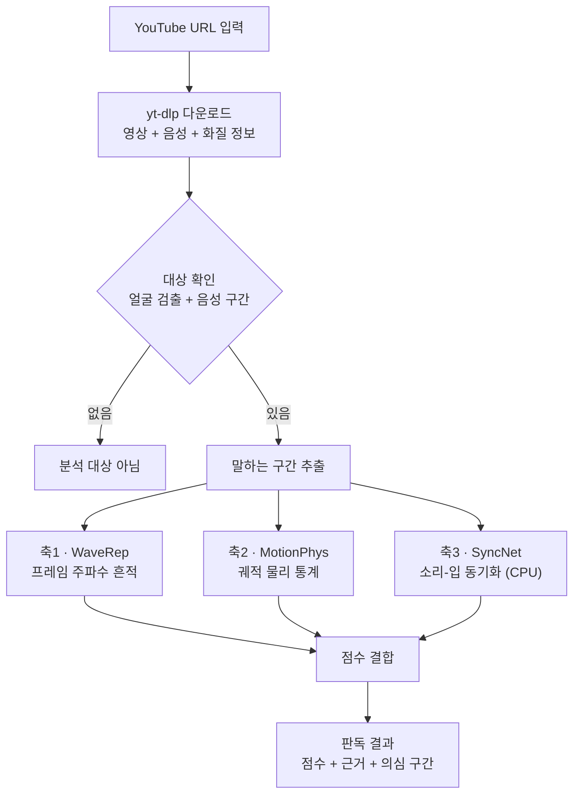
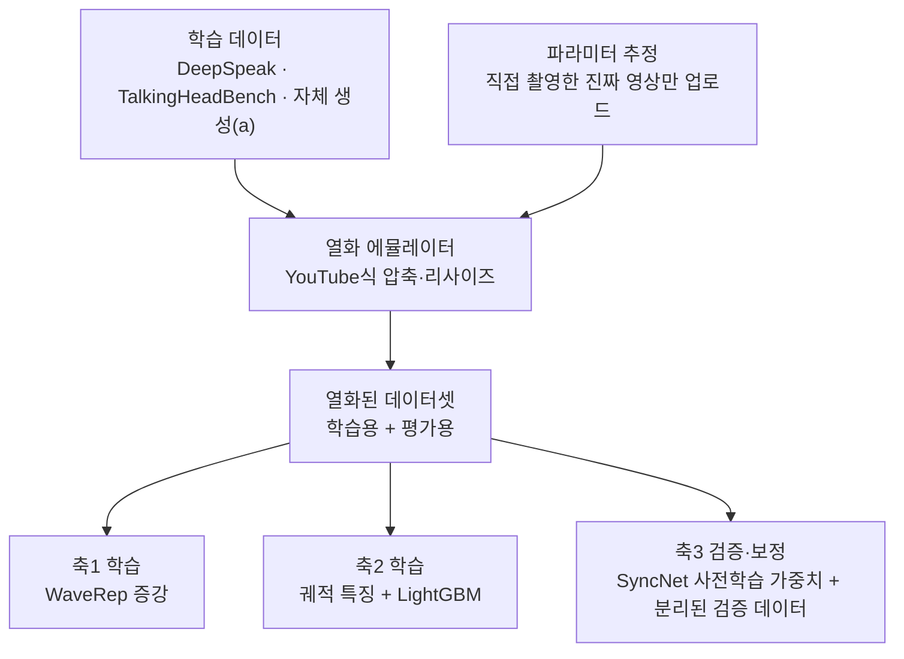
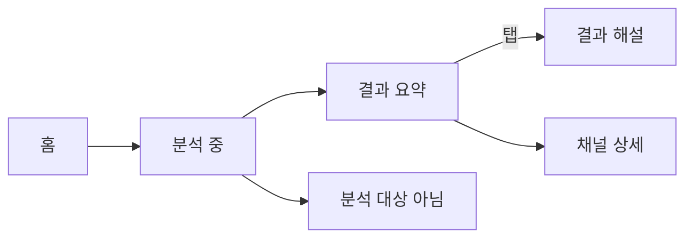

# TRINITY

> 사람이 나와서 말하는 영상이 AI로 생성·조작됐는지 판독하는 앱 (졸업작품)
>
> README v5.2 · Apple Silicon 실행 환경 재설계 · 축3 SyncNet 후보 채택(성능 검증 전) · 구현 전 검증 단계
>
> **v5.1 변경:** 학습·평가 데이터셋 확정(§6.1) · 평가에서 가짜 영상의 YouTube 업로드 제거(§6.3) · (a) 유형에 영상+음성 동시 생성 포함, 소량 자체 생성(§6.1) · 축3의 립싱크 취약성 반영(§4 ④)
>
> **v5.2 변경:** 축3 구현 후보를 AVH-Align에서 **SyncNet CPU**로 전환(검증 전 잠정 채택) · CUDA/AV-HuBERT/Fairseq를 필수 실행 의존성에서 제거 · Apple Silicon 실행 전략 추가(§10.1) · SyncNet의 탐지 한계와 평가 게이트 명시(§5.3, §11). **3축 결합의 성능 향상은 아직 입증되지 않았음.**

---

## 목차

1. [문제 정의](#1-문제-정의)
2. [시스템 개요](#2-시스템-개요)
3. [판독 파이프라인](#3-판독-파이프라인)
4. [왜 3축인가](#4-왜-3축인가)
5. [각 축 상세](#5-각-축-상세)
6. [학습 데이터와 데이터 위생](#6-학습-데이터와-데이터-위생)
7. [앱 (Flutter)](#7-앱-flutter)
8. [API (초안)](#8-api-초안)
9. [레포 구조 (초안)](#9-레포-구조-초안)
10. [실행 방법](#10-실행-방법)
11. [진행 현황과 검증 계획](#11-진행-현황과-검증-계획)
12. [한계](#12-한계)
13. [로드맵](#13-로드맵)
14. [참고문헌](#14-참고문헌)

---

## 1. 문제 정의

TRINITY는 **"사람이 속는 문제"**에서 출발했습니다. 동물이나 풍경이 가짜여도 사람이 그것 때문에 속을 이유는 크지 않습니다. 실제 피해는 **사람이 나와서 말하는 영상**이 가짜일 때 생깁니다.

**탐지 대상:** YouTube 영상 중 사람이 등장해 말하는 구간

**위조 유형:**

| 유형 | 설명 | 예 |
|---|---|---|
| (a) 인물 전체 생성 | 인물과 음성을 AI가 처음부터 생성 | 영상+음성 동시 생성 모델(Veo·Sora류), AI 아바타, 사진 한 장 기반 토킹헤드 |
| (b) 음성 교체 + 립싱크 | 실제 인물 영상에 합성 음성을 넣고 입 모양을 맞춤 | TTS + 립싱크 모델 |
| (c) 얼굴 교체 | 실제 음성은 두고 얼굴만 교체 | face swap |

**범위 밖:** 사람이나 음성이 없는 영상(“분석 대상 아님”으로 응답), 이미지, YouTube 외 플랫폼

---

## 2. 시스템 개요

**Thin Client, Fat Server** 구조입니다.

| 구성 | 내용 |
|---|---|
| 클라이언트 | Flutter 단일 코드베이스로 iOS · Android · Web 지원 |
| 입력 | 모바일: YouTube 앱 공유 시트로 링크 전달 / 웹: URL 붙여넣기 |
| 서버 | FastAPI, 맥북 셀프호스팅 (데모 시 ngrok 터널링) |
| 판단 주체 | 서버 AI 분석만 사용 (커뮤니티 투표 없음) |
| 결과 | 검증된 종합 점수 + 축별 지표·분석 가능 상태 + 판단 근거 + (구현 후) 의심 구간 |

---

## 3. 판독 파이프라인

### 3.1 실행 단계 (영상 1개 판독)



| 단계 | 하는 일 | 도구 |
|---|---|---|
| 다운로드 | 재인코딩된 영상·음성과 해상도·비트레이트 확보 | yt-dlp, ffprobe |
| 대상 확인 | 말하는 사람이 없으면 점수를 내지 않고 종료 | 얼굴 검출, 음성 구간 검출(VAD) — 모델 미정 |
| 구간 추출 | 말하는 구간만 짧은 클립으로 분할 | ffmpeg |
| 3축 판독 | 축별 점수와 근거 산출 | §5 참고 |
| 점수 결합 | 축 점수를 종합 점수로 결합 | 방식 미정 (§5.4) |

> “분석 대상 아님”을 따로 두는 이유: 풍경 영상에 낮은 점수를 주면 사용자가 “진짜로 판정됐다”고 오해할 수 있기 때문입니다.

### 3.2 학습 단계



실제 입력은 YouTube가 재인코딩한 영상이므로, 학습 데이터에도 같은 열화를 입혀 학습 조건을 실전과 맞춥니다. **축3 SyncNet은 우선 사전학습 가중치로 평가하며, 재학습을 전제로 하지 않습니다.** 필요하면 검증 데이터로 점수를 보정하고, 별도 테스트 데이터로 평가합니다(§6.3).

---

## 4. 왜 3축인가

### ① 출발점: 저수준 / 고수준 이분법

패시브(콘텐츠 기반) 탐지는 크게 두 계층으로 나뉩니다. 딥페이크 이미지 탐지 종합 리뷰(ScienceDirect, 2026.3)는 공간·주파수 단서(저수준)와 의미·생리학 단서(고수준)로 분류하고, [TriDF](https://arxiv.org/abs/2512.10652)도 Quality Artifacts와 Semantic Artifacts로 같은 경계를 긋습니다. 경계의 조작적 정의는 [Alpha Blending Hypothesis](https://arxiv.org/abs/2605.10334)를 따릅니다. 저수준 아티팩트는 영상 내용과 무관하게 생기고, 고수준 오류는 장면 내용을 봐야 드러납니다.

| | 저수준 | 고수준 |
|---|---|---|
| 무엇의 흔적인가 | 생성·처리 과정 | 묘사된 세계의 규칙 위반 |
| 내용과의 관계 | 무엇을 찍었든 발생 | 장면 속 내용이 있어야 드러남 |

### ② 고수준을 둘로 나누는 기준: 증거가 어디에 있는가

- **영상 안의 시간 흐름:** 움직임이 물리 법칙(관성, 연속적인 힘)을 따르는가. 영상만으로 판단합니다.
- **영상과 소리 사이:** 입 모양과 발화가 맞물리는가. 영상과 음성을 함께 봐야 판단할 수 있습니다.

두 단서는 입력이 다르고 잡아내는 위조 유형도 다릅니다. 하나의 축으로 합치면 한쪽이 다른 쪽을 대신할 수 없는 영역이 생깁니다.

### ③ 결과: 3축

| 축 | 계층 | 증거 위치 | 방법 | 보는 것 |
|---|---|---|---|---|
| 축1 신호 | 저수준 | 프레임 내부 | WaveRep | 압축 후에도 남는 생성기 주파수 흔적 |
| 축2 물리 | 고수준 | 시간 흐름 | MotionPhys | 궤적의 곡률 · 각속도 · jerk |
| 축3 정합 | 고수준 | 영상 ↔ 음성 | SyncNet (후보) | 입 모양과 음성의 시간적 동기화 |

축2는 물체가 무엇인지 인식하지 않지만, 판단 근거가 “장면 속 물체가 어떻게 움직였는가”라는 내용 자체에 있습니다. 내용과 무관하게 생기는 흔적이 아니므로 고수준으로 분류합니다.

### ④ 왜 2축이 아닌가

대상이 “말하는 사람 영상”이면 위조는 세 유형(§1)이고, 고수준 축 하나로는 모두 덮을 수 없습니다. 아래 역할 분담은 **설계 가설**이며 §11의 실험으로 검증합니다.

| 위조 유형 | 축1 | 축2 | 축3 |
|---|---|---|---|
| (a) 인물 전체 생성 | 주력 | 주력 | 약함 가능성 높음·검증 필요 |
| (b) 음성 교체 + 립싱크 | 보조 | 검증 필요 | 립싱크 불일치 시 보조¹ |
| (c) 얼굴 교체, 음성은 진짜 | 주력 | 보조 | 약함 |

축3만 있으면 진짜 음성을 쓴 얼굴 교체(c)를 놓치고, 축2만 있으면 음성 조작(b)을 볼 수 없습니다.

¹ **SyncNet은 진위 판별 모델이 아니라 동기화 측정 모델**입니다. 잘 맞는 합성 립싱크와 영상·음성 동시 생성(a)은 놓칠 수 있고, 편집으로 어긋난 진짜 영상에서 오경보가 날 수 있습니다. 축3이 위조 유형 (b)에 유용한지는 별도 실험으로 검증합니다(§11). 고도화된 립싱크에 대한 문제는 [TFDBench](https://neurips.cc/virtual/2026/163771)와도 비교합니다.

### ⑤ 왜 4축이 아닌가

언어 모델이 장면을 서술하며 추론하는 계열은 계산 비용이 커서 셀프호스팅 서버에 맞지 않고, 판단 근거가 모델의 서술에 의존해 검증하기 어렵습니다. 향후 과제로 둡니다(§13). 출처증명(액티브)은 패시브 3축과 성격이 달라 별도 계층으로 다룹니다.

---

## 5. 각 축 상세

### 5.1 축1 · 신호 — WaveRep

| 항목 | 내용 |
|---|---|
| 근거 논문 | Corvi et al., [*Seeing What Matters*](https://arxiv.org/abs/2506.16802) (arXiv:2506.16802) |
| 입력 | 말하는 구간에서 추출한 프레임 |
| 방법 | 프레임 단위 탐지기(논문 기준 DINOv2) + 학습 시 포렌식 증강 — 진짜 영상을 오토인코더로 재구성한 가짜 추가, 웨이블릿 대역 중 기저·가로·세로 대역을 진짜 영상 것으로 교체(대각선 중~고주파 대역은 유지) |
| 출력 | 구간별 점수 |
| 결정 필요 | 공개 코드 fine-tune vs 직접 학습 (라이선스·학습 자원 확인 필요) |
| 주의 | 강한 압축(H.264 CRF 32)에서 성능 저하 보고. 다른 벤치마크(AIGVDBench, [TRACE 논문](https://arxiv.org/abs/2609.25775)의 재현 결과)에서 무작위 수준 결과가 보고되어 원인 확인 필요 |

### 5.2 축2 · 물리 — MotionPhys

| 항목 | 내용 |
|---|---|
| 근거 논문 | He et al., [*MotionPhys*](https://arxiv.org/abs/2608.20770) (arXiv:2608.20770) |
| 입력 | 말하는 구간 클립 |
| 방법 | Shi-Tomasi 코너 + 격자점 → 피라미드 Lucas-Kanade 추적 → 8·12·24프레임 스케일 궤적 → 곡률·각속도·jerk 통계 504차원 → LightGBM |
| 출력 | 클립별 점수 + 이상이 큰 특징군(곡률/각속도/jerk) |
| 장점 | 가벼움(대형 영상 모델 불필요), 물리량 기반이라 근거 설명이 쉬움 |
| 주의 | 논문은 압축 실험 없음. 움직임이 적은 토킹헤드 영상에서의 성능은 검증 필요 |

### 5.3 축3 · 정합 — SyncNet (잠정 후보)

| 항목 | 내용 |
|---|---|
| 원전 | Chung & Zisserman, *Out of time: automated lip sync in the wild* (2016), [원본 코드](https://github.com/joonson/syncnet_python) |
| macOS 후보 구현 | [nawta/SyncNet_py309_313](https://github.com/nawta/SyncNet_py309_313) (`syncnet-python` >= 0.2.3) — Apple Silicon CPU 실행 사례가 공개됨. TRINITY 내 통합은 **미검증** |
| 입력 | 얼굴 추적이 가능한 말하는 구간의 비디오 및 대응 오디오 |
| 방법 | 사전학습 SyncNet으로 입 움직임과 음성 간 시간적 동기화 비교 (사전학습 가중치 이용, 우선 CPU 추론) |
| 원시 출력 | 얼굴 트랙별 오프셋(프레임), LSE-C(클수록 동기화 우수), LSE-D(작을수록 동기화 우수) |
| TRINITY 출력 | 원시 지표와 품질·분석 가능 상태. **위조 확률 변환·보정은 미확정**, 검증 전에는 `score`를 진위 확률로 해석하지 않음 |
| 유의 | 정상 동기화 ≠ 진짜 영상. 정밀한 립싱크 합성·영상+음성 동시 생성은 놓칠 수 있고, 지연된 진짜 영상은 오경보 가능 |
| 남은 결정 | 테스트 세트의 위조 유형별 AUC 및 낮은 FPR 성능 검증 후 축3 채택·보조 지표 격하·교체 중 결정 |

**대체 이유와 제한:** 기존 [AVH-Align](https://github.com/bit-ml/AVH-Align)은 CUDA 12.4 중심 연구 환경과 AV-HuBERT/Fairseq 의존성으로 macOS 유지보수 부담이 높습니다. SyncNet CPU 구현은 CUDA 없는 실행을 위한 **엔지니어링 대안**이며, AVH-Align과 같은 학습 목표나 딥페이크 탐지 성능을 제공한다는 뜻이 아닙니다. AVH-Align은 비교 연구 후보로 남기되 기본 의존성에서 제외합니다.

**실행 예시(별도 실험 환경, 가중치 확보 후):**

```bash
python3 -m pip install 'syncnet-python>=0.2.3'
syncnet-python clip.mp4 --device cpu -o results.json
```

- FFmpeg 설치 및 원본 SyncNet/S3FD 가중치가 필요합니다. 다운로드 경로와 가중치 이용 조건은 구현체 README에서 확인합니다.
- 공개 구현의 기본 실행 장치는 CUDA일 수 있으므로 **`--device cpu`를 명시**합니다.
- `best_conf`와 `min_dist`는 여러 얼굴 트랙에서 서로 다른 인물에게서 나올 수 있습니다. **발화자 식별·얼굴 트랙 일치 확인** 없이는 영상 전체 판정에 쓰지 않습니다.
- 짧은 구간·무음·가려진 입·멀티스피커는 `unavailable/low_quality`로 처리할 수 있도록 품질 기준을 실험으로 정합니다.
- 의심 구간 타임라인은 구간별 재평가를 구현·검증한 뒤 제공하며, SyncNet 원시 출력만으로 자동 확보된다고 가정하지 않습니다.

### 5.4 점수 결합

- 방식 미정. 후보: 축별 **검증된** 특징을 결합하는 선형 모델(축3 LSE-C/LSE-D 등을 그대로 확률로 취급하지 않음)
- 화질(해상도·비트레이트)이 낮을수록 축1 가중치를 낮추는 방식 검토(제안 단계)
- 종합 점수와 별개로 **축별 지표·분석 가능 상태를 함께 표시**해 근거를 추적할 수 있게 함
- 축3의 예측 기여도가 검증되지 않으면 종합 점수에서 제외하고 **동기화 참고 정보**로만 제공. 결측 축은 0점으로 대체하지 않음

---

## 6. 학습 데이터와 데이터 위생

### 6.1 데이터셋

| 용도 | 데이터 | 다루는 유형 | 접근 | 상태 |
|---|---|---|---|---|
| 주 학습 | [DeepSpeak v2](https://huggingface.co/datasets/faridlab/deepspeak_v2) — 동의한 참여자의 웹캠 토킹헤드 영상, 진짜 + 가짜(얼굴 교체·립싱크·아바타) | (a) 아바타 · (b) · (c) · 진짜 | 외부 양식 작성 후 Hugging Face 조건 동의 | 신청 예정 |
| (a) 보강 | [TalkingHeadBench](https://arxiv.org/abs/2505.24866) — 사진 한 장을 음성·영상으로 구동한 토킹헤드 | (a) 사진 기반 | 공개 범위·조건 확인 필요 | 확인 필요 |
| (a) 보강 | 자체 생성 — 영상+음성 동시 생성 모델(Veo·Sora류)로 만든 가상 인물 발화 영상 소량(20~50개) | (a) 동시 생성 | 생성 서비스 약관·비용 확인 | 미정 |
| 축3 검증·보정 | SyncNet 원본 사전학습 가중치(별도 확보), DeepSpeak 진짜/가짜 검증 분할 | 전부 | 가중치 사용 조건 확인 및 데이터 접근 | 미정 |
| 점수 결합 학습 | DeepSpeak 검증 분할(학습에 쓰지 않은 사람) | 전부 | 위와 동일 | — |
| 실전 평가 | [Deepfake-Eval-2024](https://arxiv.org/abs/2503.02857) — 2024년 SNS에서 실제 유통된 영상 중 말하는 사람 구간만 선별 | 혼합(유형 라벨 여부 확인 필요) | 기관 이메일 + 관련 작업 링크 제출(2027년 5월까지 심사) | 신청 예정 |
| 압축 설정 추정 | 직접 촬영한 진짜 영상만 비공개 업로드(해상도당 50개 미만) | 진짜 | — | 미정 |
| 참조 | [AV-Deepfake1M++](https://arxiv.org/abs/2507.20579) — 진짜 영상의 일부 구간을 조작한 데이터 중심 | (b) 중심 | 연구 전용 EULA | 참조만 |

**도메인 차이 주의:** DeepSpeak은 웹캠 화상회의 환경이라 YouTube의 촬영·편집 환경과 다릅니다. 이 차이는 Deepfake-Eval-2024 평가로 따로 확인합니다(§11).

### 6.2 YouTube 열화 에뮬레이터

Montibeller et al.([arXiv:2508.08765](https://arxiv.org/abs/2508.08765))의 방식을 따릅니다. 영상을 실제로 업로드했다가 다시 받아 플랫폼의 압축·리사이즈 파라미터를 추정하고, 그 값으로 대량의 학습 데이터에 같은 열화를 로컬에서 재현합니다. 원 논문은 해상도당 50개 미만의 업로드로 정확한 재현이 가능하다고 보고합니다.

**업로드에는 직접 촬영한 진짜 영상만 비공개로 사용하고, 데이터셋 영상이나 가짜 영상은 올리지 않습니다.**

### 6.3 평가 설계

학습에 쓴 열화와 **다른 조건**으로 평가합니다([AV-Deepfake1M++](https://arxiv.org/abs/2507.20579)의 학습/테스트 열화 분리 방식 참고). 평가 세트는 세 가지입니다.

1. **실전 유통본:** Deepfake-Eval-2024의 말하는 사람 구간 — 실제 플랫폼 압축을 이미 거친 영상
2. **조건 분리:** DeepSpeak 테스트 분할에, 학습 때 쓰지 않은 에뮬레이터 설정(해상도·비트레이트)을 적용
3. **(a) 동시 생성:** 자체 생성 영상 중 학습에 쓰지 않은 부분

지표: AUC, ACC@5% FPR, 위조 유형(a·b·c)별 성능, 압축 조건별 성능. **축3은 원시 동기화 지표 자체의 분포와 오탐률도 보고하고, 점수 보정·융합을 한다면 검증/테스트 분리**를 적용합니다.

### 6.4 데이터 위생 (`training/hygiene.py`)

| 점검 항목 | 이유 |
|---|---|
| 사람(ID) 단위로 학습·검증·테스트 분할 | 같은 사람이 학습과 평가에 동시에 나오면 위조 흔적 대신 얼굴을 외우는 지름길이 생김 |
| 앞부분 무음 제거·무작위화 | 기존 오디오-비주얼 데이터셋에서 가짜 영상 앞부분 무음만으로 진짜/가짜가 거의 구분되는 편향이 보고됨([AVH-Align 논문](https://arxiv.org/abs/2412.00175)) |
| 진짜/가짜의 인코딩·해상도·길이 맞추기 | 형식 차이를 탐지 단서로 학습하는 지름길 방지 |
| 같은 내용끼리 짝짓기 | 내용 차이로 구분하는 지름길 방지(WaveRep의 프롬프트 짝짓기 방식) |
| 도메인 편향 점검 | 특정 인물·촬영 환경·언어에 과적합 방지 |

### 6.5 라이선스·약관·윤리

- 이 레포에는 어떤 데이터셋의 영상이나 파생물도 포함하지 않습니다. 데이터 로더와 사람(ID) 분할 목록만 둡니다.
- DeepSpeak: 접근 양식과 이용 조건을 따르고, 사용 시 출처를 표기합니다(정확한 라이선스 조건 확인 필요).
- Deepfake-Eval-2024: 연구 목적 접근 심사를 거치며(2027년 5월까지), 라이선스는 CC-BY-SA-4.0입니다.
- AV-Deepfake1M++: 연구 전용 EULA를 따릅니다.
- SyncNet 코드/패키지의 MIT·Apache-2.0 고지와 **모델 가중치의 별도 이용 조건**을 각각 확인합니다. 코드 라이선스가 가중치까지 자동으로 허용하지는 않습니다.
- 자체 생성 (a): 실존 인물의 얼굴·목소리는 쓰지 않고 가상 인물만 만들며, 생성 서비스 약관을 따르고 공개 게시하지 않습니다.
- YouTube 영상 다운로드는 서비스 약관 허용 범위 확인 필요

---

## 7. 앱 (Flutter)

| 항목 | 내용 |
|---|---|
| 플랫폼 | iOS · Android · Web (단일 코드베이스) |
| 입력 | 모바일: YouTube 공유 시트 / 웹: URL 붙여넣기 (웹은 공유 시트 수신 불가) |
| 네비게이션 | 탭바 없는 스택 네비게이션 |
| 디자인 | Bold Typography 다크 스타일 · 배경 `#0A0A0A` · 액센트 `#FF3D00` · Inter Tight + JetBrains Mono |

**화면 흐름**



| 화면 | 내용 |
|---|---|
| 홈 | URL 입력, 최근 분석 |
| 분석 중 | 단계별 진행 상태(다운로드 → 대상 확인 → 3축 판독) |
| 결과 요약 | 검증된 종합 점수, 축별 지표/상태 3개, 화질 경고 |
| 결과 해설 | 축별 판단 근거, 검증 후 제공할 의심 구간 타임라인 (요약 화면과 별도 화면) |
| 채널 상세 | 채널 단위 분석 이력 (Phase 2) |

> 웹 빌드에서는 서버에 CORS 설정이 필요합니다.

---

## 8. API (초안)

| 메서드 | 경로 | 설명 |
|---|---|---|
| `POST` | `/analyze` | `{ "url": "..." }` → 작업 ID 반환 |
| `GET` | `/jobs/{job_id}` | 진행 상태와 결과 조회 |
| `GET` | `/channels/{channel_id}` | 채널 단위 분석 이력 집계 (Phase 2) |

**결과 응답 예시 (초안)**

```json
{
  "status": "done",
  "in_scope": true,
  "overall_score": 0.82,
  "axes": {
    "signal":    { "score": 0.71, "evidence": "..." },
    "physics":   { "score": 0.88, "evidence": "jerk 통계 이상" },
    "alignment": { "status": "measured", "model": "SyncNet", "offset_frames": 1, "lse_c": 4.53, "lse_d": 9.24, "authenticity_score": null }
  },
  "quality": { "height": 720, "bitrate_kbps": 1800, "warning": null }
}
```

말하는 사람이 없으면 `"in_scope": false`로 점수 없이 응답합니다.

---

## 9. 레포 구조 (초안)

```
TRINITY/
├── app/                    # Flutter (iOS · Android · Web)
├── server/
│   ├── main.py             # FastAPI 진입점
│   ├── ingest/             # yt-dlp, ffprobe
│   ├── gate/               # 얼굴·음성 확인, 말하는 구간 추출
│   ├── axes/
│   │   ├── signal/         # 축1 WaveRep
│   │   ├── physics/        # 축2 MotionPhys
│   │   └── alignment/      # 축3 SyncNet (CPU)
│   └── fusion/             # 점수 결합
├── training/
│   ├── datasets/           # 데이터 로더 · 사람(ID) 단위 분할 목록 (데이터 자체는 미포함)
│   ├── emulator/           # YouTube 열화 에뮬레이터
│   └── hygiene.py          # 데이터 위생 점검
└── docs/
```

---

## 10. 실행 방법

> 구현 진행에 따라 갱신합니다. 아래 서버·앱 명령은 **구현 후 실행을 위한 초안**이며, 현재 기능의 실행을 보장하지 않습니다.

### 10.1 Apple Silicon (macOS ARM64) 실행 전략

| 컴포넌트 | 실행 장치 | 전략 및 검증 상태 |
|---|---|---|
| WaveRep / DINOv2 | MPS 우선, 미지원 연산은 CPU | 모델 가중치 로딩·웨이블릿 처리·추론 테스트 필요 |
| MotionPhys / OpenCV·NumPy·LightGBM | CPU | CUDA 불필요한 구현을 우선; 논문 재현 및 속도 검증 필요 |
| SyncNet / 얼굴 추적·오디오-비디오 정합 | **CPU** | 외부 구현에 Apple Silicon CPU 사례 있음; TRINITY 통합 테스트 필요 |
| FFmpeg·ffprobe·yt-dlp | CPU | macOS 설치·입출력 검증 |
| Flutter / FastAPI | macOS 네이티브 | 기존 계획 유지 |

- NVIDIA CUDA, Windows API, Linux 전용 GPU 패키지를 **기본 실행의 필수 의존성으로 두지 않습니다**. 현재 프로젝트 구현 전이므로 전체 코드에 그런 의존성이 없다는 보증은 아닙니다.
- PyTorch MPS를 사용할 수 있더라도 WaveRep의 모든 연산이 지원된다는 뜻은 아닙니다. `mps`와 `cpu` 각각 짧은 클립으로 확인합니다.
- SyncNet 후보는 CUDA 디폴트가 있을 수 있으므로 명시적으로 `--device cpu`를 사용합니다.
- Python 3.10 ARM64를 초기 기준으로 **검토**하되, 각 축 간 의존성 충돌이 있으면 별도 가상환경·프로세스를 사용합니다. 버전 고정은 설치 시험 후 결정합니다.
- 속도, 메모리 피크, 실패율을 측정하고 모델을 순차 실행하는 구성을 우선 검토합니다.
- SyncNet 가중치 배포·재배포 제한과 YouTube 다운로드 정책을 확인한 후 사용합니다.

**축3 단독 스모크 테스트(미실행 예시):**

```bash
# 준비: macOS용 Python, FFmpeg, SyncNet/S3FD 가중치
python3 -m pip install 'syncnet-python>=0.2.3'
syncnet-python clip.mp4 --device cpu -o results.json
```


**서버**

```bash
cd server
pip install -r requirements.txt
uvicorn main:app --reload --port 8000
ngrok http 8000        # 데모 시 외부 접속용
```

**앱**

```bash
cd app
flutter pub get
flutter run -d chrome  # Web
flutter run -d ios     # iOS
flutter run -d android # Android
```

---

## 11. 진행 현황과 검증 계획

| 항목 | 상태 |
|---|---|
| 문제 정의·범위(말하는 사람 영상) | 확정 |
| 3축 구성(WaveRep · MotionPhys · SyncNet 후보) | 구조 확정 / 축3 최종 채택 미정 |
| 열화 에뮬레이터 기반 학습 구조 | 확정 |
| 학습·평가 데이터 구성(§6.1) | 확정 · 접근 신청 중 |
| (a) 동시 생성 영상 자체 제작 | 미정 (도구·비용·약관 확인) |
| 위조 유형 (a)(b)(c) 우선순위 | 미정 |
| Apple Silicon 실행 전략 | 설계 정리 / 실측 전 |
| SyncNet 사전학습 가중치·이용 조건 | 확인 필요 |
| 점수 결합 방식·가중치 | 미정 |
| 얼굴 검출·VAD 모델 선택 | 미정 |

**구현 전 검증 항목**

1. MotionPhys가 움직임이 적은 토킹헤드 영상에서도 작동하는가
2. WaveRep이 다른 벤치마크에서 무작위 수준이었던 원인은 무엇인가
3. SyncNet의 LSE-C/LSE-D로 (a) 동시 생성 영상을 구별할 수 있는가 (실패 가능성이 높으므로 검증)
4. YouTube 열화 에뮬레이터를 재현할 수 있는가, SyncNet 코드·가중치 이용 조건과 Mac CPU 실행이 적합한가
5. SyncNet(축3)이 최신 립싱크 생성기로 만든 (b) 유형에서 유의미한 탐지 성능을 내는가
6. 웹캠 환경 데이터(DeepSpeak)로 학습·보정한 모델이 실제 유통 영상(Deepfake-Eval-2024)에서도 성능을 유지하는가
7. SyncNet의 동기화 지표가 세 축 점수 결합에서 **추가적인** 성능 이득을 주는가 (축3 제외/포함 비교)
8. WaveRep의 MPS 동작, MotionPhys CPU 동작, SyncNet CPU 동작의 추론 시간·메모리·오류율은 얼마인가

---

## 12. 한계

- 판독 결과는 확률적 추정이며, 단독으로 진위를 확정하는 근거로 쓰면 안 됩니다.
- 말하는 사람이 없는 영상은 분석하지 않습니다.
- 진짜 음성을 쓴 얼굴 교체(c)는 축3이 약하므로 축1·2에 의존합니다.
- SyncNet은 **동기화 검사**일 뿐, 딥페이크 진위 확률을 직접 제공하지 않습니다. 잘 동기화된 가짜와 편집으로 어긋난 진짜를 구별하지 못할 수 있습니다.
- SyncNet이 실제 탐지 성능에 기여하지 못하면 축3은 종합 점수에서 제외하고 보조 정보로만 표시합니다.
- 강한 압축에서는 축1 성능이 떨어질 수 있습니다.
- 축별 성능 수치는 원 논문의 보고치이며, 이 프로젝트의 조건(YouTube 열화, 말하는 사람 영상)에서는 아직 측정 전입니다.
- 주 학습 데이터(DeepSpeak)는 웹캠 화상회의 환경이라 YouTube 촬영·편집 환경과 차이가 있습니다.
- 영상+음성 동시 생성(a) 데이터는 소량 자체 생성에 의존하므로, 이 유형의 성능 추정은 불확실성이 큽니다.
- Apple Silicon 호환은 일부 구성 라이브러리 및 외부 공개 실행 사례에 근거한 **계획**이며, TRINITY 전체 파이프라인의 동작을 검증한 것은 아닙니다.

---

## 13. 로드맵

| 단계 | 내용 |
|---|---|
| Phase 0 | Apple Silicon에서 3축 단독 스모크 테스트, 데이터 접근·가중치·라이선스 확인, 축3의 성능 기여 검증 |
| Phase 1 | 단일 영상 분석 — 대상 확인 + 검증된 축 결합 + 결과·해설 화면 |
| Phase 2 | YouTube 채널 ID 기준 분석 이력 누적·집계 |
| 향후 | 출처 확인 계층(C2PA, 플랫폼 AI 라벨)과 패시브 판독과의 무결성 충돌 처리 |
| 향후 | 시각적 증거(스펙트럼 잔차 히트맵, 구간별 물리 불일치 히트맵) |
| 향후 | 언어 모델 기반 세계 추론 계층 |
| 향후 | YouTube 외 플랫폼 |

---

## 14. 참고문헌

**탐지 축**

- Corvi et al. [*Seeing What Matters: Generalizable AI-generated Video Detection with Forensic-Oriented Augmentation.*](https://arxiv.org/abs/2506.16802) arXiv:2506.16802 (NeurIPS 2025) — 축1 · [코드](https://github.com/grip-unina/WaveRep-SyntheticVideoDetection)
- He et al. [*MotionPhys: Detecting AI-Generated Videos via Physical Consistency of Optical-Flow Trajectories.*](https://arxiv.org/abs/2608.20770) arXiv:2608.20770 — 축2
- Chung & Zisserman. [*Out of time: automated lip sync in the wild.*](https://www.robots.ox.ac.uk/~vgg/software/lipsync/) (2016) — 축3 SyncNet 원전 · [원본 코드](https://github.com/joonson/syncnet_python)
- [SyncNet_py309_313](https://github.com/nawta/SyncNet_py309_313) — 축3 macOS CPU 후보 구현. 검증된 것은 해당 저장소의 공개 사례이며 본 프로젝트의 실험 결과는 아님.
- Smeu et al. [*Circumventing Shortcuts in Audio-visual Deepfake Detection Datasets with Unsupervised Learning.*](https://arxiv.org/abs/2412.00175) CVPR 2025, arXiv:2412.00175 — **이전 축3 AVH-Align, 비교 연구 후보** · [코드](https://github.com/bit-ml/AVH-Align)

**학습·평가**

- Montibeller et al. [*Bridging the Gap: A Framework for Real-World Video Deepfake Detection via Social Network Compression Emulation.*](https://arxiv.org/abs/2508.08765) arXiv:2508.08765 · [DOI:10.1145/3746265.3759670](https://doi.org/10.1145/3746265.3759670) — 열화 에뮬레이터
- Cai et al. [*AV-Deepfake1M++: A Large-Scale Audio-Visual Deepfake Benchmark with Real-World Perturbations.*](https://arxiv.org/abs/2507.20579) ACM MM 2025, arXiv:2507.20579 — 평가 설계 참고

**데이터셋**

- Barrington, Bohacek, Farid. [*The DeepSpeak Dataset.*](https://arxiv.org/abs/2408.05366) arXiv:2408.05366 — 주 학습 데이터 · [Hugging Face](https://huggingface.co/datasets/faridlab/deepspeak_v2)
- Chandra et al. [*Deepfake-Eval-2024: A Multi-Modal In-the-Wild Benchmark of Deepfakes Circulated in 2024.*](https://arxiv.org/abs/2503.02857) arXiv:2503.02857 — 실전 평가
- [*TalkingHeadBench: A Multi-Modal Benchmark & Analysis of Talking-Head DeepFake Detection.*](https://arxiv.org/abs/2505.24866) arXiv:2505.24866 — (a) 보강
- [*TFDBench: A Comprehensive Benchmark and Codebase for Talking-Face Deepfake Detection.*](https://neurips.cc/virtual/2026/163771) NeurIPS 2026 (arXiv 번호 확인 필요) — 축3 립싱크 취약성 근거

**분류 체계 (§4)**

- [*Alpha Blending Hypothesis.*](https://arxiv.org/abs/2605.10334) arXiv:2605.10334 — 저수준/고수준 경계의 조작적 정의
- [*TriDF.*](https://arxiv.org/abs/2512.10652) arXiv:2512.10652 — Quality Artifacts vs Semantic Artifacts
- [*Countering synthetic realities: Advances, challenges, and future directions in deepfake image detection.*](https://www.sciencedirect.com/science/article/pii/S2772941926000396) ScienceDirect, 2026.3 — 공간·주파수 vs 의미·생리학 분류

**비교·참고**

- Chang et al. [*What Matters in Detecting AI-Generated Videos like Sora?*](https://arxiv.org/abs/2406.19568) arXiv:2406.19568
- Cao et al. [*TRACE: Trajectory Representation and Consistency Estimation for AI-Generated Video Detection.*](https://arxiv.org/abs/2609.25775) arXiv:2609.25775
