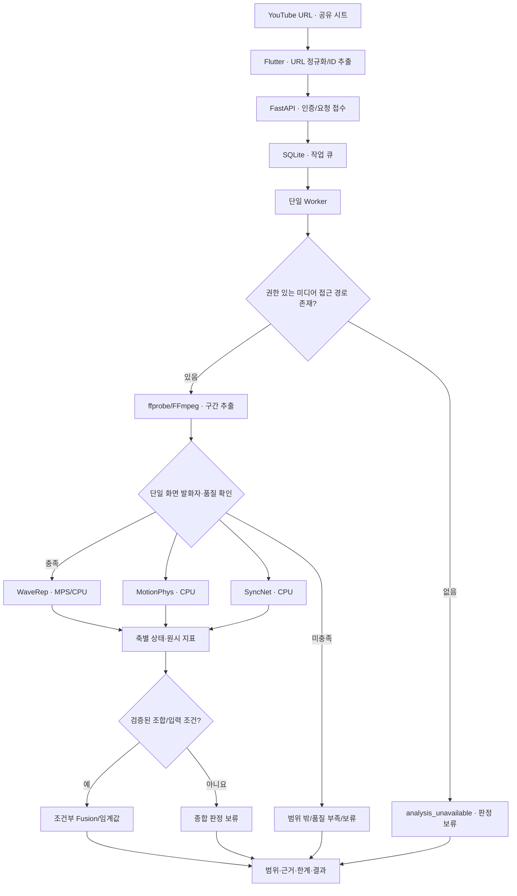

# TRINITY

> **Signals speak. Provenance testifies. Semantics verify.**
>
> **YouTube에서 누군가의 말을 믿기 전, 공유 한 번으로 AI 생성·조작 의심 신호를 확인하는 서비스**
>
> **설계 문서 v6.0 · 최종 설계 기준안 (결정 1~12 반영) · 구현/실증 이전**

**상태:** 본 문서는 **구현 명세와 실험 계획**입니다. 사용자 대상 YouTube 링크 분석, Apple Silicon 모델 구동, 데이터셋 접근, 검출 성능은 현재 TRINITY에서 완료되었다고 주장하지 않습니다. *설계 결정*과 *검증 완료*는 다릅니다.

**최상위 제품 원칙:** 사용자는 영상 파일을 다운로드하거나 업로드하지 않습니다. **YouTube 링크를 붙여넣거나 YouTube 공유 메뉴에서 TRINITY를 선택**하는 것이 유일한 기본 입력입니다. 다만 YouTube URL만으로 원본 영상/음성에 접근할 권한이 자동으로 생기지는 않습니다. 비공개 연구·시연 경로의 운영 조건은 §15.3의 2026-11-26 결정을 따릅니다. 분석 가능한 미디어 확보는 **출시를 가로막을 수 있는 독립적인 P0 과제**입니다.

**연구 목표:** 단일 화면 발화자가 확인되는 토킹헤드 영상에서 WaveRep(신호), MotionPhys/Face Motion(움직임), SyncNet(음성·입술 동기화)의 유효성을 **각각 검증**하고, 압축·새 생성기·실제 유통 환경에서의 성능과 선택적 점수 결합 효과를 비교합니다. **3축 결합의 우월성은 연구 가설이며 결과가 아닙니다.**

## 목차

1. [문제 정의와 설계 철학](#1-문제-정의와-설계-철학)
2. [제품 범위 및 성공 조건](#2-제품-범위-및-성공-조건)
3. [전체 아키텍처와 데이터 접근 관문](#3-전체-아키텍처와-데이터-접근-관문)
4. [왜 3축인가](#4-왜-3축인가)
5. [각 축 상세](#5-각-축-상세)
6. [학습 데이터와 데이터 위생](#6-학습-데이터와-데이터-위생)
7. [YouTube URL·공유 시트 제품 경험](#7-youtube-url공유-시트-제품-경험)
8. [FastAPI·Worker·SQLite 서비스 설계](#8-fastapiworkersqlite-서비스-설계)
9. [API 계약](#9-api-계약)
10. [상태, 실패, 부분 분석 및 보류](#10-상태-실패-부분-분석-및-보류)
11. [결과 설명과 사용자 신뢰](#11-결과-설명과-사용자-신뢰)
12. [Apple Silicon 환경 및 보안](#12-apple-silicon-환경-및-보안)
13. [최종 평가 프로토콜](#13-최종-평가-프로토콜)
14. [개발 우선순위와 수용 기준](#14-개발-우선순위와-수용-기준)
15. [저장소 구조·위험·결정 기록](#15-저장소-구조위험결정-기록)
16. [참고문헌](#16-참고문헌)

---

## 1. 문제 정의와 설계 철학

### 1.1 문제의 출발점

사람들은 YouTube에서 실제 인물이 발언하는 듯한 영상을 보고 사실이라고 믿기도 합니다. 영상이 AI로 생성되었거나 얼굴·음성이 조작된 경우, 시청자가 확인에 필요한 전문 도구를 직접 다루기는 어렵습니다. TRINITY는 **시청 중인 영상의 링크를 공유하고, 분석 가능한 범위에서 관찰된 단서와 불확실성을 이해할 수 있게 하는 것**을 목표로 합니다.

```text
YouTube에서 영상 시청 → 공유 → TRINITY 선택 → URL 접수
  → 적법하게 분석 가능한 미디어 확인 → 발화 구간·품질 검사
  → 탐지 모델 평가 → (검증된 경우) 종합 의심 신호
  → 분석 범위·보류 사유·근거 표시
```

- **사용자 행동 최소화:** 파일 다운로드/파일 업로드 요구 없음. URL 붙여넣기와 공유 시트만 제공.
- **정확성보다 확신을 과장하지 않음:** 분석 실패는 진짜 판정이 아님. 모델 점수는 법적 진위 증명이 아님.
- **투명성:** 관찰된 수치, 모델 추론, 해석의 한계를 구분하고, 분석한 구간만 설명.
- **연구의 정직성:** 외부 논문에 나온 성능은 TRINITY의 실측 성능이 아니며, 모델이 모두 유효할 것으로 전제하지 않음.

### 1.2 분석 범위

**초기 목표:** 한 구간에 **화면에 보이는 한 명의 발화자**를 신뢰성 있게 식별할 수 있는 말하는 사람 영상. 한 편에 여러 인물이 나와도 구간별 단일 발화자 확인이 가능한 부분만 분석 후보로 취급합니다. 얼굴과 음성이 동시에 존재한다는 사실만으로 동일 발화자라고 단정하지 않습니다.

| 위조 유형 | 설명 | 평가용 하위 유형 예시 |
|---|---|---|
| A. 인물·발화 전체 생성 | 사진 기반 말하는 얼굴, 아바타 또는 영상·음성 동시 생성 | A1 사진, A2 아바타, A3 동시 생성 |
| B. 음성 교체·립싱크 | 실제 인물 영상에 합성 음성 또는 립싱크 변환 | B1 음성 교체, B2 교체+립싱크 |
| C. 얼굴 교체 | 실제 음성은 유지하면서 얼굴만 교체·보정 | C1 교체, C2 교체+보정 |

**초기 범위 밖:** 풍경·동물만 나오는 영상, 발화자 확인 불가, 이미지·텍스트 진위 판별, 일반적인 정치·의학 발언의 사실검증, 영상의 역사적 진위에 대한 확정적인 법의학 판정. 미검증 조건은 성공 처리하지 않습니다.

## 2. 제품 범위 및 성공 조건

| 영역 | v6.0 기본 범위 | 제외/미해결 |
|---|---|---|
| 사용자 입력 | **YouTube `watch`, `youtu.be`, 지원된 Shorts URL**, 공유 시트 | MP4/MOV 업로드 UI, 연구용 어댑터 밖의 임의 URL 다운로더 |
| 미디어 확보 | 허가·승인 및 사용 조건이 확인된 데이터 접근 어댑터 | 모든 공개 YouTube 영상 자동 수집 가능하다는 가정 |
| 연구/시연 | **등록된 YouTube ID ↔ 별도 권한 보유 미디어**로 링크 중심 흐름 검증 | 등록된 원본을 YouTube 재인코딩본이라고 주장 |
| 분석 | 적합한 단일 발화 구간, 세 후보 축, 조건부 Fusion | 무조건 3축 합산, 전체 영상 진위 확정 |
| 결과 | 분석 상태·coverage·축별 원시 지표·보류 사유·설명 | 검증 전 '가짜 확률 95%' 표시 |
| 운영 | Mac 단일 서버, 인증된 제한 시연 | 다중 사용자 공개 서비스 즉시 출시 |

**서로 다른 완료 기준**을 분리합니다.

1. **연구 엔진 완성:** 권한 있는 테스트 미디어에서 파이프라인과 독립 평가 실행.
2. **링크 UX 완성:** 사용자가 URL/공유 시트로 요청하고, 등록된 허가 미디어에 대한 분석 결과 수신.
3. **범용 YouTube 서비스 가능:** 임의 영상에 필요한 미디어를 **적법하게 확보하는 접근 경로**와 운영 권한, 실제 처리본 평가가 확보된 뒤에만 주장.

## 3. 전체 아키텍처와 데이터 접근 관문



### 3.1 YouTube 미디어 접근은 구현 전 P0 관문

YouTube Data API 및 IFrame Player는 **영상 ID·메타데이터/재생**에 사용할 수 있지만, AI 추론을 위한 원본 프레임·오디오 파일을 일반적으로 제공하는 API가 아닙니다. YouTube [서비스 이용약관](https://www.youtube.com/t/terms)과 [API 개발자 정책](https://developers.google.com/youtube/terms/developer-policies)은 콘텐츠 접근·다운로드·캐싱을 제한합니다. **권리자의 동의만으로 YouTube 플랫폼의 별도 승인 요건이 자동 충족된다고 가정하지 않습니다.** API 정책이 적용되는 작업에는 필요한 YouTube의 사전 서면 승인과 콘텐츠 권한을 함께 검토합니다.

**접근 추상화 (구현 필수):**

```text
MediaResolver.resolve(youtube_video_id) ->
  Available(local_authorized_media_path, provenance, access_basis)
  | Unavailable(reason_code)
```

- `YouTubeMetadataAdapter`: 공식 지원 범위에서 영상 ID/메타데이터 확인. 디코딩용 미디어는 제공하지 않음.
- `AuthorizedMediaRegistry`: **실험·시연용으로 허가된 미디어와 YouTube ID를 연결**, 허가 출처·원본/플랫폼 처리본 여부를 기록. 사용자는 파일을 올리지 않음.
- `ApprovedPlatformAccessAdapter`: 플랫폼/콘텐츠 양측의 필요한 접근 권한과 구현 경로가 확보된 **후에만** 활성화하는 인터페이스. 공개 서비스에서는 미구현 상태 유지. 비공개 연구 시연은 §15.3의 연구용 다운로드 어댑터를 사용한다.
- `Unavailable`: 미디어가 없거나 접근 권한이 없으면 `video_access_unavailable`/`access_not_authorized`로 종료하고 **점수 생성 금지**.

**개발 우선순위상 결론:** URL 파싱/UI만 먼저 만들고 '영상 분석 기능 완성'이라고 할 수 없습니다. 반대로 허가된 미디어 기반 엔진을 개발하되 제품 입력 철학을 파일 업로드로 바꾸지도 않습니다.

### 3.2 분석 및 학습의 경계

사용자의 URL은 데이터 소스의 **식별자**이며 영상 데이터 자체가 아닙니다. 분석 Worker만 접근이 승인된 미디어 어댑터의 출력을 사용합니다. 학습 자료는 별도의 연구 저장소에서 관리하며 **실사용자 요청에서 자동 수집/학습하지 않습니다.**

## 4. 왜 3축인가

### ① 출발점: 저수준 / 고수준 이분법

패시브(콘텐츠 기반) 탐지는 크게 두 계층으로 나뉩니다. 딥페이크 이미지 탐지 종합 리뷰(ScienceDirect, 2026.3)는 공간·주파수 단서(저수준)와 의미·생리학 단서(고수준)로 분류하고, [TriDF](https://arxiv.org/abs/2512.10652)도 Quality Artifacts와 Semantic Artifacts로 같은 경계를 긋습니다. 경계의 조작적 정의는 [Alpha Blending Hypothesis](https://arxiv.org/abs/2605.10334)를 따릅니다. 저수준 아티팩트는 영상 내용과 무관하게 생기고, 고수준 오류는 장면 내용을 봐야 드러납니다.

| | 저수준 | 고수준 |
|---|---|---|
| 무엇의 흔적인가 | 생성·처리 과정 | 묘사된 세계의 규칙 위반 |
| 내용과의 관계 | 무엇을 찍었든 발생 | 장면 속 내용이 있어야 드러남 |

### ② 고수준을 둘로 나누는 기준: 증거가 어디에 있는가

- **영상 안의 시간 흐름:** 움직임이 물리 법칙(관성, 연속적인 힘)을 따르는가. 영상만으로 판단합니다.
- **영상과 소리 사이:** 입 모양과 발화가 맞물리는가. 영상과 음성을 함께 봐야 판단할 수 있습니다.

두 단서는 입력이 다르고 잡아내는 위조 유형도 다릅니다. 하나의 축으로 합치면 한쪽이 다른 쪽을 대신할 수 없는 영역이 생깁니다.

### ③ 결과: 3축

| 축 | 계층 | 증거 위치 | 방법 | 보는 것 |
|---|---|---|---|---|
| 축1 신호 | 저수준 | 프레임 내부 | WaveRep | 생성 영상과 연관된 신호·주파수 특징(압축 후 보존 여부는 실험) |
| 축2 물리 | 고수준 | 시간 흐름 | MotionPhys 기본 + 얼굴 특화 후보 | 궤적의 곡률 · 각속도 · jerk / 얼굴 특징점 움직임 |
| 축3 정합 | 관계 단서 | 영상 ↔ 음성 | SyncNet (보조 후보) | 입 모양과 음성의 동기화(진위 판별과 다름) |

축2는 원본에서는 물체의 의미를 인식하지 않지만 궤적의 시간적 일관성을 분석합니다. 얼굴 특화 접근은 별도 비교 후보입니다. 축3은 진위 탐지 모델이 아니라 동기화 측정 모델이므로 **서로 다른 증거가 반드시 상호 보완적이라는 주장은 검증되지 않았습니다.**

### ④ 왜 2축이 아닌가

서로 다른 위치에서 증거를 수집한다는 **3축 연구 가설**을 시험합니다. 아래 역할 분담은 기대 효과일 뿐, 특정 위조 유형을 반드시 탐지한다는 보장은 없습니다. 2축 모델이 더 좋다면 세 번째 축은 보조 정보로 남깁니다(§14).

| 위조 유형 | 축1 | 축2 | 축3 |
|---|---|---|---|
| (a) 인물 전체 생성 | 주력 | 주력 | 약함 가능성 높음·검증 필요 |
| (b) 음성 교체 + 립싱크 | 보조 | 검증 필요 | 립싱크 불일치 시 보조¹ |
| (c) 얼굴 교체, 음성은 진짜 | 주력 | 보조 | 약함 |

축3만 있으면 진짜 음성을 쓴 얼굴 교체(c)를 놓치고, 축2만 있으면 음성 조작(b)을 볼 수 없습니다.

¹ **SyncNet은 진위 판별 모델이 아니라 동기화 측정 모델**입니다. 잘 맞는 합성 립싱크와 영상·음성 동시 생성(a)은 놓칠 수 있고, 편집으로 어긋난 진짜 영상에서 오경보가 날 수 있습니다. 축3이 위조 유형 (b)에 유용한지는 별도 실험으로 검증합니다(§14). 고도화된 립싱크에 대한 문제는 [TFDBench](https://neurips.cc/virtual/2026/163771)와도 비교합니다.

### ⑤ 왜 4축이 아닌가

언어 모델이 장면을 서술하며 추론하는 계열은 계산 비용이 커서 셀프호스팅 서버에 맞지 않고, 판단 근거가 모델의 서술에 의존해 검증하기 어렵습니다. 향후 과제로 둡니다(§15). 출처증명(액티브)은 패시브 3축과 성격이 달라 별도 계층으로 다룹니다.

---

## 5. 각 축 상세

### 5.1 축1 · 신호 — WaveRep (결정 4)

| 항목 | 설계 |
|---|---|
| 근거 논문 | Corvi et al., [*Seeing What Matters*](https://arxiv.org/abs/2506.16802), NeurIPS 2025 |
| 기본 입력 | 발화 구간에서 추출한 **전체 프레임** |
| 기본 방법 | DINOv2 계열 프레임 탐지 + 포렌식용 웨이블릿 증강(원 논문 재현 우선) |
| 비교 후보 | 같은 구간의 **얼굴 영역(ROI) crop**, 전체+얼굴 점수 결합 — **원본과 다른 실험 조건** |
| 압축 대응 | (1) 학습 중 압축·리사이즈 **증강**, (2) 별도 검증 분할에서 **점수/임계값 보정**; 두 방법을 분리 평가 |
| 출력 | 원시 모델 점수, 프레임/클립 집계값, 분석 상태, 영상 품질 정보, 미검증 조건 경고 |
| 핵심 실험 | A·B·C 위조 유형별 성능, 전체 vs 얼굴 ROI, 압축 강도별 AUC 및 고정 FPR 탐지율, 미지 생성 모델, 증강/보정 효과 |
| 실행 | PyTorch MPS 우선 검증, 필요 시 CPU; 원본 코드의 CUDA 전용 연산 여부 확인 |
| 주의 | 원시 점수 ≠ AI 생성 확률. 강한 압축에서 성능 저하 가능; [TRACE](https://arxiv.org/abs/2609.25775) 등의 외부 재현 차이 원인 확인 필요 |

**판단 규칙:** 압축 증강은 학습 설계이고 보정은 검증 데이터에 의한 판정 설계입니다. 보정으로 해결되는 점수 이동과 압축 때문에 구분 정보 자체가 손실되는 상황을 구별합니다. 테스트 영상으로 보정값을 정하지 않습니다. 전체+얼굴 결합은 성능 이득이 확인될 때만 채택합니다.

### 5.2 축2 · 물리 — MotionPhys + 얼굴 특화 비교 (결정 3)

| 항목 | 설계 |
|---|---|
| 근거 논문 | He et al., [*MotionPhys*](https://arxiv.org/abs/2608.20770) |
| 기준선 A | **원본 MotionPhys:** Shi–Tomasi + 격자점 → 피라미드 Lucas–Kanade → 8·12·24프레임 궤적 → 곡률·각속도·jerk 통계 504차원 → LightGBM |
| 비교 B | **얼굴 ROI MotionPhys:** 동일한 알고리즘을 얼굴 영역으로 제한; 원본 연구와는 다른 조건 |
| 비교 C | **Face Motion(프로젝트 임시명):** MediaPipe Face Landmarker 특징점으로 머리·눈썹·입술의 움직임 통계 계산 + LightGBM |
| 비교 D/E | A+C, B+C 결합 — 독립 실험이며 성능 향상 전제 없음 |
| 출력 | 후보별 분류 점수 및 추적 성공률·유효 궤적 수·움직임 크기·축 상태 |
| 실패 처리 | `insufficient_motion` / `tracking_failed`, `score: null` (0점으로 대체하지 않음) |
| 실행 | OpenCV · NumPy · LightGBM · MediaPipe의 **CPU 기반** 구성을 우선 시험 |
| 핵심 실험 | 토킹헤드 움직임 많음/적음, 카메라 흔들림, 압축·프레임 누락, 얼굴 ROI 효과, Face Motion의 추가 기여 |

**주의:** MediaPipe는 얼굴 위치와 표정 관련 특징을 추출하는 도구이지 그 자체로 딥페이크 탐지기가 아닙니다. Face Motion 분류기는 학습·평가가 필요하고, SyncNet의 입술-음성 정렬과 다른 증거를 제공하는지도 검증해야 합니다. 유효 궤적 수나 최소 움직임 등 **분석 가능 기준은 개발/검증 데이터에서 정한 뒤 테스트 전에 고정**합니다.

### 5.3 축3 · 정합 — SyncNet (동기화 보조 후보; 결정 2)

| 항목 | 내용 |
|---|---|
| 원전 | Chung & Zisserman, *Out of time: automated lip sync in the wild* (2016), [원본 코드](https://github.com/joonson/syncnet_python) |
| macOS 후보 구현 | [nawta/SyncNet_py309_313](https://github.com/nawta/SyncNet_py309_313) (`syncnet-python` >= 0.2.3) — Apple Silicon CPU 실행 사례가 공개됨. TRINITY 내 통합은 **미검증** |
| 입력 | 얼굴 추적이 가능한 말하는 구간의 비디오 및 대응 오디오 |
| 방법 | 사전학습 SyncNet으로 입 움직임과 음성 간 시간적 동기화 비교 (사전학습 가중치 이용, 우선 CPU 추론) |
| 원시 출력 | 얼굴 트랙별 오프셋(프레임), LSE-C(클수록 동기화 우수), LSE-D(작을수록 동기화 우수) |
| TRINITY 출력 | 동기화 원시 지표·상태·품질. **검증 전에는 위조 확률이나 종합 탐지 점수를 출력하지 않음** |
| 유의 | 정상 동기화 ≠ 진짜 영상. 정밀한 립싱크 합성·영상+음성 동시 생성은 놓칠 수 있고, 지연된 진짜 영상은 오경보 가능 |
| 남은 결정 | 정상/인위적 오프셋/(a)/(b)/(c) 평가, 압축 내성, **축3 포함/제외의 추가 성능 이득** 확인 후 결합 여부 결정 |

**사용 원칙:** 발화자 트랙이 확인된 경우에만 측정합니다. 동기화가 정상이어도 영상이 진짜라는 뜻이 아니며, 동기화가 어긋나도 가짜라는 뜻이 아닙니다. 사전학습 SyncNet 지표 자체를 진위 점수로 변환하지 않고, 검증 데이터에서 추가 탐지 기여가 있을 때만 융합 후보로 고려합니다.

**대체 이유와 제한:** 기존 [AVH-Align](https://github.com/bit-ml/AVH-Align)은 CUDA 12.4 중심 연구 환경과 AV-HuBERT/Fairseq 의존성으로 macOS 유지보수 부담이 높습니다. SyncNet CPU 구현은 CUDA 없는 실행을 위한 **엔지니어링 대안**이며, AVH-Align과 같은 학습 목표나 딥페이크 탐지 성능을 제공한다는 뜻이 아닙니다. AVH-Align은 비교 연구 후보로 남기되 기본 의존성에서 제외합니다.

**실행 예시(별도 실험 환경, 가중치 확보 후):**

```bash
python3 -m pip install 'syncnet-python>=0.2.3'
syncnet-python clip.mp4 --device cpu -o results.json
```

- FFmpeg 설치 및 원본 SyncNet/S3FD 가중치가 필요합니다. 다운로드 경로와 가중치 이용 조건은 구현체 README에서 확인합니다.
- 공개 구현의 기본 실행 장치는 CUDA일 수 있으므로 **`--device cpu`를 명시**합니다.
- `best_conf`와 `min_dist`는 여러 얼굴 트랙에서 서로 다른 인물에게서 나올 수 있습니다. **발화자 식별·얼굴 트랙 일치 확인** 없이는 영상 전체 판정에 쓰지 않습니다.
- 짧은 구간·무음·가려진 입·멀티스피커는 `unavailable/low_quality`로 처리할 수 있도록 품질 기준을 실험으로 정합니다.
- 의심 구간 타임라인은 구간별 재평가를 구현·검증한 뒤 제공하며, SyncNet 원시 출력만으로 자동 확보된다고 가정하지 않습니다.

### 5.4 축별 점수 결합 — Fusion (결정 5)

**기본 결합 후보는 `WaveRep + MotionPhys`의 Logistic Regression**이다. SyncNet은 A/B/C 유형별 실험에서 추가적인 탐지 기여도가 확인되는 경우에만 결합 후보에 포함한다. 최종 채택은 실험 결과를 따르며, 3축의 우월성을 전제하지 않는다.

| 항목 | 설계 |
|---|---|
| 비교 기준선 | 최고 성능 단일 축 / 검증된 동일 척도 점수의 단순 평균 / Logistic Regression |
| 기본 특징 | WaveRep 점수 + 선택된 MotionPhys 계열 점수 |
| 조건부 특징 | SyncNet LSE-C, LSE-D, 오프셋; 진위 확률로 직접 취급하지 않음 |
| 전처리 | 훈련 데이터에서만 학습한 표준화/변환 파이프라인을 검증·테스트에 동일 적용 |
| 결합 모델 학습 | 인물·원본 계보 기반 그룹 분할, 기본 모델의 **OOF(out-of-fold)** 예측값 사용 |
| 확률 보정 | 검증된 필요성이 있을 때 별도 분할 또는 누수 없는 교차 검증으로 Sigmoid 우선 시험 |
| 판정 기준 | 개발용 검증 분할에서 **목표 FPR 5%**에 맞춰 선택, 최종 테스트에서 실제 FPR과 TPR 보고 |
| 부분 실패 | 검증된 축 조합별 대체 모델만 사용; 점수 결측 시 0 대체·임의 평균 금지 |
| 출력 | `raw_score` 및 `overall_score`의 의미를 구분; 보정·검증 전 종합 점수 제공 금지 |
| 실행 | scikit-learn CPU |

**데이터 절차:** (1) 기본 모델 학습 → (2) 독립 그룹에 대한 OOF 예측으로 결합 모델 학습 → (3) 별도의 보정/임계값 검증 → (4) 내부 최종 테스트 → (5) 최종 외부 테스트. 교차 검증을 사용해 데이터 규모를 효율적으로 활용하되, 각 역할 사이에 원본·인물 정보가 유출되지 않도록 한다. 특정 축이 유독 실패하는 조건에서는 그 조건만 따로 평가해야 한다.

Logistic Regression이 내놓는 0–1 값은 **보정 여부와 무관하게 곧바로 '진짜 가짜 확률'이라고 단정할 수 없다.** 확률 보정 결과와 모집단 차이의 영향을 확인하고, 사용자 표현은 §11에서 정한다.

## 6. 학습 데이터와 데이터 위생

### 6.1 데이터셋 및 역할 (결정 6)

| 데이터 | 주 역할 | 접근·제약 | 상태 |
|---|---|---|---|
| [DeepSpeak v2](https://huggingface.co/datasets/faridlab/deepspeak_v2) | 진짜 + (a) 아바타·(b) 립싱크·(c) 얼굴 교체를 이용한 **주 학습/내부 검증** | 사용 승인·동의 및 ID/원본 계보 확인 필요 | 접근 요청함, 심사 대기 (2026-11-13, `docs/dataset-access.md`) |
| [TalkingHeadBench](https://huggingface.co/datasets/luchaoqi/TalkingHeadBench) | **최종 외부 평가(토킹헤드 생성 방식 일반화)**. 별도 허용된 학습 분할은 추후 선택 | 제공 분할, 상위 영상 권리, 라이선스 확인 | 평가 자료 확보 필요 |
| 자체 생성 가상 인물 영상(약 20–50편 계획) | 최신 **영상+음성 동시 생성(a)**의 탐색적 평가 | 생성 도구 약관·비용·모델 버전·프롬프트 기록; 진짜 비교군 필요 | 계획 |
| [MAVOS-DD](https://huggingface.co/datasets/unibuc-cs/MAVOS-DD) | **최종 외부 평가(처음 보는 생성기)**: open-set model 테스트 분할만 사용. 학습/튜닝/임계값 조정에 사용하지 않음 | CC BY-NC-SA 4.0, 비상업, 접근 양식 동의; 분할 메타데이터·인물/원본 계보 확인 필요; 전체 약 308 GB라 표본 사용 시 추출 규칙을 사전 고정 | 접근 신청 전 (`docs/dataset-access.md`) |
| [Deepfake-Eval-2024](https://huggingface.co/datasets/nuriachandra/Deepfake-Eval-2024) | **실전 유통본 평가(승인 시 추가)**. 평가 전용 | 접근 승인·사용 조건 확인; 학습/튜닝/임계값 조정에 사용하지 않음 | **접근 요청 거절됨** (2026-11-13, `docs/dataset-access.md`). 재신청 검토 |
| 직접 촬영한 권한 확보 진짜 영상 | 압축 기준 특성 추정 및 파이프라인 시험 | 플랫폼 출력본 사용 권한 별도 확인 | 계획 |
| [AV-Deepfake1M++](https://arxiv.org/abs/2507.20579) | 분할·압축 평가 방식 참고 | 연구 EULA 확인 | 참조만 |

**위조 유형 관리:** A1 사진 기반, A2 아바타, A3 영상·음성 동시 생성; B1 음성 교체, B2 음성+립싱크; C1 얼굴 교체, C2 교체+보정으로 *평가용 메타데이터*를 관리한다. 이는 일곱 가지 다중분류 클래스를 새로 정의한 것이 아니다. 유형별 표본이 부족하면 성능 주장을 보류한다.

**우선 접근 원칙:** 접근·이용 허가가 확인되지 않은 데이터를 이미 확보한 것처럼 표시하지 않는다. MAVOS-DD open-set model 분할과 TalkingHeadBench 평가 분할을 최종 홀드아웃으로 두며, 반복적인 모델 수정 피드백에 사용하지 않는다. Deepfake-Eval-2024는 접근이 거절되어(2026-11-13) 현재 계획에서 제외하고, 재신청이 승인되면 같은 조건의 최종 홀드아웃으로 추가한다. TalkingHeadBench를 학습에 활용하는 경우 그 부분은 더 이상 독립적인 외부 평가 자료가 아님을 명시한다. MAVOS-DD의 학습·검증 분할은 쓰지 않는다. MAVOS-DD의 "처음 보는 생성기"는 MAVOS-DD 학습 분할 기준이므로, DeepSpeak v2와 겹치는 생성기가 있는지 확인한 뒤에만 그렇게 부른다. MAVOS-DD의 가짜 영상은 연구진이 직접 만든 것이며 실제 SNS에서 유통된 조작 영상이 아니다.

### 6.2 사회관계망 압축 에뮬레이터 — Montibeller 기반 (결정 7)

**채택 근거:** Montibeller et al., [*Bridging the Gap: A Framework for Real-World Video Deepfake Detection via Social Network Compression Emulation*](https://arxiv.org/abs/2508.08765). **공개 구현:** [`truebees-ai/social_emulator`](https://github.com/truebees-ai/social_emulator). README 및 스크립트의 실제 입출력, 라이선스, ffmpeg 의존성은 Phase 0에서 검증한다. macOS ARM64에서의 공식 실행 보증은 아직 없다. **확인 결과(2026-11-14, `docs/compression-emulator.md`):** 라이선스 파일은 CC BY 4.0, 수정 없이 macOS ARM64에서 실행됨. 추정된 파라미터 파일과 샘플 영상은 저장소에 없어, 플랫폼 처리본 없이는 저자 방식의 에뮬레이션을 할 수 없다.

**2단계 설계:**

1. **범용 강건성 시험:** macOS의 FFmpeg CPU 소프트웨어 인코더로 H.264 CRF `20/28/34`(초기 *실험 프로파일*, YouTube 내부 CRF 아님), 원본/1080p/720p/480p(업스케일 제외)를 대상으로 압축·리사이즈 변형을 생성한다. 오디오 재인코딩, FPS 변경, 반복 인코딩은 별도 실험 축으로 관리한다.
2. **플랫폼 특성 추정:** 실제 플랫폼 처리본을 **약관에 맞게 확보할 수 있을 때에만**, 원본과 대응 처리본으로 파라미터를 추정하고 공식 `social_emulator` 방식과 출력을 비교한다. 확보 불가 시 **'YouTube 재현'이라고 주장하지 않고** 범용 압축 강건성 실험으로 제한한다.

**핵심 구분:** 논문은 주로 영상 압축·리사이즈를 다룬다. SyncNet의 오디오 재인코딩과 오디오/비디오 시간 동기화 영향 시험은 **TRINITY의 추가 실험**이며 논문 저자 구현과 동일한 기능이라고 주장하지 않는다.

**실험 매트릭스:** 원본 학습→원본 테스트 / 원본 학습→압축 테스트 / 압축 증강 학습→기존 압축 조건 / 압축 증강 학습→미사용 압축 조건 / (권한 허용 시) 플랫폼 유통본 최종 평가. 학습용 압축 설정과 최종 평가 설정은 분리한다. WaveRep의 웨이블릿 증강과 플랫폼 압축 증강도 별개의 요인으로 측정한다.

**품질 및 재현성:** 해상도·코덱·비트레이트·주파수 특성·모델 출력 변화 등을 비교한다. 결과물의 메타데이터에는 `source_recording_id`, `derivation_group_id`, `split`, `profile_id`, `ffmpeg_version`, 인코더 설정, 입력/출력 SHA-256, 처리 상태를 기록한다. 원본 파일을 덮어쓰지 않으며 제한 데이터와 파생물은 GitHub에 올리지 않는다.

**예정 경로:** `training/emulator/profiles/`, `video.py`, `audio.py`, `metadata.py`, `quality.py`, `pipeline.py`. 저자 스크립트를 우선 실험하고 필요할 때 해당 기능을 래핑하거나 macOS 호환 수정한다.

### 6.3 평가 설계

모든 평가에서 ROC-AUC, **TPR@5% FPR**, 실제 FPR, 유형별 성능, 압축 조건별 성능, 축별 실패율·latency·메모리를 보고한다. 보정된 확률을 제공하는 경우 Brier score/ECE 등도 별도 보고한다. 진짜 비교군이 없는 자체 생성 가짜 영상 집합에서는 ROC-AUC를 계산하지 않는다.

**순서:** 내부 홀드아웃에서 성능을 확인한 뒤 모든 모델 선택·가중치·임계값을 고정하고, MAVOS-DD open-set model 분할과 TalkingHeadBench(승인 시 Deepfake-Eval-2024 추가)의 허용된 외부 평가로 일반화 성능을 측정한다. 외부 평가에 표본을 쓰면 추출 규칙을 결과를 보기 전에 고정한다(`docs/dataset-access.md`). 최종 외부 평가 결과를 보고 다시 조정하면 그 결과를 더 이상 독립적인 최종 테스트라고 부르지 않는다. 최종 평가 프로토콜은 §13에 명시한다.

### 6.4 데이터 위생 (`training/hygiene.py`) (결정 6)

데이터 분할은 가능한 한 **인물(얼굴 교체의 출처·대상 포함) + 원본 녹화 + 파생본 계보**의 연결 관계를 기준으로 한다. 같은 원본의 가짜·압축·ROI crop·재인코딩 파생본이 서로 다른 분할에 들어가면 안 된다. 공식 벤치마크 분할은 존중하되 누수 위험이 있다면 제외·별도 실험·제약 보고를 검토한다.

| 점검 항목 | 방법 / 목적 |
|---|---|
| 인물·원본 계보 분할 | 연결 그룹 간 `train/validation/test` 중복 방지. 얼굴 출처·대상 모두 확인 |
| 동일/유사 영상 | 해시 + 원본 계보 + 필요한 경우 영상 유사도 점검. 해시가 다르다고 다른 영상은 아님 |
| 오디오 무음 편향 | 진짜/가짜 간 앞부분 무음·길이·오디오 처리 차이 확인 |
| 코덱·해상도·FPS·길이 | 파일 메타데이터만으로 라벨이 예측되는 **shortcut** 여부 진단 |
| 원본 변환과 압축 | 먼저 분할을 확정한 뒤 압축·증강 적용. 계보 ID 보존 |
| 외부 평가 접근 제한 | 학습·OOF·확률 보정·임계값 설정에 외부 최종 평가 샘플 유입 금지 |
| 재현성 | 데이터셋 버전, 공개 가능한 ID/변환 메타데이터, 분할 해시, 전처리 설정 기록 |

**공통 데이터 레코드(계획):** `dataset_id`, `video_id`, `source_recording_id`, `identity_ids`, `generator_id`, `manipulation_type`, `parent_video_id`, `derivation_group_id`, `split`, `file_hash`. 이 필드들은 **TRINITY 내부 공통 스키마**이며 외부 데이터셋의 실제 필드와 반드시 같지는 않다.

### 6.5 라이선스·약관·윤리

- 이 레포에는 어떤 데이터셋의 영상이나 파생물도 포함하지 않습니다. 데이터 로더와 사람(ID) 분할 목록만 둡니다.
- DeepSpeak: 접근 양식과 이용 조건을 따르고, 사용 시 출처를 표기합니다(정확한 라이선스 조건 확인 필요).
- MAVOS-DD: CC BY-NC-SA 4.0(비영리, 동일조건변경허락)과 접근 양식의 조건을 따르고, 사용 시 출처를 표기합니다. **평가 전용**으로 사용하며 영상과 파생물을 재배포하지 않습니다.
- Deepfake-Eval-2024: 접근이 거절되었습니다(2026-11-13). 재신청이 승인되면 접근 심사와 배포 조건을 준수하며 **평가 전용**으로 사용합니다. 구체적 신청 기한·사용 허가는 신청 시점에 재확인합니다.
- AV-Deepfake1M++: 연구 전용 EULA를 따릅니다.
- SyncNet 코드/패키지의 MIT·Apache-2.0 고지와 **모델 가중치의 별도 이용 조건**을 각각 확인합니다. 코드 라이선스가 가중치까지 자동으로 허용하지는 않습니다.
- 자체 생성 (a): 실존 인물의 얼굴·목소리는 쓰지 않고 가상 인물만 만들며, 생성 서비스 약관을 따르고 공개 게시하지 않습니다.
- 사용자 제품 입력은 **YouTube URL만** 허용합니다. 연구용 미디어는 개발자가 별도로 확보·허가한 자료를 내부 테스트 어댑터에서만 사용하며, 업로드 UI를 만들지 않습니다. YouTube 오디오·영상 확보는 플랫폼 승인과 콘텐츠 권한에 적합한 경로가 있을 때만 수행합니다. 무단 스크래핑·다운로드를 정상 기능으로 간주하지 않습니다.

---

## 7. YouTube URL·공유 시트 제품 경험

**핵심 플로우:** `YouTube 공유 버튼 → TRINITY → 영상 확인 → 분석 요청 → 상태 → 결과`. 앱 내부에는 URL 붙여넣기 입력을 함께 제공합니다. 파일 선택/업로드 화면을 두지 않습니다.

| 화면 | 해야 할 일 | 예외 |
|---|---|---|
| URL 입력/공유 수신 | URL 정규화, video ID 추출; 지원 범위 제한 | 미지원 주소·재생목록 전체·임의 외부 도메인 거절 |
| 미디어 확인 | 허용된 범위에서 제목·출처·썸네일 표시 | API 접근 제한·비공개·삭제된 영상 |
| 분석 준비 | 허가된 미디어 확보 여부 표시 | 확보 불가면 판정 보류 사유 설명 |
| 진행 | `queued`, `processing`과 실제 현재 단계 | 네트워크 단절 후 상태 재조회 |
| 결과 요약 | 의심 신호 또는 보류, 전체/대상 구간 coverage | 전체 진위를 단정하지 않음 |
| 상세 | 축별 원시 지표, 영상 품질, 적용 범위, 모델/설명 버전 | 검증되지 않은 히트맵·확률 금지 |

**모바일 공유:** Flutter 플랫폼별 공유 수신은 별도 플러그인/네이티브 설정 검토 후 구현합니다. 링크 뒤에 붙는 추적 쿼리와 시작 시각은 버리고, `youtube_video_id`는 서버에서 다시 검증합니다. `youtube.com`, `www.youtube.com`, `m.youtube.com`, `youtu.be` 등 **명시적 허용 호스트**만 다루며 리디렉션 대상이나 사용자 제공 임의 URL을 서버에서 다운로드하지 않습니다.

**제품 메시지:** '의심 신호 낮음'은 '실제 사실'이나 '진짜 영상'을 보증하지 않습니다. TRINITY는 내용의 사실검증 서비스가 아닙니다.

## 8. FastAPI·Worker·SQLite 서비스 설계

```text
Flutter (URL JSON 요청)
    ↓
FastAPI — 인증·입력 검증·작업 소유권·요청 제한
    ↓
SQLite — 영속적 작업/상태/결과 메타데이터
    ↓
단일 Worker — 권한 있는 미디어 확인 → 전처리 → 모델 순차 실행
    ↓
구조화된 결과 JSON + 설명 규칙 → SQLite/승인된 저장소
    ↓
Flutter — REST Polling으로 상태/결과 표시
```

- **처리량 초기값(설계안):** 동시 분석 1건, 대기 3건. 제한값은 실측 후 조정.
- **작업 방식:** CPU/MPS 추론을 FastAPI 요청 핸들러나 `BackgroundTasks`에서 직접 수행하지 않고 별도 Worker 프로세스가 실행.
- **큐 신뢰성:** SQLite 트랜잭션으로 `queued → processing` 원자적 선점, `lease/heartbeat`, 재시작 복구, 작업별 제한적 재시도, 중복 실행 방지, 취소·타임아웃 구현. SQLite는 자동 완성된 분산 큐가 아님.
- **진행률:** 초기에는 숫자 % 대신 `validating`, `access_check`, `preprocessing`, `waverep`, `motionphys`, `syncnet`, `fusion`, `finalizing` 등 실제 단계만 노출.
- **결과:** 모델별 입력/출력 계약을 명시하며, 한 축 실패 시 나머지 축은 원칙적으로 계속 처리. 검증된 모델 조합이 없으면 종합 결과 `null`.
- **영상 보존:** 허가 범위 안에서 생성한 임시 클립/오디오/얼굴 crop은 처리 후 삭제. 비정상 종료의 잔여물은 24시간 내 정리하는 초기 정책(승인·라이선스 조건이 우선). 일반 사용자 URL·영상은 학습 데이터에 자동 편입하지 않음.
- **연구 데이터와 별도:** 학습/평가 데이터셋은 `data/research`(Git 외부), 서비스 임시 파일은 `data/runtime`(Git 외부); 결과 JSON은 저장 기간·삭제 정책 별도 적용.
- **배포:** 개발은 `localhost`; 이후 내부망/접근 제한된 HTTPS 터널 시연. 터널 자체는 인증 수단이 아님.

## 9. API 계약

**계정 인증과 소유권 (백로그 14).** 분석 API는 `Authorization: Bearer <개인 키>`로 사용자를 확인한다. 자격 누락·무효·만료·폐기·정지, 구 `X-Client-Token` 단독 사용, 신구 인증 헤더 혼용은 모두 HTTP 401 `authentication_required`와 `WWW-Authenticate: Bearer`를 반환한다. 다른 사용자의 작업과 없는 작업은 같은 HTTP 404 `analysis_not_found`를 반환한다. 키 만료·폐기는 작업을 취소하거나 결과를 변경하지 않는다. 분석 API 응답에는 `Cache-Control: no-store`를 적용한다. 허용 출처의 CORS에서 Authorization·Idempotency-Key를 허용하고 ETag·Retry-After를 노출한다.

- 본인 목록 GET은 `items`와 `next_cursor`를 반환한다. 각 항목에는 `analysis_id`, `created_at`, `job_status`가 있다. 생성 시각 내림차순으로 정렬하고 동률이면 ID 내림차순으로 정렬한다. `limit`은 1~20이며 기본값은 20이다. 다음 페이지는 응답의 `next_cursor`를 `cursor`로 전달한다. 마지막 페이지에서는 `next_cursor`가 null이다.
- POST는 제출마다 UUID v4인 `Idempotency-Key`를 요구한다. 같은 사용자의 같은 키에 접수 후 24시간 미만인 영수증이 있으면 삭제 표식을 먼저 확인한다. 삭제 표식이 있으면 영상 ID가 달라도 HTTP 410 `analysis_deleted`가 409보다 우선한다. 삭제 표식 없이 정규화된 영상 ID가 다르면 HTTP 409 `idempotency_conflict`다. 영상 ID까지 같으면 완료된 작업도 최초 HTTP 202 응답(같은 ID, `job_status=queued`)을 반환한다. 재전송은 API 호출량에 포함되고 신규 접수량은 늘리지 않는다. 상태 GET은 조회 시점의 실제 상태를 반환한다.
- 사용자별 활성 작업 1건, 최근 10분 신규 접수 6건, 고정 1분 창당 분석 API 호출 180회를 허용한다. Worker 재시도는 신규 접수량에서 제외한다. 동시 실행은 1건이고 전체 대기 한도는 `TRINITY_MAX_QUEUED` 설정의 기본값이 3건이다. 각 제한에 도달해 요청이 거절되면 HTTP 429와 각각 `user_active_limit`, `user_submission_limit`, `request_rate_limited`, `queue_full`을 반환한다. 시간 기반 제한에는 `Retry-After`를 제공한다.

기본 접두어는 `/api/v1`입니다. 아래 JSON은 API 형태를 설명하는 예시이며, 실제 Gate·WaveRep 연결 상태는 §14.1을 따릅니다. 일반 사용자 미디어 파일 업로드 엔드포인트는 없습니다.

| 메서드 | 경로 | 의미 | 접근 |
|---|---|---|---|
| `GET` | `/api/v1/analyses` | 본인 작업 목록 조회 | 인증된 사용자 |
| `POST` | `/api/v1/analyses` | YouTube URL 분석 작업 등록 | 인증된 사용자 |
| `GET` | `/api/v1/analyses/{id}` | 상태·진행 단계 조회 | 작업 소유자 |
| `GET` | `/api/v1/analyses/{id}/result` | 결과·보류 사유 조회 | 작업 소유자 |
| `DELETE` | `/api/v1/analyses/{id}` | 실행 중 취소 또는 완료 결과 삭제 요청 | 작업 소유자 |
| `GET` | `/api/v1/health` | 최소한의 서버 생존 확인 | 환경에 따라 제한 |

**요청 예시** (`POST /api/v1/analyses`, `application/json`):

```json
{"url":"https://www.youtube.com/watch?v=dQw4w9WgXcQ"}
```

이 URL은 **형식 설명용 예시**이며, TRINITY가 해당 영상 콘텐츠에 접근할 수 있음을 뜻하지 않습니다. 정상 접수 시 HTTP `202 Accepted`:

```json
{"analysis_id":"f5ca20bf-c850-4a98-bb5d-bd39e7ccb3c5","youtube_video_id":"dQw4w9WgXcQ","job_status":"queued"}
```

작업 조회 예시:

```json
{"analysis_id":"f5ca20bf-c850-4a98-bb5d-bd39e7ccb3c5","job_status":"processing","stage":"access_check","completed_stages":["validating"]}
```

결과 예시(가상의 분석 값이며 실측 아님):

```json
{
  "analysis_id": "f5ca20bf-c850-4a98-bb5d-bd39e7ccb3c5",
  "youtube_video_id": "dQw4w9WgXcQ",
  "job_status": "finished",
  "analysis_status": "partial",
  "verdict_status": "abstained",
  "verdict_label": null,
  "overall_score": null,
  "abstention_reason": "no_valid_fusion_model",
  "media_provenance": "registered_authorized_source",
  "coverage": {
    "video_duration_sec": 60,
    "eligible_duration_sec": 35,
    "analyzed_duration_sec": 20,
    "full_video_coverage": 0.3333,
    "eligible_coverage": 0.5714,
    "analyzed_segments": [{"start_sec": 5, "end_sec": 25}]
  },
  "axes": {
    "signal": {"status": "completed", "raw_score": 0.81, "model_version": "example"},
    "physics": {"status": "insufficient_input", "reason_code": "insufficient_motion", "raw_score": null},
    "alignment": {"status": "completed", "lse_c": 4.2, "lse_d": 7.8, "included_in_fusion": false}
  },
  "explanations": [
    {"template_id": "NO_VALID_FUSION", "reason_code": "no_valid_fusion_model", "message": "검증된 종합 판정 모델이 없어 판단을 보류합니다."}
  ]
}
```

**SyncNet 정합 결과 보완 (2026-11-15):** 모든 Gate 적합 구간에서 각각 유효 트랙 지표가 하나 이상 계산됐을 때만 `alignment.status=completed`다. 대표값 집계는 보류하여 API의 `lse_c`·`lse_d`는 `null`, `included_in_fusion=false`를 유지한다. 기존 `explanations`로 트랙별 계산 완료와 대표값 집계 보류를 설명한다. 트랙별 지표는 내부 계산 결과이며 API 필드를 추가하지 않는다. 진위 판정이나 발화자 동일인 확인을 의미하지 않는다.

**판정 라벨 `verdict_label`** (2026-11-14 추가, 결정 8): `suspicious_signals`(의심 신호 발견), `low_suspicion`(의심 신호 낮음), `null`. 결과 요약 화면이 숫자 점수 없이 둘을 구분하기 위한 필드입니다. 서버가 고정된 임계값으로 정하며 클라이언트는 `overall_score`로 라벨을 만들지 않습니다. `verdict_status=assessed`일 때만 값이 있고 그 밖에는 `null`입니다. **검증된 결합 모델이 없으면 항상 `null`**이며(지금의 서버가 그렇습니다), 클라이언트는 `assessed`인데 라벨이 없으면 판단 보류로 표시합니다. `low_suspicion`은 진짜 영상임을 뜻하지 않습니다.

**접근 불가 결과:** `job_status=finished`, `analysis_status=analysis_unavailable`, `verdict_status=abstained`, `verdict_label=null`, `overall_score=null`, `reason_code=video_access_unavailable` 또는 `access_not_authorized`; 모든 축의 점수는 `null`. HTTP 요청 접수 성공과 분석/판정 성공은 다릅니다.

**입력·DB 오류 응답.** HTTP 422의 원인은 요청 형식 오류 `invalid_request`, 잘못된 URL `invalid_youtube_url`, 접수 키 누락·형식 오류 `invalid_idempotency_key`, 커서 오류 `invalid_cursor`로 구분한다. SQLite 잠금 대기 시간 초과는 HTTP 503 `temporarily_unavailable`, 그 밖의 SQLite 오류는 HTTP 500 `database_error`로 응답한다. 결과 대기 중(`queued`, `processing`)에는 완료 결과를 꾸며내지 않고 `GET /result`가 HTTP `202`와 함께 `job_status`·`stage`만 반환.

**취소·삭제 및 조건부 요청 (2026-11-15, Codex, GPT-6 Astra 제안, 사용자 승인):**

- `DELETE /api/v1/analyses/{id}`는 `queued`·`processing`에서 취소 요청만 접수하고
  HTTP `202`와 현재 상태(`analysis_id`, `job_status`, `stage`, `completed_stages`)를 반환한다.
  취소 처리 중 재요청도 `202`이며 중복 실행하지 않는다. 새 취소 중 상태/필드는 없다.
  Worker가 Gate·모델 자식 프로세스를 멈추고 임시 작업 폴더를 정리한 뒤 `cancelled`로 바꾼다.
- `finished`·`failed`·`cancelled`에서는 결과·작업 기록·임시 폴더를 삭제하고 본문 없는 `204`를 반환한다.
  **진행 중 작업을 완전히 지우려면 DELETE를 두 번(취소 접수 → 취소 완료 후 삭제) 호출해야 한다.**
- 삭제 후 조회(`/result` 포함)·재삭제와 다른 소유자의 요청은 `404`, 토큰 없음은 `401`이다.
- 상태 조회 `GET /api/v1/analyses/{id}`는 수명주기 `ETag`를 반환한다.
  `queued`·`processing` 동안 단계·heartbeat·선점·재시도와 무관하게 같은 값이고,
  `finished`·`failed`·`cancelled`로 종료할 때만 달라진다. 캐시 재검증용이 아니며 응답은 `Cache-Control: no-store`다.
- `If-Match`가 있는 DELETE는 소유권 확인 후 현재 ETag와 원자적으로 비교한다.
  불일치는 변경 없이 `412`(본문 없음)이다. 일치하면 일반 DELETE와 같은 상태 분기를 따른다.
  `If-Match`가 없는 일반 DELETE 동작은 위와 같다.
- 앱의 취소 버튼은 진행 중 상태 조회에서 받은 ETag를 `If-Match`에 넣는다.
  `202` 후 상태를 조회하여 기존 “취소됨” 화면을 보여 주며 후속 삭제를 호출하지 않는다.
  먼저 종료돼 `412`가 오면 오류로 표시하지 않고 상태·결과를 다시 조회해 이미 나온 결과를 보여 준다.
  브라우저용 CORS는 허용 출처에서 `DELETE`·`If-Match`를 허용하고 `ETag`를 노출한다.

## 10. 상태, 실패, 부분 분석 및 보류

**작업 종료 ≠ 분석 완료 ≠ 진위 판정.** 세 상태를 독립된 필드로 유지합니다.

| 층위 | 필드 | 값(초안) |
|---|---|---|
| 작업 | `job_status` | `queued`, `processing`, `finished`, `failed`, `cancelled` |
| 분석 | `analysis_status` | `completed`, `partial`, `out_of_scope`, `unsupported`, `insufficient_quality`, `analysis_unavailable` |
| 판정 | `verdict_status` | `assessed`, `abstained`, `not_applicable` |
| 축별 | `axes.*.status` | `completed`, `insufficient_input`, `unsupported_input`, `out_of_distribution`, `error` |

연구용 다운로드의 원인과 상태 대응은 다음과 같다. 연구용 다운로드는 전체 길이 30분을 상한으로 둔다.

| 코드 | analysis_status / verdict_status | 앱 문구안 |
|---|---|---|
| `download_blocked` | `analysis_unavailable` / `abstained` | YouTube가 영상 받기를 막아서 분석하지 못했습니다. |
| `video_removed` | `analysis_unavailable` / `abstained` | 삭제된 영상이라 찾을 수 없습니다. |
| `video_private` | `analysis_unavailable` / `abstained` | 비공개 영상이라 분석할 수 없습니다. |
| `age_restricted` | `analysis_unavailable` / `abstained` | 나이 제한이 있는 영상은 로그인 없이 받을 수 없어 분석하지 못했습니다. |
| `video_too_long` | `unsupported` / `abstained` | 영상이 길어서 분석하지 않았습니다. 30분 이하 영상만 분석합니다. |
| `live_not_supported` | `unsupported` / `abstained` | 실시간 방송은 분석하지 않습니다. 방송이 끝난 뒤 다시 보내 주세요. |
| `download_network_error` | `analysis_unavailable` / `abstained` | 인터넷 문제로 영상을 받지 못했습니다. 잠시 뒤 다시 시도해 주세요. |
| `no_suitable_format` | `analysis_unavailable` / `abstained` | 분석할 수 있는 형태의 영상(소리 포함)을 찾지 못했습니다. |
| `download_failed` | `analysis_unavailable` / `abstained` | 영상을 받는 중 문제가 생겨 분석하지 못했습니다. |

**보류 원인:** `insufficient_evidence`, `unvalidated_condition`, `no_valid_fusion_model`, `video_access_unavailable`, `access_not_authorized`, `speaker_unconfirmed`. 축별 세부 원인 예: `tracking_failed`, `insufficient_motion`, `occluded_mouth`, `audio_missing`, `inference_error`. 발화 구간 Gate의 구간 제외 원인(백로그 6번): `media_unreadable`, `audio_missing`, `no_speech_detected`, `no_mouth_movement`, `no_face_detected`, `speaker_unconfirmed`, `low_resolution`, `face_too_small`, `too_blurry`, `segment_too_short`, `mouth_unmeasurable`(2026-11-26 추가, §15.3). 작업 실패 원인(`job_status=failed`의 `reason_code`): `timeout`, `worker_error`, `max_attempts_exceeded`. Gate 실행 실패는 `gate_error`, Gate 단계 제한시간 초과는 `gate_timeout`이다. 원인별 분석·판정 상태 대응은 §15.3 결정 8 보완 표를 따른다.

- 모델 오류·추적 실패·미실행 점수는 **`null`**, 진짜라고 해석될 `0`이 아님.
- 입력이 분석 범위 밖이거나 영상에 접근할 수 없으면 **진위를 추정하지 않음**.
- 두 모델의 점수가 서로 다르더라도 **의견 불일치 자체는 오류/보류 조건이 아님**. 해당 조합의 Fusion이 검증되었다면 판단할 수 있음.
- `WaveRep`만 성공하는 등 일부 축이 누락되면, **그 조건에 대해 따로 검증된 단일/부분 축 모델**이 있는 경우에만 종합 판정. 없으면 축별 정보만 제공.
- 원본 전체 길이, 적합 구간 길이, 성공적 분석 길이, 성공/실패 구간 목록을 남김. `coverage`는 분석한 양이지 정확도나 신뢰도가 아님.
- OOD 검출을 보장하지 않음. 해상도·얼굴 크기·프레임레이트·길이·압축 등 **검증된 운영 범위**를 기록하고 조건 밖은 경고/보류 처리.
- 타임라인은 먼저 **분석된 구간/제외된 구간**을 표시. 조작 위치 표시는 **구간 단위 탐지·위치 정확도 평가를 통과한 경우에만** 추가.

SyncNet은 upstream `min_track`(50프레임) 미만 구간을 제외하고 판단하며, 남은 구간이 없으면 `insufficient_input` / `segment_too_short`다(2026-11-17, §15.3). 남은 구간의 유효 트랙 없음은 `insufficient_input` / `tracking_failed`, 구간 실행 오류나 잘못된 결과는 `error` / `inference_error`다. 오류가 섞이면 `error`를 우선한다. 구간 없음은 `insufficient_input` / `no_segments`, Gate 우회는 `insufficient_input` / `speaker_unconfirmed`이며 실행하지 않는다. 타임아웃은 `error` / `timeout`, 실행 환경 부재는 `error` / `model_unavailable`이다. 모든 구간 성공 시 대표값 미집계로 `completed`와 null 지표를 함께 반환할 수 있다. 정합 실패도 다른 축 결과를 지우지 않는다.

## 11. 결과 설명과 사용자 신뢰

**세 종류를 분리:** (1) 관찰값(해상도, 입술-음성 오프셋, 유효 궤적), (2) 모델 추론(원시 점수/결합 점수), (3) 해석·한계(압축 조건, 미검증 유형, 보류 사유).

| 지표 | 사용자에게 가능한 설명 | 하면 안 되는 주장 |
|---|---|---|
| WaveRep | 모델이 특정 프레임에서 AI 생성 관련 신호와 유사한 특징을 탐지 | 해당 픽셀이 AI로 만들어졌다고 확정 |
| MotionPhys | 추적 궤적의 움직임 통계가 학습 분포와 다름 | 높은 jerk 자체가 조작의 직접 증거 |
| SyncNet | 입 움직임과 음성의 시간적 정렬 정도 | 동기화 이상 = 합성 음성 확정 |
| Fusion | 검증된 모델이 여러 신호를 종합해 의심 수준 산출 | 원시 점수 = 진위 확률, 판정 = 사실검증 |

**기본 UI는 두 층:** 결과 요약(진위 확정 대신 `AI 조작 의심 신호 발견/낮음/판단 보류`, 적용 구간), 상세 화면(원시 지표, 품질, 모델 버전, 확인된 분석 범위, 보류 이유). 검증 전에는 종합 의심 수준·퍼센트 표시 자체를 비활성화합니다. 향후 확률 표시는 외부 평가·보정·사용자 이해도 검증 뒤 별도 의사결정합니다.

**설명은 규칙 기반 템플릿:** `template_id`, `reason_code`, 측정 근거, 모델 버전을 함께 기록. LLM에 설명을 자유 생성시키지 않음. 모델의 수학적 특징 기여도는 인과적 증거가 아니므로 그 차이를 명시. 프레임/구간 점수가 없는 상태에서 가짜 '의심 구간 히트맵' 생성 금지.

**저장:** JSON 결과는 사용자/연구자의 권한과 보존 정책에 따름. 원본 영상·음성·얼굴 crop을 기본적으로 영구 보관하지 않음.

## 12. Apple Silicon 환경 및 보안

### 12.1 실행 환경

Python **3.11 ARM64 우선 시험**. 각 모델의 라이브러리 의존성을 별도 `.venv`에서 먼저 재현하고, 충돌이 없는 환경만 통합합니다. 정확한 버전은 설치·추론 스모크 테스트 후 lockfile로 고정합니다.

| 구성 | 1차 실행 후보 | 수용 기준 |
|---|---|---|
| WaveRep / DINOv2 | PyTorch MPS 우선, CPU 대체 | 공개 가중치 CPU 추론 성공 → MPS 동일 입력 점수/시간/메모리 비교 |
| MotionPhys | OpenCV·NumPy·LightGBM CPU | 원본 궤적 특징·분류 추론 재현 |
| Face Motion | MediaPipe CPU | 얼굴 특징 추출 후 별도 학습·검증 |
| SyncNet | `nawta/SyncNet_py309_313` CPU | 가중치 조건·OpenCV 충돌 해결·동기화 지표 출력 확인 |
| 압축 에뮬레이터 | FFmpeg CPU + `social_emulator` | 소스 설치·라이선스·동일 입력/설정 출력 확인 |
| Fusion | scikit-learn CPU | OOF/표준화/보정/임계값의 분할 누수 방지 |
| API/Worker | FastAPI + SQLite | 긴 추론 중에도 API 응답, 재시작 시 중복 작업 방지 |

**순서:** 초기에는 한 영상·한 모델씩 **순차 실행**. Mac의 통합 메모리를 고려해 추론 시간/최대 메모리/오류율을 실측한 뒤 병렬화. 학습과 서빙 환경을 구분하고, 체크포인트 해시·코드 버전·전처리·데이터 분할을 기록합니다. CUDA/Fairseq 기반 AVH-Align은 기본 서비스 의존성에서 제외합니다.

### 12.2 보안·개인정보

- 통제 시연은 운영자가 사용자별 고정 ID와 불투명 난수 키를 발급한다. 서버는 digest만 저장한다. 키는 발급 후 24시간에 절대 만료되고 재발급하면 같은 사용자 ID에서 이전 키를 원자적으로 폐기한다. 운영자는 키만 폐기하거나 계정을 정지할 수 있다.

- **URL allowlist + SSRF 방지:** 사용자 URL은 정규화·구문검사·허용 호스트·ID 추출만 수행; 내부망 IP, 임의 리디렉션, 로컬 파일 경로, 셸 인자, 임의 다운로드 소스 입력 금지.
- **인증·소유권:** `analysis_id` UUID만으로 권한을 부여하지 않음. 조회·취소·삭제는 서버가 인증된 주체와 작업 소유권 검사. 외부 시연은 접근 제한 및 HTTPS.
- **요청·자원 제한:** 사용자별 rate limit, 대기열 제한, 단계별 timeout, FFmpeg/서브프로세스 리소스 제한, 강제 취소/정리 경로.
- **민감정보 절제:** API 키/토큰을 Flutter에 내장하지 않음. 서버 환경설정/시크릿 저장소에서 관리. 로그에 인증값·영상 내용·얼굴 이미지·민감한 URL 쿼리 출력 금지.
- **미디어 권한:** YouTube 공식 정책과 별도 콘텐츠 권한을 충족하는 접근 경로만 사용. 무단 수집·저장은 우회 구현하지 않음.
- **삭제:** 일반 사용자 미디어 임시 파일은 작업 종료 시 정리, 비정상 종료 잔여물은 24시간 내 정리(초기 정책); 연구 데이터 보존은 라이선스가 우선.
- **실행 격리:** 모델별 프로세스가 사용자 제공 경로를 직접 열지 않도록 하고, 서버 발급 작업 경로만 전달. 명령 실행 시 shell 문자열 결합 금지.

## 13. 최종 평가 프로토콜

### 13.1 목적·데이터·지표

**주 연구 질문:** 서로 다른 탐지 단서를 결합하면, 토킹헤드·위조 유형 A/B/C·압축·미지 생성 모델 환경에서 단일 축보다 일반화 성능이 실제로 개선되는가?

| 지표 | 반드시 보고할 내용 |
|---|---|
| **TPR@5% FPR** | **개발 검증 분할에서 선택한 임계값을 고정**하고 홀드아웃에서 측정한 TPR·실제 FPR. ROC 곡선의 이상적인 5% 지점과 구분 |
| ROC-AUC | 진짜/가짜가 모두 있는 평가 집합에 대해 영상 단위 보고 |
| 유형별 Recall | A1~C2, 생성 엔진별·압축 조건별 결과; 표본 수 표기 |
| 선택적 분류 | **판정 제공 비율(verdict coverage)**, 보류율, 판정한 집합에서의 성능, 전체 집합에 대한 실패/보류 현황 |
| 영상 분석 범위 | 전체 영상 대비/분석 대상 구간 대비 분석 성공 시간 비율 |
| Calibration | 보정 이후 Brier score, 신뢰도 곡선/ECE 등; 데이터 분포 영향 고려 |
| Latency/Memory | 장치, 클립 길이·해상도별 p50/p95 시간, 최대 RSS/메모리, 오류율 |
| 불확실성 | 인물·원본 계보 그룹을 고려한 신뢰구간 및 대응 비교 |

**데이터 역할:** DeepSpeak v2 내부 학습·검증·홀드아웃. **최종 외부 평가**는 MAVOS-DD open-set model 분할(처음 보는 생성기)과 TalkingHeadBench(토킹헤드 생성 방식). 자체 생성 A유형은 탐색적 평가. Deepfake-Eval-2024는 접근이 거절되어(2026-11-13) 현재 계획에서 제외하며, 재신청이 승인되면 실전 유통본 평가로 추가합니다. 데이터 접근 승인과 각 분할/원본 계보·라이선스를 먼저 확인합니다.

**유통본 평가의 한계:** MAVOS-DD의 가짜 영상은 연구진이 생성기로 직접 만든 것입니다. 실제 SNS 유통본으로 평가하지 못하면 결과 보고에 "실제 SNS에서 유통된 조작 영상에 대한 성능은 평가하지 못했다"는 한계를 명시합니다. MAVOS-DD 결과는 생성 방식별로 나눠 보고하고(음성만 바꾼 영상 포함), DeepSpeak v2와 겹치는 생성기는 "처음 보는 생성기"로 세지 않습니다.

### 13.2 사전 고정 실험 매트릭스

| 실험 ID | 비교 | 결정할 것 |
|---|---|---|
| W1~W5 | WaveRep 원본/압축, 전체/얼굴 ROI, 새 생성기, 증강·보정 | 기본축 유지, ROI·증강 채택 |
| M1~M5 | 원본 MotionPhys, 얼굴 ROI, Face Motion, 두 조합 | 토킹헤드 적합성 및 추가 정보 |
| S1~S6 | 정상 동기화, 인위적 A/V 오프셋, 립싱크·동시 생성·얼굴 교체, 압축 | SyncNet 동기화 지표의 품질, Fusion 기여 여부 |
| F1~F6 | 각 단일 모델/두 축/세 축의 Logistic Regression 결합 | 가장 단순한 유효한 모델 조합 선택 |
| C1~C5 | 원본·H.264·미사용 압축·`social_emulator`·(허가 시) 플랫폼 처리본 | 압축 일반화 및 에뮬레이션의 실제 유사성 |
| P1~P4 | localhost/공유 시트/접근 실패/허가 미디어 링크 분석 | 제품 흐름 및 접근 제약의 정확한 처리 |
| R1~R4 | 한 축 오류/모두 실패/중단·재시작/다른 사용자 작업 조회 | 보류·재복구·보안 동작 |

**Fusion 비교:** `WaveRep`, `MotionPhys`, `WaveRep+MotionPhys`를 기본으로 하고 `SyncNet`을 조건부 추가하는 실험을 수행. 단순 평균은 동일한 척도·방향이 검증된 조건에서만 기준선으로 사용. 기본 모델의 학습 샘플에 대한 *in-sample* 점수를 결합 학습에 사용하지 않고 그룹 OOF 사용. 표준화/보정/임계값은 테스트 데이터와 분리.

**압축:** Montibeller et al. 방법과 공개 `social_emulator`를 참고 구현으로 채택. 범용 FFmpeg 프로파일(H.264 CRF 20/28/34)은 초기 강건성 시험값이며 YouTube 내부 설정이 아님. 실제 처리본 접근 불가 시 '실제 YouTube 재인코딩 동등성' 주장 금지.

### 13.3 판정 모델 채택 조건 및 실패 시 행동

| 관문 | 통과에 필요한 증거 | 실패 시 행동 |
|---|---|---|
| G0 미디어 접근 | URL과 허가 영상 간 검증된 연결; 범용 서비스는 승인된 접근 경로 | 허가 미디어 데모만 제공, 일반 URL은 보류 |
| G1 실행 | Apple Silicon CPU/MPS에서 모델 단독 추론·오류 처리·재현성 기록 | CPU 대안/구성 제거·환경 분리 |
| G2 단일 축 | 내부 홀드아웃에서 유의미한 구분 능력, 실패율·유형별 성능 확인 | 해당 축을 정보용/연구 후보로만 유지 |
| G3 결합 | 독립 검증에서 단일 최강 모델 대비 개선 근거, 실제 FPR 악화 여부 분석 | 단일/2축으로 단순화; SyncNet은 보조만 |
| G4 서비스 판정 | 사전 정의한 FPR 목표·Coverage·외부 일반화·설명/오류 정책 검증 | `abstained` 기본 유지; 확률/퍼센트 표시 비활성화 |
| G5 최종 시스템 | URL→권한 확인→유효 미디어→Worker→결과, 복구·인증·삭제 테스트 | 기능/운영 보완 후 다시 검증 |

**숫자 사용 규칙:** 개발용 임계값 선택의 목표는 **FPR ≤5%**. 독립 테스트에서 5% 이내라는 결과는 **보장되지 않으며**, 실제 결과·신뢰구간·평가 표본 수를 함께 보고. 모델 합격 여부를 임의의 단일 정확도 90% 같은 값으로 단정하지 않음. 모델 채택은 개발/검증 데이터에서 정하고 최종 홀드아웃의 결과를 보고 반복 튜닝하지 않음.

**연구 성공과 제품 성공은 별개:** 모델 성능을 증명해도 임의 YouTube 콘텐츠 접근 경로를 확보하지 못하면 범용 서비스 완성이 아님. 링크 수신이 성공해도 실제 프레임을 확보하지 못하면 3축 분석 성공이 아님.

## 14. 개발 우선순위와 수용 기준

> **개발 순서의 원칙:** (1) 프로젝트를 막는 기술·권한 위험부터 검증 → (2) 가장 작은 **URL 기반 종단 간 경로** 완성 → (3) 단일 탐지 모델의 실측 성능 확보 → (4) 유효성이 입증된 축만 추가 → (5) 연구 평가와 운영 안정화. **처음부터 Flutter UI나 세 모델을 모두 완성하지 않습니다.**

### 14.1 최우선 작업 백로그 (착수 순서)

| 순위 | 단계 / 우선도 | **가장 먼저 구현·확인할 작업** | 완료 조건(Definition of Done) | 의존성 |
|---|---|---|---|---|
| **1** | **P0-0 / BLOCKER** | **YouTube 미디어 접근 정책·허가 경로 조사, 승인 필요성 확인**. 영상 ID/메타데이터 API와 추론용 미디어의 차이를 문서화. | 적법하게 사용 가능한 **실험/시연 미디어** 1건 이상과 권한 근거 기록. 범용 URL 접근 불가 시 명시적 `Unavailable` 결정.<br>**상태(2026-11-19): 진행 중.** ID·메타데이터 접근과 추론용 미디어의 차이 문서화, 임의 URL `analysis_unavailable` 결정은 끝남. 실험 미디어는 본인 촬영 영상(스파이크용 1개, 2026-11-15에 옮긴 A~E, Git 밖)이고 검증은 Git 밖 임시 레지스트리에서 테스트 ID `TRINITYtest`에 연결해 함. 저장소 레지스트리에는 여전히 테스트 ID뿐이며 실제 YouTube ID와 연결된 시연용 등록은 없음. YouTube Studio에서 받을 수 있는지·받은 파일이 플랫폼 처리본인지·약관상 허용되는지는 확인 필요(본인 영상 일부 공개 업로드 → Studio 처리본 측정은 시연 방식 결정과 함께 남은 일). 근거: `docs/media-access.md`, `docs/gate.md` "실내 촬영 샘플 확인", `docs/HANDOFF.md` | 없음 |
| **2** | **P0-1 / BLOCKER** | **맥북 ARM64 개발 환경 스모크 테스트:** Python 3.11, FFmpeg/ffprobe, PyTorch CPU/MPS, OpenCV/LightGBM, 저장소/가중치 이용 조건 점검. | 실제 콘솔 로그·버전·가용 장치·실패 목록을 문서화.<br>**상태(2026-11-19): 완료.** 2026-11-12 `scripts/check_env.py`로 conda `trinity`(Python 3.11.18, arm64, FFmpeg·ffprobe 8.0.1, libx264)와 WaveRep venv(PyTorch 2.15.0, CPU·MPS 행렬곱 정상)를 점검함. 모델별 venv(WaveRep·MotionPhys·SyncNet·학습)는 lockfile로 고정했고 MotionPhys·학습 venv의 LightGBM은 4.7.0. 이용 조건 점검은 2026-11-19 라이선스 표로 넓혔고 WaveRep 가중치, SyncNet·S3FD 가중치의 상업 이용 등은 확인 필요로 남음. 근거: `docs/env-check.md`, `docs/env-check-waverep.md`, `docs/licenses.md`, `docs/HANDOFF.md` "백로그 2번" | 없음 (1과 병렬 가능) |
| **3** | **P0-2 / BLOCKER** | **데이터셋 접근 신청/라이선스·누수 구조 확인:** DeepSpeak, TalkingHeadBench, MAVOS-DD, Deepfake-Eval. | 접근 상태·사용 조건, 최소 테스트 샘플, 공통 manifest/분할 규칙 확보.<br>**상태(2026-11-19): 진행 중.** DeepSpeak v2는 심사 대기(문서상 변동 없음. 카드의 Licensing 절은 읽었고 라이선스 본문은 접근 뒤에만 보임). MAVOS-DD는 접근 승인(2026-11-13), open-set model 표본 2,160개를 받아 최종 평가 전용으로 잠금. Deepfake-Eval-2024는 거절(재신청 검토). TalkingHeadBench는 카드만 읽었고 접근 절차와 카드가 가리키는 원본 데이터셋(FFHQ·CelebV-HQ·FaceForensics++) 조건은 확인 필요. 공통 manifest·그룹 분할 규칙과 누수 검사는 구현함(합성 데이터로 확인). 학습용 최소 테스트 샘플은 아직 없음. 근거: `docs/dataset-access.md`, `docs/licenses.md`, `docs/evaluation-pipeline.md`, `configs/external_eval_lock.json` | 없음 (1·2와 병렬 가능) |
| **4** | **P0-3 / 핵심** | **URL-only 최소 수직 슬라이스:** URL 검사·ID 추출 → `AuthorizedMediaRegistry` → FastAPI/SQLite 단일 Worker → 상태/보류 JSON. **모델은 임시 Stub**. | 등록된 허가 YouTube ID는 작업→결과 완료, 미등록/무권한 ID는 `analysis_unavailable`; 업로드 UI 없음.<br>**상태(2026-11-19): 완료.** 2026-11-12 stub 모델로 URL 검사·ID 추출 → `AuthorizedMediaRegistry` → SQLite 단일 Worker → 상태/보류 JSON을 구현하고, 실제 서버·Worker로 등록 ID 작업 완료와 미등록 ID `analysis_unavailable`을 확인함. 업로드 UI 없음. 이후 stub은 실제 Gate와 세 축으로 바뀜(6·7·10·11번). 근거: `docs/HANDOFF.md` "한 일 (백로그 4번)"·"검증 결과", 이 문서 하단 "서버 실행 방법" | 1·2 |
| **5** | **P0-4 / 핵심** | **WaveRep 단독 추론 스파이크:** 공개 체크포인트·CPU 추론 → MPS 시험; 프레임 점수와 실행시간/메모리 기록. | 허가 테스트 클립에서 추론 반복 가능, 실패·장치 대안 문서화. **성능 검증과 구별**.<br>**상태(2026-11-19): 완료.** 2026-11-12 본인 촬영 영상 1개로 CPU·MPS 추론을 반복함(CPU 2회 점수 일치, CPU↔MPS 프레임 점수 최대 차 0.00019, 가중치 키 177개 일치). 실행 가능성 확인이며 성능 검증이 아님. 이후 Worker 어댑터의 기본 장치는 MPS(못 쓰면 CPU). 근거: `docs/waverep-spike.md`, `docs/env-check-waverep.md`, `docs/waverep-adapter.md` | 2·3 |
| **6** | **P1-1 / 핵심** | **최소 발화 구간 Gate:** ffprobe, 얼굴 추적, VAD, 발화자-얼굴 대응, 구간별 품질·coverage. | 단일 발화/무음/얼굴 없음/다중 발화 예시를 분리 처리하고 원인 코드 생성.<br>**상태(2026-11-19): 구현하고 Worker에 연결함. 다중 발화는 미검증.** 음성(webrtcvad)과 입 움직임(MediaPipe 얼굴 특징점의 입 벌림 반복)이 함께 있을 때만 발화로 인정함. 본인 실내 영상 A·B·E(가로·세로·교대 발화)는 통과, C(발화 없음)와 D(화면 속 입 움직임 없이 음성만)는 `no_mouth_movement`. 2026-11-19 오디오 트랙을 SyncNet·압축 에뮬레이터와 같은 규칙으로 고르게 함(§15.3 결정 2·7 보완). 임계값은 임시값이고 다중 발화·옆얼굴·작게 말하는 경우는 미검증. 근거: `docs/gate.md` | 4·5 |
| **7** | **P1-2 / 핵심** | **실제 WaveRep를 Worker에 연결:** 모델 어댑터, 순차 실행·실패 격리, 원시 지표 JSON. | URL→허가 미디어→WaveRep 원시 지표까지 **진짜 계산**; `overall_score=null` 유지; 추론 중 주기적 heartbeat로 lease 연장.<br>**상태(2026-11-19): 연결·실측 완료. 실제 YouTube ID 시연은 미검증.** 기본 경로는 허가 미디어 → Gate → 적합 구간 → WaveRep(기본 MPS)이고 Gate가 거르면 호출하지 않음. 말하는 허가 영상 A를 실제 API 서버와 별도 Worker로 여러 번 실행함(2026-11-18·19, 기본 설정에서 finished / completed / abstained, WaveRep 단계 약 19초). 추론 중 heartbeat로 lease 연장, MPS 추론 중 API 취소(2026-11-19)를 확인함. WaveRep 실행 중 Worker SIGKILL은 미검증. 검증된 묶음이 없어 `raw_score`·`overall_score`는 `null`. 근거: `docs/waverep-adapter.md`, `docs/syncnet-adapter.md` "실제 Worker 수명주기 확인", `docs/HANDOFF.md` | 4·5·6 |
| **8** | **P1-3 / 연구** | **데이터 위생·고정 평가 파이프라인:** 원본 계보 그룹 분할, 해시/편향, ROC-AUC/TPR/FPR/실패율 기록. | 누수 검사 자동화, 재현 가능한 단일축 기초 평가 리포트.<br>**상태(2026-11-19): 진행 중(합성 데이터로 종단 확인, 실제 데이터 미실행).** 공통 manifest, 그룹 분할·누수 검사, 지표와 그룹 bootstrap, dev 임계값 잠금, 외부 평가 잠금, 데이터셋 어댑터, 일괄 특징 추출(캐시·재개), 단일축 비교 리포트를 만듦. 2026-11-18 독립 감사(고친 것 11건)와 사용자 결정(A9·A10·A11·A15·A16·A17)을 반영함. 신호 없는 합성 데이터의 우연 채택률은 인물 1,000명·시드 100회에서 결합 0/100, WaveRep 단독 0/100. 실제 단일축 평가 리포트는 없음(DeepSpeak v2 대기). 근거: `docs/evaluation-pipeline.md`, `docs/training-pipeline.md`, `docs/audit-training-pipeline.md` | 3·5 |
| **9** | **P1-4 / 연구** | **Montibeller `social_emulator` 설치·적용** + FFmpeg 범용 압축 프로파일; 원본 훼손·분할 누수 방지. | 실행 설정·해시·압축 출력 비교 리포트; 실제 YouTube 동등성은 미주장.<br>**상태(2026-11-19): 범용 프로파일과 본인 영상 견고성 측정까지. 플랫폼 파라미터 추정은 하지 않음.** 공개 코드(CC BY 4.0)는 수정 없이 실행해 동작만 확인함. FFmpeg 범용 프로파일 12개, 설정·해시 기록, manifest 압축 조건과 조건별 지표를 구현함. 본인 진짜 영상 A·B·E에 12개 프로파일을 적용해 세 축 지표 변화를 잼(2026-11-16~17, 가짜 없음, 탐지 성능 아님). dev 압축 조건(`original`, `x264-crf28-720p`)과 최종 평가 전용 프로파일을 정함(2026-11-17). 2026-11-19 오디오 트랙을 Gate·SyncNet과 같은 규칙으로 고르고, 복사할 수 없으면 `error`로 남겨 요약에 집계함. 실제 YouTube 처리본 측정은 남은 일. 근거: `docs/compression-emulator.md`, `docs/robustness-selfvideo.md`, `docs/HANDOFF.md` | 2·3·8 |
| **10** | **P2-1 / 연구** | **MotionPhys 기본→얼굴 ROI→Face Motion 비교**. | 유효 궤적 비율·AUC·TPR@5%FPR·추론 시간 비교, 축 유지/제거 결정.<br>**상태(2026-11-19): 진행 중(특징 추출을 Worker에 연결, 분류기 없음).** 논문 기준 재구현(공개 코드 없음), 세 후보의 특징 추출기를 physics 축에 연결함(별도 프로세스, heartbeat·취소·타임아웃·Worker 강제 종료 복구는 대역 프로세스로 검증). 실제 Worker에서 A의 physics `completed`, 장치 CPU 기록. A·B·E 압축 견고성 측정. 2026-11-19 서버 경로 margin이 학습 쪽 LightGBM `predict(raw_score=True)`와 비트 단위로 같음을 확인함(합성 특징으로 학습한 모델). 학습된 분류기가 없어 `raw_score`는 `null`이고 AUC·TPR 비교와 축 유지/제거 결정은 하지 않음. MotionPhys 실행 중 취소·SIGKILL은 대역 프로세스로만 확인함. 근거: `docs/motionphys-spec.md`, `docs/motionphys-adapter.md`, `docs/robustness-selfvideo.md` | 6·8·9 |
| **11** | **P2-2 / 연구** | **SyncNet CPU 동기화 검증**: 실제 발화 구간과 인위적 오프셋, A/B/C 비교. | LSE-C/LSE-D/오프셋 산출, 실패 조건, 위조 탐지 추가 기여 판단.<br>**상태(2026-11-19): Worker 연결과 실측. 위조 탐지 추가 기여는 미검증.** 원본 코드를 수정 없이 재현하고 Gate 적합 구간만 실행함. A의 한 구간(26–34초)에서 인위적 오디오 이동(±0.08·0.20초)에 오프셋이 기대한 부호·크기대로 변함(2026-11-15). A·B·E 원본과 압축 변형의 LSE-C·LSE-D·오프셋을 잼(2026-11-16~17). 짧은 구간 규칙과 기본 장치 MPS(2026-11-17), 작업·단계 제한(2026-11-18), 실제 Worker의 단계 제한·SIGKILL 복구·MPS 실행 중 취소(2026-11-19)를 확인함. 가짜 영상이 없어 탐지 추가 기여는 판단하지 못함. 근거: `docs/syncnet-adapter.md`, `docs/syncnet-spike.md`, `docs/robustness-selfvideo.md` | 6·8·9 |
| **12** | **P2-3 / 연구** | **OOF 기반 Logistic Regression·보정·임계값**: WaveRep 최강 단일 모델과 비교. | 미사용 그룹에서 비교 완료, 조합 채택/보류 결정. 3축 강제 채택 금지.<br>**상태(2026-11-19): 진행 중(절차·관문 구현과 감사 반영, 실제 비교 전).** 그룹 5-fold OOF 로지스틱 결합, OOF sigmoid 보정, dev 임계값 잠금, 사전 고정 채택 조건(`configs/training.json`), 검증된 묶음만 서버가 쓰는 관문을 합성 데이터로 확인함. 2026-11-18 감사 결정(서빙 규칙 A9, FPR 관문 A10 등)을 반영함. 신호 없는 합성 데이터(인물 1,000명·시드 100회)에서 결합·WaveRep 단독 채택 0/100. 실제 데이터의 비교와 채택 결정은 하지 않았고 `configs/fusion_bundle.json`이 비어 있어 서버는 항상 보류함. 근거: `docs/training-pipeline.md`, `docs/audit-training-pipeline.md`, `configs/fusion_bundle.json` | 8·10·11 |
| **13** | **P3-1 / 제품** | **Flutter YouTube 공유 시트 + URL 붙여넣기 + 상태 Polling + 결과 요약/상세**. | YouTube 앱에서 공유→TRINITY→상태/보류/근거 화면 시연. 파일 업로드 UI 없음.<br>**상태(2026-11-19): 진행 중(웹만).** 디자인 시스템, 화면 8개, mock·실제 서버 모드, 세 엔드포인트 연결, 밝은 테마 개정(2026-11-14). 2026-11-16 Chrome에서 실제 서버 모드로 테스트 ID 한 건(A, WaveRep·SyncNet 실제 실행)을 끝까지 확인함(finished / partial / abstained). 앱 취소·412 재조회는 모의 응답 위젯 테스트로만 확인함. YouTube 공유 시트, iOS·Android 빌드, 실제 YouTube ID 시연, 기기 화면 낭독기 확인은 없음. 근거: `app/README.md`, `docs/design-system.md`, `docs/HANDOFF.md` "Flutter 실제 서버 모드 A 예행" | 4·7 |
| **14** | **P3-2 / 안정화** | **인증·작업 소유권·취소·중복 방지·재시작 복구·임시 파일 삭제·rate limit**. | 다른 사용자 결과 접근 차단, 작업 복구/취소/정리 통합 테스트.<br>**상태(2026-11-23): 계정 DB와 개인 Bearer 인증, 사용자별 작업 소유권·목록·요청 제한, 멱등 접수와 Flutter 인증을 구현했다.** DELETE 취소·삭제, ETag 조건부 취소, Worker 재시작 복구·자식 종료·임시 폴더 정리, 비정상 종료 잔여물 24시간 정리(Worker 실행 중 반복)를 구현함. 실제 모델로 SyncNet 실행 중 Worker SIGKILL 복구, SyncNet·WaveRep MPS 실행 중 취소, 단계·작업 제한을 확인함(2026-11-19). Gate·WaveRep·MotionPhys 실행 중 SIGKILL 복구와 MotionPhys 실행 중 API 취소는 각각 실제 2회 확인했다(커밋 a19aa20의 HANDOFF). 근거: `docs/HANDOFF.md`, `docs/syncnet-adapter.md` "실제 Worker 수명주기 확인" | 4·7·13 (보안 기초는 4부터 적용) |
| **15** | **P4 / 최종 검증** | **내부 홀드아웃+허가된 외부 벤치마크, 압축 일반화, 맥북 latency·RAM, 결과 해석 검증**. | 모델·임계값 잠금, 실제 FPR/TPR·Coverage·실패율/CI 공개, 범용 YouTube 접근 가능 여부를 별도로 보고.<br>**상태(2026-11-19): 시작 전.** 외부 평가 잠금(`configs/external_eval_lock.json`: MAVOS-DD 표본, TalkingHeadBench, Deepfake-Eval-2024 모두 locked)과 평가 명령은 있으나 모델·임계값을 고정하지 않아 실행하지 않음. 맥북 latency·메모리는 본인 영상 몇 개로 축별 처리 시간을 잰 기록만 있음(평가 아님). 근거: `docs/evaluation-pipeline.md`, `configs/external_eval_lock.json`, `docs/robustness-selfvideo.md` "처리 시간과 메모리", `docs/syncnet-adapter.md` | 8~14 |

**즉시 시작할 작업은 1~3번**입니다. 세 가지는 병렬 조사 가능하지만, **권한 없는 YouTube 미디어를 전제로 전체 시스템을 개발하지는 않습니다.** 가장 먼저 **코드로 완성할 작은 기능은 4번 URL-only 수직 슬라이스**이고, 가장 먼저 **실제 추론으로 검증할 모델은 5번 WaveRep**입니다.

### 14.2 Milestone과 진행 판단

| Milestone | 이름 | 사용자에게 보여줄 수 있는 산출물 | 하지 말아야 할 주장 |
|---|---|---|---|
| **M0** | Feasibility | 허가 자료·데이터 허가표·macOS 테스트 보고서 | YouTube 임의 링크 분석 완료 |
| **M1** | Link-first Skeleton | 유효 URL 접수, 작업 ID, 등록 영상/접근 불가 상태 반환 | 가짜 탐지 완료 |
| **M2** | Single-Axis Evidence | 실제 WaveRep 실행과 축별 지표/보류 화면 | 보정 전 가짜 확률 |
| **M3** | Research Comparison | MotionPhys/SyncNet·압축·결합 비교 결과 | 3축이 언제나 우수함 |
| **M4** | Controlled Demo | YouTube 공유 시트, 허가 영상 처리, 근거/coverage, 작업 복구 | 임의 YouTube 링크 모두 지원 |
| **M5** | Evaluated Prototype | 고정된 내부/외부 평가와 운영/보안 테스트 | 판정을 법적 증거로 보장 |

### 14.3 첫 개발 이슈(권장 GitHub Issues)

1. `[P0] YouTube media access policy & approved-media feasibility`
2. `[P0] macOS ARM64 / FFmpeg / PyTorch MPS smoke test`
3. `[P0] Dataset access + source/identity grouped manifest`
4. `[P0] YouTube URL parser + approved media resolver interface`
5. `[P0] FastAPI SQLite worker stub and unavailable verdict schema`
6. `[P0] WaveRep CPU inference proof-of-concept`
7. `[P1] Talking-head gate & coverage schema`
8. `[P1] Real WaveRep worker adapter + error/null handling`
9. `[P1] Evaluation harness + leakage tests`
10. `[P1] Montibeller social_emulator adaptation`

**완료 체크리스트(모든 이슈 공통):** 재현 명령 또는 실행 절차 · 자동/수동 검증 사례 · 실제 출력 예시 · 실패 케이스 · 버전/권한·라이선스 기록 · README/설계 변경의 근거.

## 15. 저장소 구조·위험·결정 기록

### 15.1 목표 저장소 구조 (아직 생성되지 않은 경로 포함)

```text
TRINITY/
├── app/                               # Flutter: YouTube 공유 수신 + URL UI (파일 업로드 UI 없음)
├── server/
│   ├── main.py                        # FastAPI
│   ├── api/                           # analyses / health
│   ├── auth/                          # 접근 제한·작업 소유권
│   ├── ingest/
│   │   ├── youtube_url.py             # URL 정규화·Video ID 추출
│   │   └── media_resolver.py          # 승인된 미디어 어댑터 / Unavailable
│   ├── jobs/                          # SQLite 큐/worker/recovery/cancel
│   ├── gate/                          # 얼굴·VAD·발화자 구간·품질
│   ├── axes/
│   │   ├── signal/                    # WaveRep
│   │   ├── physics/                   # MotionPhys/Face Motion
│   │   └── alignment/                 # SyncNet
│   ├── fusion/                        # 검증 후만 활성화
│   ├── explanations/                  # 설명 템플릿 및 근거
│   └── schemas/                       # 결과/상태 Pydantic 모델
├── research/                           # 모델별 독립 재현 (가상환경 분리)
│   ├── waverep/
│   ├── motionphys/
│   └── syncnet/
├── training/
│   ├── datasets/                       # manifest, source lineage, split, loader
│   ├── emulator/                       # Montibeller 연계, FFmpeg, profiles
│   ├── fusion/                         # OOF, 표준화, 보정
│   ├── evaluation/                     # 내부/외부 독립 평가
│   └── hygiene.py                      # 누수·편향 검사
├── configs/                            # runtime, 모델/가중치 해시
├── scripts/                            # 환경 점검·유효성 검사
├── tests/                              # URL/API/권한/작업/모델/데이터/보안
└── docs/                               # ADR, 데이터/실험/정책·접근 근거
```

**Git에 커밋하지 않는 것:** `.venv/`, 원본/변환 영상·오디오, 얼굴 crop, 데이터셋 파일, 사용자 요청 데이터, 비밀 키, 제한된 가중치. `.gitignore`와 파일 보존 규칙은 초기 이슈에서 구성합니다.

### 15.2 미해결 위험과 결정 전제

| 위험 | 심각도 | 대응 |
|---|---|---|
| **모든 공개 YouTube URL의 미디어 접근** | **Critical / 프로젝트 서비스 관문** | 필요한 YouTube 승인·콘텐츠 권한을 확인; 없으면 허가 영상 ID 등록 데모와 접근 불가 상태만 지원 |
| WaveRep MPS/CPU 포팅 | High | 공식 가중치로 스모크 테스트; CPU 대체, 버전 분리 |
| MotionPhys 토킹헤드 일반화 | High | 전체/얼굴/Face Motion을 데이터 분할 고정해 비교 |
| SyncNet을 진위 분류로 오해 | High | 동기화 지표만 기본 표시; ablation 후 선택적 결합 |
| 실제 YouTube 플랫폼 압축 재현 | High | Montibeller 방법 + 실제 처리본 확보 시에만 일치도 검증 |
| 데이터셋 허가·원본/인물 누수 | High | 승인 확인, 연결 그룹 분할, shortcut 점검 |
| 일반 영상에 대한 과도한 확신 | High | 보류, coverage, 규칙 기반 설명, 검증 전 전체 점수 숨김 |
| Mac RAM·긴 추론·보안 | Medium/High | 한 번에 1건, 단일 Worker, timeout/인증/삭제 |

### 15.3 설계 결정 1~12 요약

**변경 제안 · 2026-11-27 · 구간별 기준 범위 (승인 대기)**

결과에 선택적 `evidence_ranges` 배열을 추가한다. 각 행의 `start_sec, end_sec`는 원본 시작 기준 초, `axis, signal_id, unit`은 측정 종류, `value`는 구간 관찰값이다. `reference_version`은 데이터 예약 해시·모델·Gate·전처리·장치·통계 규칙을 식별한다. `comparisons`의 조건별 행에는 `profile_id, n_people, percentile, percentile_ci95, upper_reference_value`를 둔다(백분위 0~100, 신뢰구간은 하한·상한 순). `comparison_status`는 within_range / rare / abstained, `comparison_reason`은 결측·표본 부족·경계 불확실·조건 불일치 사유다. 측정 실패 값과 계산할 수 없는 백분위는 null이다. 구버전·비교 미실행 결과는 필드를 생략할 수 있다. 기존 작업·분석·판정·축 상태, fusion 라벨, coverage 계약은 유지한다. 기준 버전에는 12-03 결정 후 고정한 Gate 버전, 역할별 예약 순서·정지 규칙(250/150명을 상한으로 원본 Gate 통과 100/60명 또는 소진 시 종료), 25초 전처리와 비교 신호 집합을 포함한다. A-select 한 사람분의 원본만 동시에 받고 전처리 확인 즉시 삭제한다. percentile의 분모는 해당 조건·신호의 사람별 성공 구간 최댓값 수다. 두 신호에 단측 2.5%씩 배분하며 결측 시 재배분하지 않는다. 표시 경계와 독립 검증은 사람 단위 오탐 5%를 목표로 고정한다. 상세 통계·공개 조건은 [4단계 계획](superpowers/plans/2026-11-27-evidence-range.md)을 따른다.


**결정 1 변경(연구용 다운로드 어댑터) — 2026-11-26, 사용자 승인.**
졸업작품 시연·연구 전용(비상업, 공개 배포 없음)으로 다음을 허용한다. Worker가 사용자 YouTube 링크의 영상을 연구용 다운로드 어댑터(`server/ingest/research_download.py`, 기존 `ApprovedPlatformAccessAdapter` 자리)로 내려받아 분석한다.
이 경로는 YouTube 서비스 약관에 어긋날 수 있다. 그 위험을 알고 아래 조건으로 한정한다.
- **실행 위치:** Worker 안에서만 실행한다. 별도 venv의 yt-dlp를 서브프로세스(인자 리스트)로 부른다.
- **입력:** 사용자 문자열은 넘기지 않는다. 서버가 검증한 video ID로 만든 정규 URL만 넘긴다.
- **하지 않는 것:** 브라우저 쿠키, YouTube 로그인, 권한·연령 제한 우회는 쓰지 않는다. 로그인을 요구하면 실패로 끝낸다.
- **켜고 끄기:** 기본은 꺼짐이다. `TRINITY_RESEARCH_DOWNLOAD=1`일 때만 켜진다.
- **등록부 우선:** `AuthorizedMediaRegistry`에 등록된 ID는 다운로드하지 않고, 등록된 로컬 파일을 먼저 쓴다(예비 경로).
- **삭제:** 받은 영상은 작업 폴더에만 둔다. 분석이 끝나거나 실패하거나 취소되면 지운다.
- **학습 제외:** 학습 데이터에 넣지 않는다(기존 규칙).
- **금지 범위:** API 핸들러, 학습·평가 스크립트, 그 밖의 모듈에서 임의 URL을 내려받는 것은 여전히 금지한다.
- **영향받는 기존 기록:** §1 최상위 원칙의 "권한이 없으면 Unavailable", §2 표의 "임의 URL 다운로더" 범위 밖 행, §8, `docs/media-access.md`. 이번 변경은 이 경로에 한해 이 기록들을 대체한다.
- **API 계약 변경:** 새 원인 코드가 생긴다(§10).

60초 이하 영상은 전체를, 긴 영상은 발화가 가장 많은 연속 60초를 선택한다. 기존 coverage에 원본 길이와 원본 기준 모델 분석 구간을 담고 explanations에 선택 창의 시작·끝 초를 표시한다. 접수 URL은 공유 텍스트 8 KiB 안에서 하나를 고른다(링크 2048자).

**결정 8 보완(Gate 입 측정 불가 원인) — 2026-11-26, Claude 제안(PR #40), 사용자 승인(2026-11-26). `docs/gate.md`의 문안 그대로, (a) 항목은 넣지 않았다.**
얼굴 특징점을 얻지 못한 음성 구간이 지금은 `no_mouth_movement`(`out_of_scope` / `not_applicable`)로 분류된다. 그래서 "입을 잴 수 없음"이 "말하지 않음"으로 나간다. Seamless 전처리본(1080×1920)에서 현행 입 벌림 측정률은 pilot#0 B 13.1%, 파일럿 3번 A 4.3%였다. 두 영상 모두 대표 원인이 `no_mouth_movement`였다(`docs/gate.md` "작은 얼굴 입 측정 비교"). 다음과 같이 정한다.
- **새 Gate 구간 제외 원인 `mouth_unmeasurable`.**
  - 대상: 주된 얼굴이 하나인 음성 구간에서 반복되는 입 움직임을 확인하지 못한 조각 가운데, 조각 안 입 표본의 절반 미만만 입 벌림을 잰 조각(임시값 0.5).
  - 절반 이상을 쟀거나 조각 안에 표본이 없으면 지금처럼 `no_mouth_movement`다.
  - 대응은 `insufficient_quality` / `abstained`다. 위 결정 8 보완 표에 행을 더한다.
  - 발화 없음 계열(`NO_SPEECH_FAMILY`)에는 넣지 않는다.
- **API 계약 변경.**
  - §10 "발화 구간 Gate의 구간 제외 원인" 목록에 값 `mouth_unmeasurable`을 더한다.
  - 이 값은 최상위 `reason_code`(적합 구간이 없을 때)와 `explanations[].reason_code`에 나올 수 있다.
  - 새 API 필드와 새 상태 값은 없다.
  - 앱은 이 코드의 안내 문구를 추가한다. 문구가 없는 이전 앱은 기본 문구와 서버 설명 메시지를 보여 준다.
- 학습 특징 버전의 Gate 버전을 `gate-v2`로 올리고 옛 캐시는 쓰지 않는다. 고정된 묶음은 아직 없다.

근거(현행 측정에 규칙을 적용한 결과):
- pilot#0 B의 20.2초, 파일럿 3번 A의 10.7초가 `mouth_unmeasurable`로 바뀌고 대표 원인이 된다.
- 본인 촬영 A~E는 입 벌림 측정률이 100%이고 바뀌는 조각이 없다. C(발화 없음)와 D(입 움직임 없이 음성)는 `no_mouth_movement`를 유지한다.
- 영상 13개, 기기 1대에서 측정했다. 0.5는 임시값이다.

**제품 절대 규칙 — 2026-11-26, 사용자 결정.** `AGENTS.md` 맨 위 "제품 절대 규칙"을 그대로 따른다. (1) 입력은 웹의 YouTube 링크 붙여넣기, 앱의 YouTube "공유 → TRINITY" 또는 링크 붙여넣기뿐이며 파일 업로드 등 다른 입력은 만들지 않는다. (2) 링크의 영상을 서버가 받아 분석한다(졸업작품 시연·연구 전용, 연구용 다운로드 어댑터에서만). (3) 결과는 점수가 아니라 증거다. 진위를 숫자 하나("가짜 확률 ○○%", 종합 점수)로 말하지 않고, 어느 구간에서 어떤 신호가 진짜 영상들의 일반 범위와 비교해 어떻게 다른지를 보여주며, 근거가 부족하면 판단 보류로 그대로 말한다. 이 규칙과 충돌하는 기존 문서·코드는 아직 고치지 않았다. 충돌 목록은 `docs/HANDOFF.md` 2026-11-26 절에 있고, 항목별로 따로 결정한다. (2)의 구체 설계(연구용 다운로드 어댑터)는 별도 결정 기록으로 승인받은 뒤 구현한다.

**Seamless 참가자 합성 — 2026-11-26, 사용자 확인.** 2026-11-26 사용자 확인: 캡스톤은 비상업이고, 참가자 데이터로 연구용 합성을 만드는 데 학교 절차는 없다. 합성 진행 가능. 합성물은 외부(저장소·Pages·발표 자료)에 공개하지 않고, 출처와 변경 내용을 기록하며, 시연은 본인 영상으로만 한다. 기존 "참가자 얼굴 합성은 지도교수 확인(비상업 범위, 학교 절차) 뒤에 시작" 조건은 이 문장으로 바꾼다.

**PR #31 리뷰 3·14 보완 (제안자 Codex, 사용자 승인, 2026-11-23 브리즈번).** §9에 현재 Bearer 인증, 본인 목록의 정렬·페이지 응답과 HTTP 오류 계약을 기록한다. 전체 대기 한도의 설정 기본값은 3건이다. 같은 사용자·접수 키에 24시간 미만의 영수증이 있으면 삭제 표식을 영상 ID보다 먼저 확인한다. 삭제한 접수는 영상이 달라도 410, 삭제하지 않은 접수의 영상 불일치는 409다. 일치하는 재전송은 최초 접수 응답(202, 같은 ID, `queued`)을 반환한다. 상태 GET은 실제 작업 상태를 반환한다. 재전송도 API 호출량에 포함하며 신규 접수량은 늘리지 않는다.

**백로그 14 인증·제한·전환 (사용자 승인, 2026-11-19).** §9의 사용자별 제한과 재전송 보호 초기값, §12.2의 운영자 등록 개인 Bearer 키를 채택한다. 구 시스템의 접수를 닫고 작업을 drain한 뒤 API·Worker를 정지하고 구 DB/runtime을 분리 보존한다. 사용자 FK가 있는 새 DB와 별도 runtime으로 전환한다. 기존 소유자 해시를 계정으로 자동 이전하지 않는다. 구 기록의 보존 종료일은 미정이다. 구현 순서는 [단계별 제안서](proposals/auth-rate-limit.md) §6을 따른다. 실제 전환은 별도 운영 작업이다.

**결정 2·7 보완(오디오 트랙 선택) — 2026-11-19, 규칙은 사용자 지시, 세부(D1~D4)는 Claude 제안·사용자 승인.**
Gate VAD, SyncNet 구간 절단, 압축 에뮬레이터는 같은 함수(`server/gate/audio_track.py`)로 오디오 트랙 하나를 고르고 `-map 0:<index>`로 명시해 쓴다. FFmpeg의 자동 선택에 맡기지 않는다. 규칙: 디코딩할 수 있는 오디오 트랙 가운데 default 표시가 있는 것(여럿이면 index가 가장 작은 것), 없으면 디코딩할 수 있는 트랙 가운데 index가 가장 작은 것. 디코딩 가능 여부는 ffprobe의 `codec_name`이 그 FFmpeg의 `-codecs` 목록에서 디코딩 표시가 있는 오디오 코덱인지로 정한다(코덱 태그로 판단하지 않는다).
- (D1) 세 경로가 같은 작업 파일에 같은 함수를 각자 부른다. SyncNet 요청 형식과 어댑터는 바꾸지 않는다.
- 고를 트랙이 없으면 Gate는 지금처럼 `media_unreadable`, SyncNet 구간은 지금처럼 `error` / `inference_error`다. `has_audio`, 원인 코드, API 필드와 상태 값은 바꾸지 않는다.
- (D2) 압축 에뮬레이터는 2026-11-16 결정("첫 번째 AAC 트랙 하나만 복사")을 이 규칙으로 바꾼다. 고른 트랙이 AAC가 아니면(mp4에 복사할 수 없음) 다른 트랙으로 대신하거나 재인코딩하지 않고 그 파일을 만들지 않으며 `error` / `audio_not_copyable`로 남긴다. 개수와 이유는 에뮬레이션 요약에 집계한다.
- (D3) 학습 특징 버전의 Gate·SyncNet 항목에 규칙 이름(`audio_track_rule`)을 넣는다. 규칙이 바뀌면 두 축의 특징 캐시와 묶음을 다시 만든다.

근거: 원본 A~E는 바꾸기 전에도 세 경로가 같은 트랙(index 1, AAC)을 읽었지만, 트랙 구성이 다른 합성 영상에서는 서로 다른 트랙을 읽었다(`docs/gate.md` "오디오 트랙 선택 확인"). 바꾼 뒤 A~E의 선택(index 1)과 Gate가 읽는 PCM은 예전과 바이트 단위로 같다.

**결정 5·6·7·8·12 보완(독립 감사 결정) — 2026-11-18, Claude 제안(`docs/audit-training-pipeline.md`), 사용자 승인.**
학습 파이프라인·서버 관문 감사의 제안을 다음과 같이 정한다. API 필드와 상태 값은 바꾸지 않는다.

- **서버의 묶음 사용 조건 추가(결정 5·8 보완의 (1)~(5)에 이어. (5)는 아래 서빙 규칙으로 대신한다):**
  (6) 묶음의 학습 설정이 저장소에 커밋된 `configs/training.json`과 같다. 설정을 바꾸면 그 묶음은 쓰지 않고 다시 학습·검증한다.
  (7) 검증 리포트의 판단과 서빙 후보는 리포트에 적힌 dev·test 지표를 그 설정의 채택 기준으로 다시 계산한 결과와 같다.
  (8) 서버가 읽는 묶음 파일은 모두 digest가 덮는다.
  (9) WaveRep·SyncNet이 설정과 다른 장치로 대체되어 실행되면 그 값은 결합 입력으로 쓰지 않는다(결정 9 보완의 "장치가 다르면 다른 특징").
- **서빙 규칙(A9, 결정 5·8 보완의 (5)를 대신한다):** 채택 가능이면 dev에서 고른 결합 후보, WaveRep 단독이면 W가 선택 후보다.
  선택 후보는 **그 후보의 축이 모두 성공하고 입력이 모두 있으면** 쓴다(다른 축이 더 성공해도 쓴다). 그렇지 않을 때만 성공한 축 집합과
  정확히 같은 대체 후보를 쓰고, 없으면 지금처럼 `abstained` / `no_valid_fusion_model`이다. 대체 후보(선택 후보보다 축이 적은 결합 후보와 W)는
  서버에서 실제로 쓰일 test 영상(축 성공 패턴이 정확히 같은 영상)만으로 TPR·FPR·CI와 관문(AUC CI 하한, FPR 상한)을 계산하고, 그 집단의
  진짜·가짜 그룹 수가 설정의 최소값(`fallback_min_real_groups`·`fallback_min_fake_groups`, 각 36)보다 적으면 서빙하지 않는다. 대체 후보에는
  TPR 이득 비교를 하지 않는다. 학습의 "축 성공"은 서버 축 상태와 같은 함수(`training/serving.py`)로 정하며, MotionPhys는 `full` 변형 기준이다.
- **FPR 관문(A10, 결정 12·16 보완):** 고정 임계값의 test FPR 상한은 그룹 bootstrap 상한과 Clopper–Pearson 정확 상한 중 큰 값이다.
  정확 상한은 n = 진짜 그룹 수, k = n × 영상 단위 FPR로 계산한다(그룹 안 영상을 독립으로 세지 않는 보수적 표본 수이면서 영상 단위 FPR을 잰다).
  "오탐이 있는 그룹 수"를 k로 쓰면 그룹당 진짜 영상이 여럿일 때 영상 FPR이 5%여도 상한이 10% 밑으로 내려오지 않아 쓰지 않는다.
  리포트에 두 상한을 모두 적는다. 오탐 0건이면 진짜 그룹이 36개 이상이어야 10% 이하가 된다.
- **묶을 수 없는 영상(A11, 결정 6 보완):** train·dev·test 분할에서 인물 ID와 확인된 원본 계보(`unknown:`이 아닌 `source_recording_id`)가
  둘 다 없는 행은 학습 전 오류(`ungroupable_video`)다. 외부 평가 분할은 대상이 아니다.
- **최종 평가 전용 압축(A15, 결정 7·12 보완):** `held_out_compression_profiles`의 test 행은 test 관문(채택 판단)에 넣지 않는다. 관문 뒤에
  탐지 지표(AUC·TPR·FPR와 CI)와 판정 제공 비율을 따로 한 번 보고하고, 표에 "관문 뒤 1회 보고, 채택 판단에 사용하지 않음"을 적는다.
  운영 범위 밖 480p는 지금처럼 판정 제공 비율만 따로 보고한다.

같은 감사에서 정한 구현 세부(묶음 생성 전 재현 검증 A16, TPR 차이를 두 후보가 모두 점수를 낸 가짜에서 계산하는 A17)는
`docs/training-pipeline.md`에 적는다. MAVOS-DD 표본의 파일 해시 교차 확인(A7 남은 부분)은 보류한다.

**결정 9·11 보완(작업 제한) — 2026-11-18, Claude 제안, 사용자 승인.**
작업 전체 제한을 Gate가 끝난 직후 적합 구간 길이로 다시 정한다: `min(1800, 180 + 20 × 적합 구간 초)`. 제한은 작업 시작 시각부터 잰다. Gate 전 단계와 적합 구간 길이를 모를 때는 기존 `TRINITY_JOB_TIMEOUT_SECONDS`(기본 600초)를 쓴다. Gate가 구간 길이를 정하지 못한 경우(`gate_error`, `gate_timeout`, `media_unreadable`)와 개발 전용 Gate 우회도 기존 제한을 유지한다. 계수·기본항·상한은 `TRINITY_JOB_TIMEOUT_PER_ELIGIBLE_SECOND`, `TRINITY_JOB_TIMEOUT_BASE_SECONDS`, `TRINITY_JOB_TIMEOUT_MAX_SECONDS`로 바꿀 수 있다. 초과하면 지금처럼 `failed` / `timeout`이다. API 필드와 상태 값은 바꾸지 않는다.
계수 20을 쓰는 이유: (1) MPS를 쓸 수 없어 SyncNet이 CPU로 대체되면 적합 구간 1초당 7.5~10.5초가 걸렸고, (2) 같은 기기에서 시간이 약 2배까지 늘어난 세션(CPU SyncNet 1초당 15.6초)이 있었다. MPS 기준 계수 12는 이 두 경우를 덮지 못한다. (3) 제한은 상한일 뿐이라 정상 작업의 대기 시간을 늘리지 않는다(2026-11-18 MPS Worker 실측 A 208.5초, 제한 920초). 적합 구간이 81초를 넘으면 상한 1,800초에 걸린다. 근거는 영상 3개·한 기기의 측정이다(`docs/syncnet-adapter.md` "작업 제한 정책 결정"). WaveRep·MotionPhys 단계 제한(300초)은 바꾸지 않는다.
**SyncNet 단계 제한 보완(같은 날, 사용자 승인):** SyncNet 단계 제한 = `min(60 + 16 × 적합 구간 초, 남은 작업 시간 − 마무리 여유)`. 기존 고정값 `min(600, 남은 시간)`을 대신한다. 계수 16은 가장 느린 CPU 실측(적합 구간 1초당 15.6초)을 덮는 값이다. 목적은 SyncNet이 느려져도 작업 전체가 `failed` / `timeout`이 되지 않고 SyncNet 축만 `error` / `timeout`으로 끝나 다른 축 결과를 보존하는 것이다. 마무리 여유는 10초다(`TRINITY_JOB_FINALIZE_MARGIN_SECONDS`). 근거: 실제 A로 SyncNet을 일부러 timeout시킨 4건(MPS 20·60·120초, CPU 120초)에서 단계 제한 시각부터 어댑터 반환(프로세스 그룹 종료·임시 폴더 삭제 포함)까지 0.03~0.07초, Worker 실측의 fusion·finalizing 0.002초, 그 사이 fusion 단계 기록이 SQLite 잠금을 기다릴 수 있는 상한 5초. 합 약 5.1초에 여유를 두어 10초로 정했다. 남은 시간이 여유보다 짧으면 SyncNet을 시작하지 않고 `error` / `timeout`이다. 기본항·계수도 `TRINITY_SYNCNET_TIMEOUT_BASE_SECONDS`(60), `TRINITY_SYNCNET_TIMEOUT_PER_ELIGIBLE_SECOND`(16)로 바꿀 수 있다. API 필드와 상태 값은 바꾸지 않는다.

**결정 2·8 보완 — 2026-11-17, Claude 제안, 사용자 승인.**
2026-11-15 SyncNet 정합 결과 보완을 다음과 같이 고친다. SyncNet upstream은 `min_track`(현재 50프레임, 25fps 기준 2초)보다 짧은 장면에서 트랙을 만들지 않는다. 그래서 Gate 적합 구간 가운데 SyncNet이 만든 프레임 수가 `min_track` 미만인 구간은 SyncNet에 넣지 않고, 그 개수와 길이를 기존 `explanations`에 적는다. 남은 구간이 하나 이상이고 **남은 구간 모두**에서 유효 트랙 지표가 하나 이상 계산됐을 때 `alignment.status=completed`다. 남은 구간이 없으면 `insufficient_input` / `segment_too_short`이고 SyncNet을 실행하지 않는다. 남은 구간 중 하나라도 트랙이 없으면 `insufficient_input` / `tracking_failed`, 실행 오류는 `error` / `inference_error`로 기존과 같다. 대표값 집계 보류, `lse_c`·`lse_d`=`null`, `included_in_fusion=false`는 그대로다(검증된 묶음이 있을 때는 결정 5·8 보완을 따른다). API 필드와 상태 값은 추가하지 않는다. upstream의 `min_track`은 바꾸지 않는다. 학습 파이프라인의 SyncNet 특징도 이 기준의 `completed`일 때만 쓴다.

구현 주석: 프레임 수는 upstream이 구간에서 만든 25fps 프레임 수다. 그래서 구간을 잘라 변환하는 단계(구간당 약 2초)는 돌고, 얼굴 검출(S3FD)부터는 돌지 않는다. "SyncNet을 실행하지 않는다"는 얼굴 검출·트래킹·임베딩을 하지 않는다는 뜻이다. 서버의 결합 입력과 학습 특징은 같은 함수(`server/axes/alignment/report.fusion_features`)로 만든다. 세부는 `docs/syncnet-adapter.md` "개선 1차".

**결정 9 보완 — 2026-11-17, Claude 제안, 사용자 승인.**
SyncNet의 기본 장치를 MPS로 바꾼다(`TRINITY_SYNCNET_DEVICE`, 기본 `mps`). MPS를 쓸 수 없으면 CPU로 대체하고 `PYTORCH_ENABLE_MPS_FALLBACK=1`을 설정한다. `cuda`와 그 밖의 값은 실행 전에 거부한다. 근거(본인 촬영 영상 A·B·E, `docs/syncnet-adapter.md` "개선 1차"): CPU 기준선과 **오프셋·트랙 수가 모두 같았고**, S3FD 검출 시간이 −42~−61% 줄었으며, LSE-C 차이는 최대 0.122(B의 한 트랙, 약 2.5%), A 0.006, E 5e-6였다. MPS 결과는 같은 입력에서 반복해도 같았다. 영상 3개·한 기기의 측정이며 동기화 정확도나 탐지 성능을 검증한 것이 아니다. 특징 버전에 장치가 들어가므로 CPU로 추출한 특징과 MPS로 추출한 특징은 서로 다른 것으로 취급된다.

**결정 5·8 보완 — 2026-11-16, Claude 제안, 사용자 승인.**
서버는 검증된 모델 묶음이 있을 때만 종합 판정을 낸다. 묶음은 계수·표준화·보정 파라미터, MotionPhys 모델,
dev에서 잠근 임계값, 특징 버전, 학습 manifest·특징 해시, 검증 리포트를 한 폴더(`data/models/fusion/<id>/`, Git 제외)에
담고 전체 digest로 고정한다. 저장소에는 `configs/fusion_bundle.json`에 digest만 커밋하며 기본값은 비어 있다(묶음 없음).

서버는 다음을 모두 만족할 때만 묶음을 쓴다: (1) 묶음의 digest가 커밋된 값과 같다, (2) 검증 리포트의 판단이
`채택 가능` 또는 `WaveRep 단독`이다, (3) 합성 데이터로 만든 묶음이 아니다(테스트 전용 설정으로만 허용하며 환경 변수로 켤 수 없다),
(4) 묶음의 특징 버전이 서버 축의 버전·설정과 같다, (5) 이번 요청에서 성공한 축의 집합과 정확히 일치하는, 따로 관문을 넘은
후보가 묶음에 있다. 하나라도 어긋나면 지금과 같이 `overall_score=null`, `verdict_label=null`, `verdict_status=abstained`,
`abstention_reason=no_valid_fusion_model`이다. 결측 축을 0이나 평균으로 채우지 않는다.

묶음을 쓸 때 기존 필드에 값이 채워진다. **새 API 필드와 새 상태 값은 없다.**

- `axes.signal.raw_score`: 프레임 logit의 중앙값(확률 아님).
- `axes.physics.raw_score`: MotionPhys 분류기의 원시 margin(확률 아님). 묶음의 후보가 physics를 쓸 때만.
- `axes.alignment.lse_c`·`lse_d`: 전 구간·전 트랙의 중앙값, `included_in_fusion=true`. 묶음의 후보가 alignment를 쓸 때만.
  그 밖에는 2026-11-15 보완대로 `null`·`false`를 유지한다.
- `overall_score`: 보정(sigmoid)된 결합 점수. 진짜/가짜 확률이라고 표시하지 않는다(§5.4, §11).
- `verdict_status=assessed`, `verdict_label`: 묶음의 고정 임계값으로 서버가 정한다(결정 8). 클라이언트는 점수로 라벨을 만들지 않는다.

`gate_bypassed` 결과와 Gate가 거른 결과에는 적용하지 않는다. `analysis_status` 규칙은 바꾸지 않는다.
앱은 실제 서버 모드에서 라벨을 숨기는 현재 동작을 유지하며, 라벨 표시는 G4(서비스 판정) 검증 뒤 별도로 결정한다.
채택 조건의 수치와 학습 절차의 사전 고정 값은 `configs/training.json`에 있다(§13.3에는 숫자 기준이 없다).
현재 저장소에는 고정된 묶음이 없으므로 서버는 항상 판단을 보류한다.

**결정 3·8 보완 — 2026-11-16, Claude 제안, 사용자 승인.**
MotionPhys를 physics 축에 특징 추출까지만 연결한다. 학습된 분류기가 없으므로 `axes.physics.raw_score`는
항상 `null`이고 종합 판정에 포함하지 않는다. `axes.physics`의 필드는 기존 네 개(`status`, `reason_code`,
`raw_score`, `model_version`) 그대로이며 `included_in_fusion` 등 새 API 필드를 추가하지 않는다.
"종합 판정에 포함하지 않음"과 특징 요약(분석 구간, 유효 궤적 수, 추적 성공률)은 기존 `explanations` 한 항목에 적는다.
추출 성공은 `completed` + `raw_score=null`이다. 축 상태의 기준은 후보 A(전체 화면)이고 B·C는 설명에만 요약한다.
궤적 부족은 `insufficient_input` / `insufficient_motion`, 추적 실패는 `insufficient_input` / `tracking_failed`,
실행 오류는 `error` / `inference_error`, 단계 제한 시간 초과는 `error` / `timeout`, 실행 환경 없음은 `error` / `model_unavailable`이다.
`analysis_status` 규칙은 바꾸지 않는다. `analysis_status`는 분석량을, 판정 가능 여부는 `verdict_status`
(`abstained` / `no_valid_fusion_model`)가 맡는다. 세 축이 모두 `completed`면 기존 규칙대로 `completed`다.
분석 가능 기준은 추출기의 임시값을 그대로 쓰며 임계값을 새로 정하지 않았다. 세부는 `docs/motionphys-adapter.md`.

**결정 11 보완 — 2026-11-15, Codex, GPT-6 Astra 제안, 사용자 승인.**
DELETE 하나로 진행 중에는 취소 접수 `202`, 종료 작업에는 결과·기록·폴더 삭제 `204`를 제공한다.
취소 중 재요청은 같은 `202`; Worker가 자식 프로세스 종료·폴더 정리 후 `cancelled`를 기록한다.
진행 중 작업의 완전 삭제는 취소와 삭제 두 번의 DELETE가 필요하다.
소유권 불일치·없는 작업은 `404`, 토큰 없음은 `401`이다.
앱의 취소와 작업 종료 경합으로 기록이 지워지지 않도록 상태 조회의 `ETag`와 DELETE의
`If-Match`를 사용한다. ETag는 `queued`·`processing` 동안 불변이며 종료 시에만 변경한다.
조건 불일치는 변경 없이 `412`를 반환하고 앱은 오류 대신 상태·결과를 다시 표시한다.
If-Match 없는 일반 DELETE는 그대로 유지한다. 새 상태 값·JSON API 필드는 만들지 않는다.
세부 응답·CORS 규칙은 §9를 따른다.

**결정 2·8 보완 — 2026-11-15, Codex, GPT-6 Astra 제안, 사용자 승인.**
**SyncNet 정합 결과 보완 (2026-11-15):** 모든 Gate 적합 구간에서 각각 유효 트랙 지표가 하나 이상 계산됐을 때만 `alignment.status=completed`다. 대표값 집계는 보류하여 API의 `lse_c`·`lse_d`는 `null`, `included_in_fusion=false`를 유지한다. 기존 `explanations`로 트랙별 계산 완료와 대표값 집계 보류를 설명한다. 트랙별 지표는 내부 계산 결과이며 API 필드를 추가하지 않는다. 진위 판정이나 발화자 동일인 확인을 의미하지 않는다.


**결정 8 보완 — 2026-11-15, Codex, GPT-6 Astra 제안, 사용자 승인.**
Gate 적합 구간이 없으면 WaveRep을 실행하지 않는다. 기존 상태 값만 사용한다.

| Gate 원인 코드 | analysis_status | verdict_status |
|---|---|---|
| `audio_missing`, `no_speech_detected`, `no_mouth_movement`, `no_face_detected` | `out_of_scope` | `not_applicable` |
| `speaker_unconfirmed` | `unsupported` | `abstained` |
| `low_resolution`, `face_too_small`, `too_blurry`, `segment_too_short`, `mouth_unmeasurable`(2026-11-26 추가) | `insufficient_quality` | `abstained` |
| `media_unreadable`, `gate_error`, `gate_timeout` | `analysis_unavailable` | `abstained` |

Gate의 실행 실패(`gate_error`)와 단계 제한시간 초과(`gate_timeout`)는
작업을 `finished`로 마치되 축 점수는 `null`로 남긴다. 작업 전체 제한시간 초과는
기존 `failed` / `timeout`, 취소는 `cancelled` 규칙을 유지한다.
구간 품질·제외 사유는 기존 `explanations`, 분석량은 기존 `coverage`에 기록한다.
새 API 필드나 상태는 추가하지 않는다. 앱은 기존 원인 코드로 접근 불가와 분석 실패를 구별한다.
수동 구간은 개발·테스트 전용이며 기본 꺼짐, 켜면 `gate_bypassed=true`, `partial` / `abstained`다.
`raw_score`, `overall_score`, `verdict_label`은 계속 `null`이다.

| # | 결정 | 검증 상태 |
|---|---|---|
| 1 | **YouTube URL·공유 시트 유일 사용자 입력**, 단일 발화자 구간, 적법한 미디어 확보 별도 | 설계 확정 / URL-only 입력과 허가 미디어 레지스트리 구현, 실제 YouTube ID와 연결된 미디어 접근은 미검증(2026-11-19). 근거: `docs/media-access.md` |
| 2 | SyncNet은 입술·음성 동기화 보조 지표 | 설계 확정 / Worker 연결, A·B·E 실측과 인위적 오프셋 응답 확인, 결합 입력에 넣지 않음, 탐지 추가 기여는 미검증(2026-11-19). 근거: `docs/syncnet-adapter.md` |
| 3 | MotionPhys 전체·얼굴 ROI·Face Motion 비교 | 실험안 확정 / 세 후보 특징 추출을 축에 연결하고 margin 경로 확인, 분류기 학습·비교 평가 전(2026-11-19). 근거: `docs/motionphys-adapter.md` |
| 4 | WaveRep 전체·얼굴 ROI, 압축 증강·점수 보정 분리 | 실험안 확정 / 공개 체크포인트로 전체 프레임(가운데 crop) 추론만 구현(얼굴 ROI·압축 증강 재학습 없음), 점수 보정은 학습 파이프라인의 OOF sigmoid로 합성 데이터에서만 확인, 평가 전(2026-11-19). 근거: `docs/waverep-adapter.md`, `docs/training-pipeline.md`, `docs/robustness-selfvideo.md` |
| 5 | 그룹 OOF Logistic Regression 기본, SyncNet 조건부, 부분 실패시 검증된 조합만 사용 | 설계 확정 / 결합·보정·관문을 합성 데이터로 구현하고 독립 감사 반영, 실제 학습 전, 묶음 없음(2026-11-19). 근거: `docs/training-pipeline.md`, `docs/audit-training-pipeline.md` |
| 6 | DeepSpeak 주 학습. 최종 외부 평가는 **MAVOS-DD open-set model 분할 + TalkingHeadBench**. Deepfake-Eval-2024는 접근 거절(2026-11-13), 재신청을 검토하고 승인되면 실전 유통본 평가로 추가. 유통본 평가를 못 하면 결과 보고에 한계 명시. 그룹 누수 방지 | 실험안 변경(2026-11-13) / MAVOS-DD 접근·표본 확보(평가 잠금), DeepSpeak v2 심사 대기, TalkingHeadBench 접근 절차 확인 필요(2026-11-19). 근거: `docs/dataset-access.md` |
| 7 | Montibeller `social_emulator` 기반 압축 검증 + TRINITY 오디오 별도 실험 | 설계 확정 / 범용 프로파일, 본인 영상 견고성 측정, dev 조건 결정, 오디오 트랙 규칙 통일. 플랫폼 파라미터 추정·YouTube 처리본 측정·오디오 별도 실험은 전(2026-11-19). 근거: `docs/compression-emulator.md`, `docs/robustness-selfvideo.md` |
| 8 | 작업·분석·판정 분리, 실패 `null`, 보류/coverage 필수. 판정 라벨은 `verdict_label`로 서버가 정하고 검증된 결합 모델이 없으면 `null`(2026-11-14 추가) | 계약 확정 / 세 축을 실제로 연결한 뒤에도 상태 분리·실패 `null` 유지, 묶음이 없어 `overall_score`·`verdict_label`은 항상 `null`(2026-11-19). 근거: `docs/HANDOFF.md`, 이 문서 하단 "서버 실행 방법" |
| 9 | macOS ARM64, MPS/CPU 대체, 순차 실행, 모델별 환경 | 설계 확정 / 기기 실측: WaveRep·SyncNet MPS, MotionPhys CPU, 순차 실행, 모델별 venv, 축별 장치·열 상태 기록. MPS를 쓸 수 없을 때의 CPU 대체는 실제로 미검증(2026-11-19). 근거: `docs/syncnet-adapter.md` "Worker 장치·열 상태 기록", `docs/env-check-waverep.md` |
| 10 | 규칙 기반 설명, 의심 신호 표현, 분석 타임라인 우선 | 설계 확정 / 서버의 규칙 기반 설명 항목과 앱 판단 근거 화면 구현(웹), 사용자·기기 화면 낭독기 검증 전(2026-11-19). 근거: `docs/design-system.md`, `app/README.md` |
| 11 | URL-only Flutter → FastAPI → SQLite 단일 Worker + 인증·복구·삭제 | 설계 확정 / Flutter(웹) → FastAPI → SQLite 단일 Worker, 복구·취소·삭제 구현과 실제 모델 검증, 개인 Bearer 인증·사용자별 요청 제한 구현(2026-11-23). 근거: `docs/HANDOFF.md`, `app/README.md` |
| 12 | TPR@검증 FPR 5% 목표, 내부/외부·유형/압축·운영 별도 평가 | 프로토콜 확정 / 평가·관문 코드와 외부 평가 잠금을 합성 데이터로 구현, 실제 평가 전(2026-11-19). 근거: `docs/evaluation-pipeline.md`, `docs/training-pipeline.md` |

### 15.4 향후 범위

C2PA·콘텐츠 출처 증명, 구간별 조작 위치 추정, 모델 기반 설명 LLM, 다중 발화자·다중 플랫폼 지원은 **초기 구현 외**. YouTube 채널 대량 수집·자동 분석은 권한과 플랫폼 조건 해결 전 추진하지 않음.

워터마크·C2PA 등 출처 증명 신호는 초기 구현 외, 탐지 축과 별도 신호로 검토.

---

## 16. 참고문헌

**탐지 축**

- Corvi et al. [*Seeing What Matters: Generalizable AI-generated Video Detection with Forensic-Oriented Augmentation.*](https://arxiv.org/abs/2506.16802) arXiv:2506.16802 (NeurIPS 2025) — 축1 · [코드](https://github.com/grip-unina/WaveRep-SyntheticVideoDetection)
- He et al. [*MotionPhys: Detecting AI-Generated Videos via Physical Consistency of Optical-Flow Trajectories.*](https://arxiv.org/abs/2608.20770) arXiv:2608.20770 — 축2 기준선
- Google [MediaPipe Face Landmarker](https://ai.google.dev/edge/mediapipe/solutions/vision/face_landmarker/python) — 축2 Face Motion의 특징점 추출 도구(딥페이크 탐지 모델 아님)
- [THEval](https://github.com/Newbyl/THEval) — 토킹헤드 움직임 평가 접근 참고(직접 탐지 성능을 뜻하지 않음)
- Chung & Zisserman. [*Out of time: automated lip sync in the wild.*](https://www.robots.ox.ac.uk/~vgg/software/lipsync/) (2016) — 축3 SyncNet 원전 · [원본 코드](https://github.com/joonson/syncnet_python)
- [SyncNet_py309_313](https://github.com/nawta/SyncNet_py309_313) — 축3 macOS CPU 후보 구현. 검증된 것은 해당 저장소의 공개 사례이며 본 프로젝트의 실험 결과는 아님.
- Smeu et al. [*Circumventing Shortcuts in Audio-visual Deepfake Detection Datasets with Unsupervised Learning.*](https://arxiv.org/abs/2412.00175) CVPR 2025, arXiv:2412.00175 — **이전 축3 AVH-Align, 비교 연구 후보** · [코드](https://github.com/bit-ml/AVH-Align)

**학습·평가**

- Montibeller et al. [*Bridging the Gap: A Framework for Real-World Video Deepfake Detection via Social Network Compression Emulation.*](https://arxiv.org/abs/2508.08765) arXiv:2508.08765 · [DOI:10.1145/3746265.3759670](https://doi.org/10.1145/3746265.3759670) — 열화 에뮬레이터 · [공식 구현](https://github.com/truebees-ai/social_emulator)
- Cai et al. [*AV-Deepfake1M++: A Large-Scale Audio-Visual Deepfake Benchmark with Real-World Perturbations.*](https://arxiv.org/abs/2507.20579) ACM MM 2025, arXiv:2507.20579 — 평가 설계 참고

**데이터셋**

- Barrington, Bohacek, Farid. [*The DeepSpeak Dataset.*](https://arxiv.org/abs/2408.05366) arXiv:2408.05366 — 주 학습 데이터 · [Hugging Face](https://huggingface.co/datasets/faridlab/deepspeak_v2)
- Chandra et al. [*Deepfake-Eval-2024: A Multi-Modal In-the-Wild Benchmark of Deepfakes Circulated in 2024.*](https://arxiv.org/abs/2503.02857) arXiv:2503.02857 — 실전 유통본 평가 (접근 거절, 승인 시 추가)
- Croitoru et al. [*MAVOS-DD: Multilingual Audio-Video Open-Set Deepfake Detection Benchmark.*](https://arxiv.org/abs/2505.11109) arXiv:2505.11109 — 최종 외부 평가(처음 보는 생성기) · [Hugging Face](https://huggingface.co/datasets/unibuc-cs/MAVOS-DD)
- [*TalkingHeadBench: A Multi-Modal Benchmark & Analysis of Talking-Head DeepFake Detection.*](https://arxiv.org/abs/2505.24866) arXiv:2505.24866 — (a) 보강
- [*TFDBench: A Comprehensive Benchmark and Codebase for Talking-Face Deepfake Detection.*](https://neurips.cc/virtual/2026/163771) NeurIPS 2026 (arXiv 번호 확인 필요) — 축3 립싱크 취약성 근거

**분류 체계 (§4)**

- [*Alpha Blending Hypothesis.*](https://arxiv.org/abs/2605.10334) arXiv:2605.10334 — 저수준/고수준 경계의 조작적 정의
- [*TriDF.*](https://arxiv.org/abs/2512.10652) arXiv:2512.10652 — Quality Artifacts vs Semantic Artifacts
- [*Countering synthetic realities: Advances, challenges, and future directions in deepfake image detection.*](https://www.sciencedirect.com/science/article/pii/S2772941926000396) ScienceDirect, 2026.3 — 공간·주파수 vs 의미·생리학 분류

**비교·참고**

- Chang et al. [*What Matters in Detecting AI-Generated Videos like Sora?*](https://arxiv.org/abs/2406.19568) arXiv:2406.19568
- Cao et al. [*TRACE: Trajectory Representation and Consistency Estimation for AI-Generated Video Detection.*](https://arxiv.org/abs/2609.25775) arXiv:2609.25775

---

**문서 버전:** v6.0 · **문서 목적:** 개발·실험 우선순위를 가진 구현 기준안 · **현재 상태:** 구현/성능/YouTube 범용 접근 미검증

---

## 서버 실행 방법 (백로그 4·7번)

영상을 내려받지 않습니다. Gate가 허가 미디어에서 적합 발화 구간을 찾으면 세 축(신호 WaveRep, 물리 MotionPhys, 정합 SyncNet)을 실제 모델로 차례로 실행하고, Gate가 거르면 축을 실행하지 않습니다. 한 축의 모델 환경이 없거나 실패하면 그 축만 `error`이고 나머지 축은 계속합니다(`analysis_status=partial`). 검증된 결합 묶음이 없으므로(`configs/fusion_bundle.json`의 `digest`가 `null`) 판정은 항상 보류입니다(`verdict_status=abstained`, `abstention_reason=no_valid_fusion_model`). `overall_score`·`verdict_label`과 축별 `raw_score`는 `null`입니다(2026-11-19 기준).

**1. 환경 준비** (Python 3.11)

```bash
conda create -n trinity python=3.11 -y
conda activate trinity
pip install -r requirements.txt
```

**2. 테스트**

```bash
pytest -q
```

**3. 계정 DB 준비와 키 발급**

저장소 루트에서 새 로컬 시연 환경을 한 번 준비합니다. 아래 경로는 Git에서 제외됩니다. 운영자 소유의 실제 디렉터리(0700)를 사용합니다. `init`은 새 파일(0600)에만 성공하며, 이미 준비한 환경을 다시 시작할 때는 이 단계를 건너뜁니다.

```bash
mkdir -p data/runtime
mkdir -m 700 data/runtime/accounts-demo
export TRINITY_DB_PATH="$(pwd -P)/data/runtime/accounts-demo/accounts.sqlite3"
python -m server.accounts --db "$TRINITY_DB_PATH" init
stat -f '%Sp %N' data/runtime/accounts-demo "$TRINITY_DB_PATH"
python -m server.accounts --db "$TRINITY_DB_PATH" issue
```

`stat`의 디렉터리는 `drwx------`, DB는 `-rw-------`여야 합니다. `issue`는 녹화하지 않는 대화형 터미널에서 실행합니다. 표시된 `key=` 뒤의 값이 개인 키입니다.

**4. API 서버와 Worker 실행**

두 터미널 모두 저장소 루트에서 `trinity` 환경을 활성화하고 아래 두 경로를 설정합니다. 별도의 허가 미디어 레지스트리를 쓰면 그 경로와 미디어 루트도 두 터미널에 동일하게 설정합니다.

```bash
export TRINITY_DB_PATH="$(pwd -P)/data/runtime/accounts-demo/accounts.sqlite3"
export TRINITY_RUNTIME_DIR="$(pwd -P)/data/runtime/accounts-demo/jobs"
```

```bash
uvicorn server.main:app --reload --no-access-log      # 터미널 1: API 서버 (http://127.0.0.1:8000)
python -m server.jobs.worker          # 터미널 2: Worker (분석은 여기서만 실행)
```

**5. 요청해 보기**

```bash
python scripts/smoke_slice.py         # 개인 키를 숨김 입력한 뒤 실행 중인 서버 확인
```

curl로 접수할 때는 새 제출마다 UUID v4를 한 번 생성합니다. 응답을 받지 못해 같은 제출을 다시 보낼 때는 아래 두 번째 명령만 반복해 기존 UUID를 사용합니다. 개인 키는 프롬프트에 입력하고, curl은 헤더를 표준입력으로 받습니다.

```bash
submission_id=$(python -c 'import uuid; print(uuid.uuid4())')
python -c 'import getpass; print("Authorization: Bearer " + getpass.getpass("개인 키: "))' | \
  curl -sS -H @- -H 'Content-Type: application/json' -H "Idempotency-Key: $submission_id" \
  http://127.0.0.1:8000/api/v1/analyses \
  -d '{"url":"https://www.youtube.com/watch?v=TRINITYtest"}'
```

**허가 미디어 등록:** `configs/authorized_media.json`에 등록된 video ID만 분석 대상으로 봅니다. 현재는 검증용 가짜 ID(`TRINITYtest`)만 있습니다. 등록되지 않은 ID는 `analysis_unavailable` / `access_not_authorized`로 끝납니다. 항목의 `local_path`(미디어 루트 `TRINITY_AUTHORIZED_MEDIA_ROOT`, 기본 `data` 안의 상대 경로)에 허가 미디어 파일을 적으며, 파일이 연결되지 않은 등록 ID는 `analysis_unavailable` / `video_access_unavailable`로 끝납니다. 저장소의 설정 파일에는 `local_path`가 없으므로, 미디어 파일을 연결한 레지스트리는 Git 밖(`data/` 아래)에 두고 `TRINITY_AUTHORIZED_MEDIA`로 가리킵니다.

**Gate → WaveRep 실행:** `research/waverep/.venv`와 가중치가 있어야 합니다(`docs/waverep-spike.md` "재현 방법"). Gate는 기존 conda `trinity`의 Python 자식 프로세스에서 실행합니다. `requirements-gate.txt`와 `data/models/gate/`의 모델 파일이 필요합니다(`docs/gate.md`). torch는 trinity에 설치하지 않습니다. 기본 설정은 Gate가 찾은 구간만 분석합니다. 개발·테스트에서만 `TRINITY_DEV_MANUAL_SEGMENTS=0-10`처럼 수동 구간을 주어 Gate를 건너뛸 수 있습니다. 이 우회 결과에는 `gate_bypassed=true`가 남고 항상 `analysis_status=partial`, `verdict_status=abstained`입니다.

```bash
export TRINITY_AUTHORIZED_MEDIA=data/runtime/authorized_media.local.json   # 4단계의 두 터미널에 설정
uvicorn server.main:app --no-access-log                                        # 터미널 1
python -m server.jobs.worker                                  # 터미널 2: 기본 Gate 경로
python scripts/smoke_slice.py                                  # 터미널 3
```

**발화 없는 샘플로 Gate 차단 확인:** `python scripts/smoke_gate_worker.py`. 임시 레지스트리·DB로 실제 로컬 서버와 Worker를 띄우고, 기존 허가 샘플의 차단·WaveRep 단계 생략·lease 갱신·작업 폴더 삭제를 확인한 후 종료합니다. 말하는 영상은 미검증입니다.

**환경 변수:** `TRINITY_DB_PATH`(기본 `data/runtime/trinity.sqlite3`), `TRINITY_RUNTIME_DIR`, `TRINITY_AUTHORIZED_MEDIA`, `TRINITY_MAX_QUEUED`(기본 3), `TRINITY_LEASE_SECONDS`, `TRINITY_MAX_ATTEMPTS`, `TRINITY_JOB_TIMEOUT_SECONDS`(기본 600, Gate 전·적합 구간 길이를 모를 때), `TRINITY_JOB_TIMEOUT_BASE_SECONDS`(기본 180), `TRINITY_JOB_TIMEOUT_PER_ELIGIBLE_SECOND`(기본 20), `TRINITY_JOB_TIMEOUT_MAX_SECONDS`(기본 1800; Gate 뒤 작업 제한 = min(상한, 기본항 + 계수 × 적합 구간 초), §15.3 2026-11-18), `TRINITY_STUB_STAGE_DELAY_SECONDS`(단계 전이를 눈으로 볼 때만 사용), `TRINITY_AUTHORIZED_MEDIA_ROOT`(기본 `data`), `TRINITY_WAVEREP_DEVICE`(기본 `mps`, 못 쓰면 `cpu`로 대체), `TRINITY_WAVEREP_BATCH_SIZE`(기본 1), `TRINITY_WAVEREP_SAMPLE_FPS`(기본 2), `TRINITY_WAVEREP_TIMEOUT_SECONDS`(기본 300), `TRINITY_GATE_TIMEOUT_SECONDS`(기본 120), `TRINITY_SYNCNET_DEVICE`(기본 `mps`, 못 쓰면 `cpu`), `TRINITY_SYNCNET_TIMEOUT_BASE_SECONDS`(기본 60), `TRINITY_SYNCNET_TIMEOUT_PER_ELIGIBLE_SECOND`(기본 16), `TRINITY_JOB_FINALIZE_MARGIN_SECONDS`(기본 10; SyncNet 단계 제한 = min(기본항 + 계수 × 적합 구간 초, 남은 작업 시간 − 마무리 여유), §15.3 2026-11-18), `TRINITY_MOTIONPHYS_TIMEOUT_SECONDS`(기본 300, 임시값), `TRINITY_HEARTBEAT_INTERVAL_SECONDS`(기본 10, lease보다 짧아야 함), `TRINITY_DEV_MANUAL_SEGMENTS`(개발 전용, 기본 꺼짐). `TRINITY_CORS_ORIGINS`(쉼표로 구분한 브라우저 출처. 기본 `http://localhost:8080,http://127.0.0.1:8080`. localhost·127.0.0.1만 받고 `*`는 거부한다. 빈 값이면 CORS를 끈다. Flutter 웹 개발용).

**축별 장치·열 상태(내부 기록):** Worker는 WaveRep·MotionPhys·SyncNet이 끝날 때마다 `job <id> axis <축> device=<…> thermal_start=<…> thermal_end=<…>` 한 줄을 로그에 남기고, 같은 값을 jobs 테이블의 `run_info_json`(시도 번호별 누적)에 쓴다. API 응답에는 나가지 않는다. 형식과 근거는 `docs/syncnet-adapter.md` "Worker 장치·열 상태 기록".
